1. 0.1 和 0.2 在二进制中是无限循环小数，存储时会被截断，两者相加后的结果约为 `0.30000000000000004`，与 `0.3` 的精确值存在微小差异   0.1+0.2  == 0.3的返回值为False
  拓：正确比较eg.判断两数之差的绝对值是否小于一个极小的阈值（如 `1e-9`）或**使用 decimal 模块**：提供更高精度的十进制运算
2. 异常仅指程序运行层面的错误，而错误范围更广，还包含程序的逻辑错误等
3. 函数可以没有return
4. 如果一个python程序包含main()函数,这个函数与其他函数地位相同,python中的main函数可以改变为其他名称
  语法地位：main()与其他函数完全平等，都是普通函数。
  实际作用：通过if __name__ == "\_\__main___":的约定，main()成为程序的“入口函数”，承担组织核心逻辑的角色，这是它与其他函数在功能定位上的主要区别。
5. python字符编码可以使用ASCII和Unicode编码
6. complex(r,i)生成复数r+i*1j,   str(1+2j)返回值为'(1+2j)'
7. 在Python中， 链式比较操作符是合法的语法。例如，表达式`11 <= 22 < 33`等价于`(11 <= 22) and (22 < 33)`
8. 字典的key键不可变,不能传入列表等可变变量
9. 运算符优先级:括号优先 , 算术(幂次优先,单目正负,乘除模整,最后加减)>比较>逻辑
10. 高级语言分为静态语言和脚本语言,前者采用编译方式执行,后者解释方式执行
11. 一维数据采用线性方式组织,二维(表格数据)采用二维表格方式组织,高维数据由键值对类型的数据构成,采用对象方式组织,   字典无法表示一维数据,  集合可以表示
12. 1.23e-4+5.67e+8j.real该表达式可以拆解为：1.23e-4=0.000123 , 5.67e+8j.real=5.67*10^8*j,所以该表达式实部为0，虚部为5.67*10^8。所以答案为 0.000123
13. 二进制数以0b作为引导(0B也没错)  八进制0o,  十六进制0x
14. eval()的作用是去掉字符串最外侧的引号,并执行去掉引号后的字符内容，如果去掉后为字符串则认为是变量名，不存在该变量名时会报错
15. 函数定义传参时*表示可选的位置参数,**表示可选的关键字参数,\*单独使用eg(a, * , b )表示强制后续参数为关键字参数
先给出所有非可选参数,再列出可选参数及其默认值
16. id()用于获取对象的内存地址(是一个正整数)
17. divmod(x,y)返回两个值, 整数商和余数,输出方式为二元数组
18. 字典的items函数返回字典中的所有键值对信息,返回值为一种内部数据类型dict_items  (不是元组)
19. round(x)返回对x四舍五入的整数值
20. 对于简单类型变量,在函数内部进行修改时实际上是创建了新的副本,不会影响外部定义的变量,而对于组合类型变量,如果没有惊醒赋值操作,而是在内部进行修改,会对外部定义的变量造成影响
21. 常见的组合数据类型有集合类型、序列类型和映射类型。序列类型的典型代表是字符串类型和列表类型，映射类型的典型代表是字典类型。集合类型是一个元素集合，元素之间无序，相同元素在集合中唯一存在。==数组类型不属于组合数据类型==
22. 提高代码的执行速度不是函数的作用
23. 对函数内部全局变量的使用仅在需要对变量进行修改时才需要声明global
24. 全局变量在源文件顶层,一般没有缩进
25. unexpected indent错误表示代码缩进不正确
26. None是保留字,而none不是
27. 分支的精进模式语法格式为  表达式1 if 条件 else 表达式2
28. python中利用try、except、finally和else保留字提供异常处理功能
29. 储存多信息的数据,最适合的是列表数据类型
30. CSV格式文件既能保存一维数据,也能保存二维数据
31. a,b = b,a可以交换a,b的值
32. python中没有switch语句,但python3.10之后引入了match case语句
33. .pop(i)可以返回列表的第i个元素并删除该元素
34. list()函数传入字典后会对字典的键进行操作,舍弃键的值
35. pip -h 查询帮助信息,  pip search 用于查询关键字,   pip download 是用于下载库的
36. reverse()逆转列表
37. numpy主要用于数据分析, scrapy和requests主要用于爬虫,  pyinstaller主要用作打包程序
38. for in结构遍历字典时是以字典的索引进行遍历,要注意边遍历边修改列表长度等造成的影响
39. .format()是字符串对象的内置方法:
- 位置占位符"My name is {}, and I'm {} years old.".format(name, age)

- 索引占位符"I like {0} and {1}, but {0} is my favorite.".format("apple", "banana")

- {:.2f} 保留2位小数,   {:.1%} 保留1位小数并显示百分号,    {:,} 为大数字添加逗号分隔

- < 左对齐，> 右对齐，^ 居中对齐

  ```python
  "Left: {:<10} | Center: {:^10} | Right: {:>10}".format("A", "B", "C")
  ```

- 使用表达式,  "Sum: {:.2f}".format(a + b * 0.5)
40. pow(x,y)     x**y    pow(x,y,z)    (x**y)%z
41. zip()将对象中的对应元素打包成一个个元组,返回元组组成的zip对象,对应元素需要各个对象皆有才可以(相当于取最小个数元素的对象)
42. all()当传入的参数全为真时返回True, any()有一个真就返回True,  空格也算真
44. if A or B:      若语句A正确，则直接执行代码块，不会运行语句B(语句B就算异常也不会报错)
45. index(s,\*x,\*y)共可传三个参数,从索引x处开始查找s,一直到索引y处(不包含)
46. turtle库(默认初始画笔朝东)
- fd(x)   向前移动x, x为负则向后         left()right() 旋转  seth()  朝向    circle(r, rad)半径r的rad弧度圆弧
- pensize(x)设置画笔粗细
- 颜色填充    color(a,b)  a画笔颜色，b  填充颜色   要在开始填充前夹begin_fill()，结束end_fill(),  未封闭时连接开始点到结束点, 形成封闭图形
- goto(x,y)移动到(x,y)点
- penup()抬笔 pendown() 落笔
47. random库
- random.random()生成[0.0,1.0)的浮点数
- random.uniform(a,b)生成[a,b]之间的随机小数
- random.randint(a,b)生成[a,b]之间随机整数
- random.randrange(start,stop,*step)
- random.choice(seq)从非空序列中(如列表,字符串)随机选择一个元素
- random.sample(a,k)从序列中不放回地随机选择k个元素==(返回值为列表)==
- random.shuffle(lst)原地打乱列表==(无返回值,直接修改列表)==
- random.seed(x)设置随机数生成器种子
- 拓：random.gauss(mu,sigma) 生成高斯(正态)分布的随机数  random.expovariate(lambd)生成指数分布的随机数
48. jieba库,  jieba.lcut()  分词


1.   .format()方法      


"Hello, {}. I'm {}.".format("Alice", 25) 直接占位

"Name: {1}, Age: {0}".format(25, "Bob")  指定参数位

"User: {name}, Score: {score}".format(name="Tom", score=95) 命名参数

data = {"city": "Beijing", "temp": 26}  
"Today in {city}: {temp}°C".format(**data)支持传入字典   用\*\*解包

{[索引/名称]:[格式说明]}

.2表示保留两位小数         ,千位分隔符      #x十六进制显示且带前缀

<^>数字      对齐固定字符    (:=10d  数字补零)


"This is a brace: {{}}".format()  # 输出："This is a brace: {}"

random.seed( 数字 ) 随机数种子初始化

chr()将Unicode码转化为对应字符

randint(a,b)生成闭区间[a,b]中的随机整数


列表插入指定位置用insert

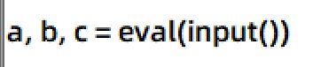

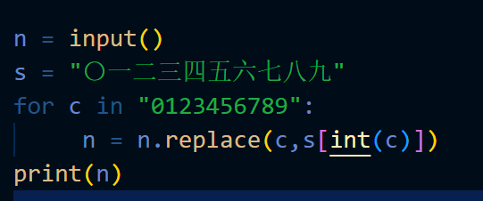

join连接的列表需要是字符串类型的元素

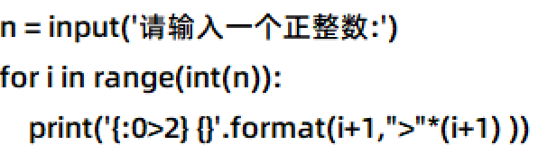


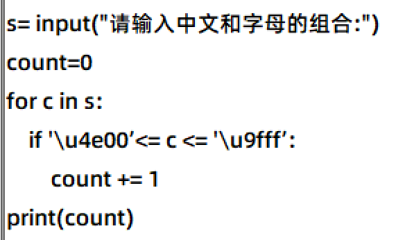

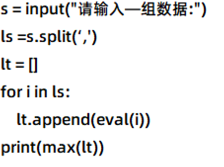

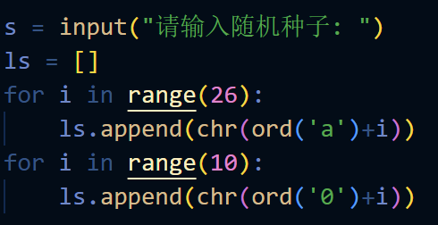

isdigit()

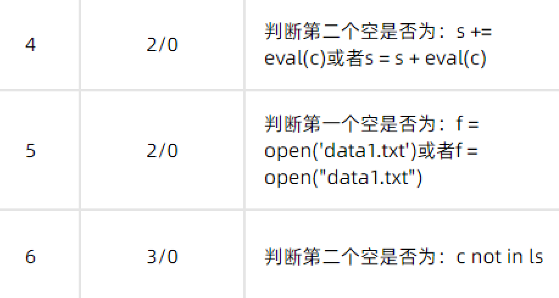

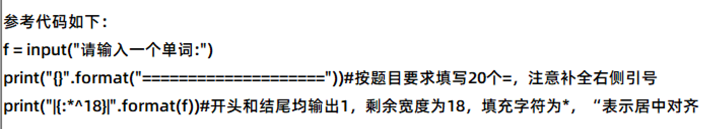

a.isalpha()     a.upper()

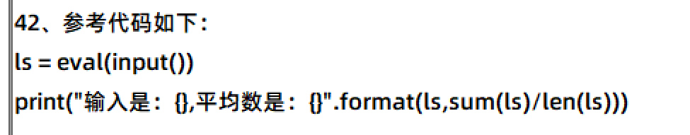


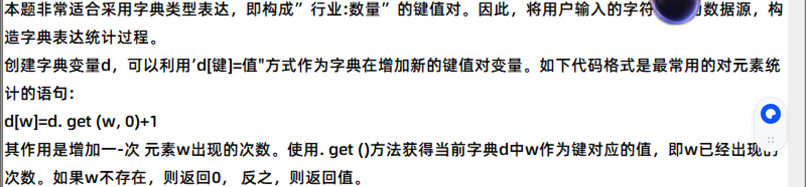

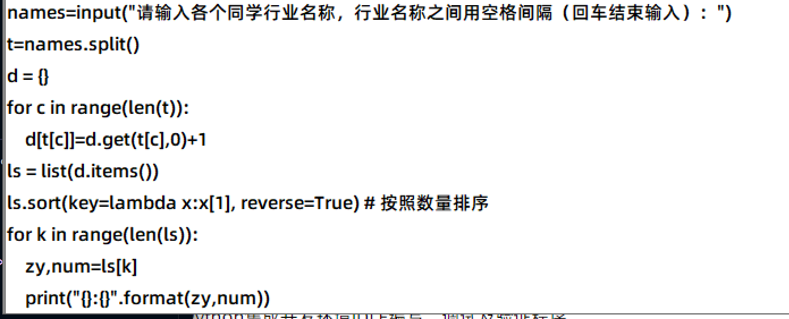

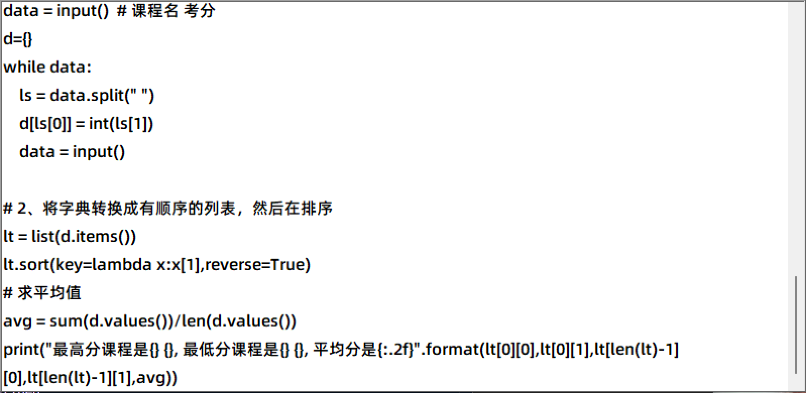

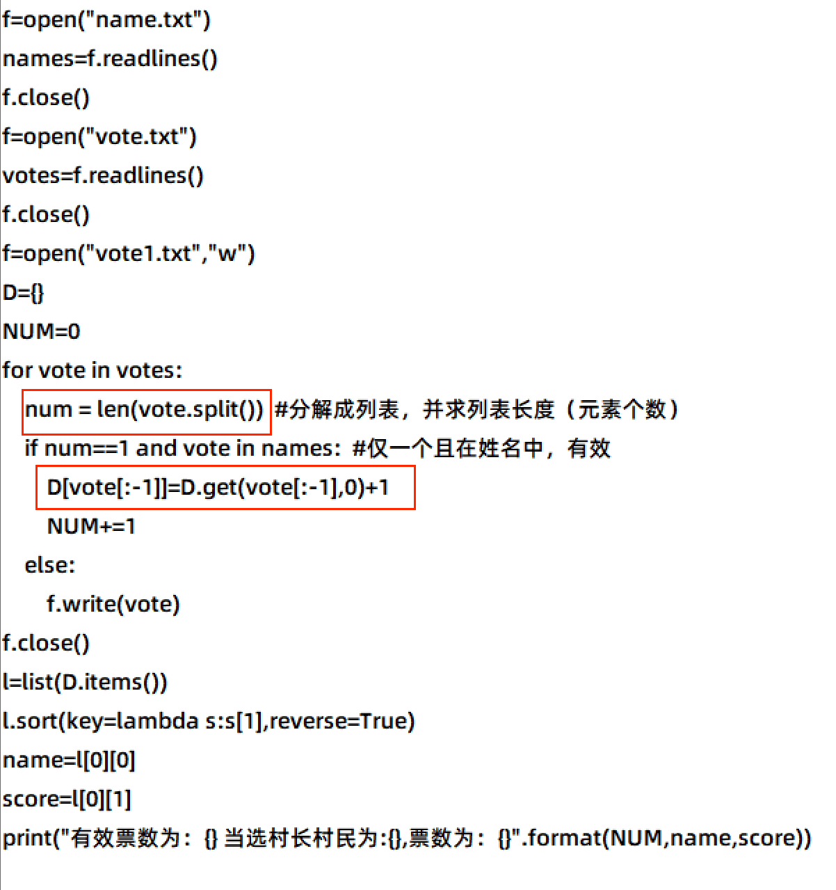

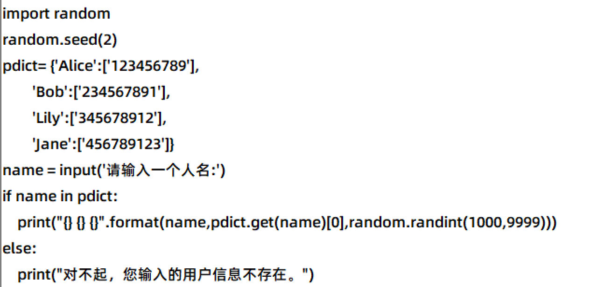

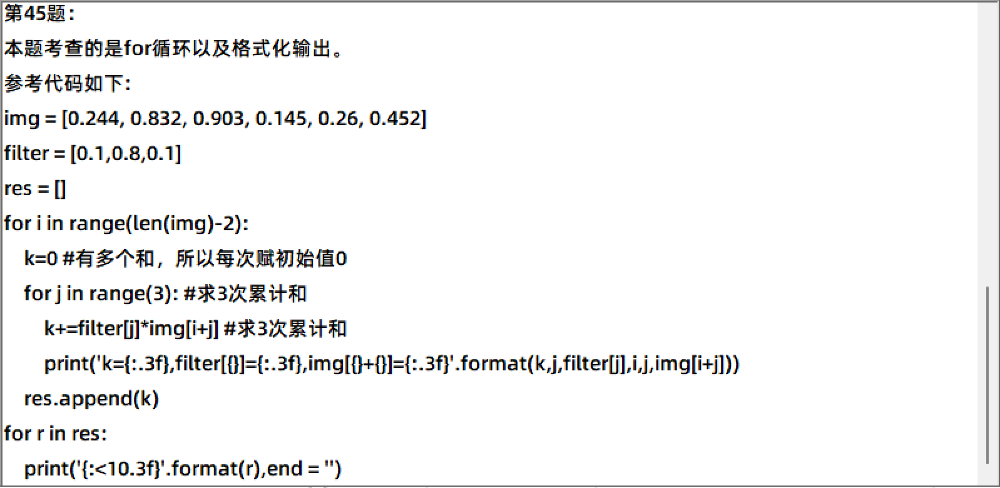

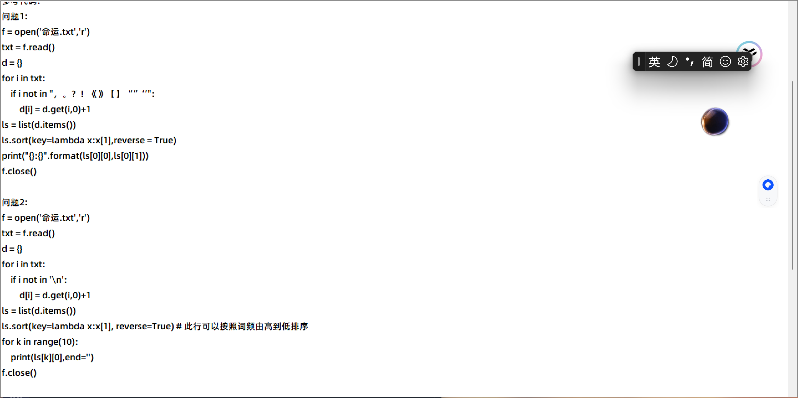


