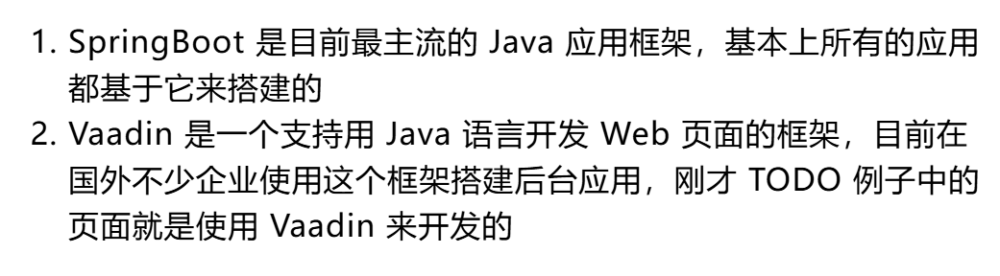

## Java语言的执行

Java和其他的高级语言一样，需要先翻译成低级语言才能被计算机执行。
目前世界上这个编程语言翻译主要有两种方式
解释(interpreting)
编译(compiling)
完成解释任务的程序叫解释器，解释器会按行（一行一行的读取)对程序进行翻译，然后执行命令。
完成编译任务的程序叫做编译器，它会在高级语言执行之前一次性对该程序进行完整的编译，所以程序的运行是在编译过程之后。我们一般把这种高级语言称为源代码(source code,我们经常说的coding就是写源代码)，编译器生成的程序称为可执行程序(executable)
Java比较强大，它既可以被编译也可以被解释，不同的是ava编译过程并不生成机器语言，而是生成字节码。字节码和机器语言一样，但是它具备高级语言的可移植性，因此在一台机器上编译ava,在另外一台机器上也可以被解释运行，这就是Java语言能够在诞生的时候就瞬间超越了其他编程语言的核心原因：一次编写到处运行。

JVM(java虚拟机)	通过JVM支持了字节码的解释运行

1.驼峰命名
2.在正确的目录下创建
src/main/java
焦哥又强调了src/main/java这个文件夹，这是一个非常特殊的文件夹，因为Java工程会自动把这个文件夹下的代码认定为源代码，放在其他目录就不能识别咯哦

块注释：
/**
*我是块注释

*/

如上例，
包围的地方可以填你想描述的内容，如果内容太多可以多行
但是每一行都要有*

一般，我们会在Java的类声明上面，方法上面使用块注释

变量名首字母小写更规范

​         

