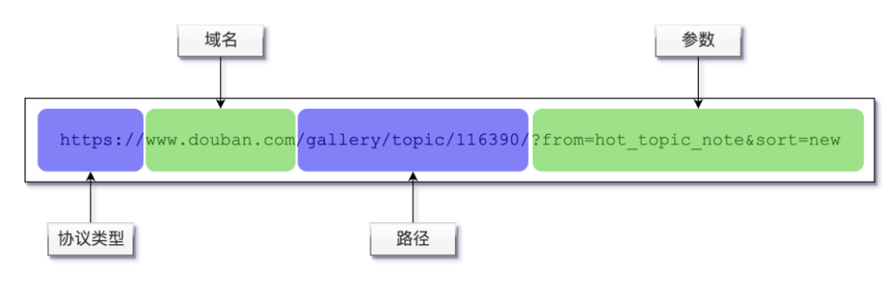

# 依赖

easyexcel

```
<dependency>
  <groupId>com.alibaba</groupId>
  <artifactId>easyexcel</artifactId>
  <version>3.1.1</version>
</dependency>
```

JavaMail

```
<dependency>
 <groupId>javax.mail</groupId>
 <artifactId>mail</artifactId>
 <version>1.4</version>
</dependency>
```


```java
    .addHeader("User-Agent","Mozilla/5.0 (Windows NT 10.0; Win64; x64) AppleWebKit/537.36 (KHTML, like Gecko) Chrome/124.0.0.0 Safari/537.36 SLBrowser/9.0.6.9111 SLBChan/135 SLBVPV/64-bit\n" +)
    .addHeader("Referer","")
    .addHeader("Host","")
```

​	qq邮箱授权码

nxpdtrhonheveajc


| 协议           | HTTP                         | HTTPS                                  |
| -------------- | ---------------------------- | -------------------------------------- |
| 端口           | 80                           | 443                                    |
| 数据传输       | 明文传输                     | 加密传输                               |
| 真假网站识别   | 很容易被复制                 | 使用证书，很难被复制                   |
| 浏览器显示区别 | 浏览器显示问号，提示不安全   | 浏览器显示小锁，提示安全               |
| 门槛           | 不需要证书                   | 需要Gworg机构颁发证书，需要 一定的成本 |
| 安全性         | 很容易被劫持，跳转到其他网站 | 加密安全，很难劫持，交易数据 加密      |

URL   Uniform Resource Locator

统一资源定位符



格式说明：

- 协议类型与域名之间以：/1（固定写法）分隔
- 路径(英文常称为pth)以单斜杠/开头，中间每层的分隔符也是单斜杠
- 路径相当于一层一层的文件夹。但要注意与windows的文件夹分隔符不要混淆了。
- 参数：
- - 路径与参数之间用？分隔。看到问号？就知道后面的内容就是参数了
- - 多个参数之间用&分隔
- - 参数用"参数名=参数值”(key=value)的格式表示。


## 扩展知识点

### 端口号

可能会看到这样的URL：

[https://www.douban.com:443/gallery/topic/116390/?from=hot_topic_note&sort=new](javascript:void(0))

域名后的 `:443` 表示网站的端口号。`HTTP` 协议默认的端口号是 `80` ，`HTTPS` 协议默认的端口号是 `443` 。默认的端口号在 URL 中是可以省略的，其它的端口号就必须要写明了。

上网浏览时，大多数情况下看不到端口号，但是大家在开发过程中可能经常会用到不同的端口号，以 `8000` 、 `8080` 最常见，这些端口号必须写明。

### 路径的两种情况

#### 1.相对路径

大家在开发过程中，可能会看到这样格式的 `URL`：

[gallery/topic/116390/?from=hot_topic_note&sort=new](javascript:void(0))

就要非常小心了。不是以斜杠 `/` 开头的路径，表示相对路径，但是具体相对于什么就很复杂了，要看具体情况，所以使用这种相对路径非常容易出错。

建议大家书写 `URL` 时一定要写以斜杠 `/` 开头的绝对路径；收到别人给的不是以斜杠 `/` 开头的路径时，也要确认清楚。

#### 2.默认路径

我们在上网时，仅输入了 [https://www.douban.com](javascript:void(0)) 或 [https://www.douban.com/](javascript:void(0)) 都能打开豆瓣首页，并没有输入路径啊。

实际上，没有输入路径时，表示请求网站的默认页面，那么服务器就会返回一个**默认**页面给浏览器。至于具体**默认**页面是什么页面，是由服务器决定的，通常服务器**默认**的页面是首页。

依赖路径

<!-- https://mvnrepository.com/artifact/com.squareup.okhttp3/okhttp -->
<dependency>
 <groupId>com.squareup.okhttp3</groupId>
 <artifactId>okhttp</artifactId>
 <version>4.1.0</version>
</dependency>


使用 `Okhttp3` 完成页面请求，需要三大步骤：

1. 实例化 `OkHttpClient`。使用 `OkHttpClient okHttpClient = new OkHttpClient();` 代码。
2. 执行调用。
   1. 在执行调用之前，需要实例化一个 `Request` 对象，作用是定义请求的各种参数，`Request request = new Request.Builder().url(url).build();`
   2. 然后构建调用对象 `Call call = okHttpClient.newCall(request);`
   3. 最后执行调用，如果调用失败可能抛异常，所以必须抓取异常。`call.execute()` 就是执行调用的代码。
3. `call.execute()` 返回的其实是一个执行的结果对象，调用对象的方法即可获取返回的字符串内容：`call.execute().body().string();`


提交数据至服务端进行增加、修改、删除等操作，都是P0ST操作。与王陆登记入住客栈类似，我们在网页上提交表单进行登录的场景，就是典型的POST操作。


```java
Builder builder = new FormBody.Builder();
// 设置数据，第一个参数是数据名，第二个参数是数据值
builder.add("", "");
FormBody formBody = builder.build();

Request request = new Request.Builder().url(url).post(formBody).build();
```

### 连写代码

这段代码出现了连写。

```
new Request.Builder().url(url).post(formBody).build();
```

大多数情况下 `不推荐` 使用连写（特别是新手不要使用连写）的方式。不用连写的方式应该写作：

```
Request.Builder build = new Request.Builder();
build = build.url(url);
build = build.addHeader("Referer", "http://www.taobao.com");
build = build.post(formBody);
Request request = build.build();
```

> Request.Builder 表示 Builder 是 Request 的内部类。特殊的是需要通过 Request 类引用 Builder 类。
>
> > 不懂内部类也没关系，不用纠结，重点是知道这段代码的功能就可以了。
> >
> > > 关于内部类的知识点可以找 Java 书籍学习。

要完全理解 url header post 这些知识点，可能还需要 **\*学校*** 里学过 **\*《计算机原理》*** 、 **\*《计算机网络》*** 课程，这里不用纠结。

可以 **\*等学校里课程学完*** 后再来 **\*复习*** ，这里重点是学会 **\*完成功能*** 。

> 即使不知道水稻是如何播种、如何收获的，但不妨碍大家吃饭

不连写的代码可能对新手更友好一点。但这段代码是发送 POST 请求专用的代码，不具备通用性，所以基于很多 *大神*、*前辈* 的编码风格，给大家展示简洁的连写风格。

我们仍然把发送表单数据的过程，封装为 `postContent()` 方法，方便重用。这里的重点是，理解使用 `FormBody` 对象的实例来存放表单数据。

## 执行结果说明

`gitee` 对密码做了特殊加密，所以登录会失败，但是这也说明 `gitee` 已经收到了请求，只是判断登录不成功而已。

> 注意所有的符号都是英文字符哦。


//okHttpClient实例
OkHttpclient okHttpclient = new OkHttpclient();
//post方式提交的数据
Builder builder = new FormBody.Builder();
//放入表单数据
for (String key:formData.keySet()){
builder.add(key,formData.get(key));
}
//构建FormBody对象
FormBody formBody builder.build();
//指定post方式提交FormBody
Request request new Request.Builder().url(url).post(formBody).build();
//使用client去请求
Call call okHttpclient.newCall(request);


在日常开发工作中，除了提交表单数据以外，也经常用到提交
JSON数据。
跟表单数据提交方法一样，也是调用post()方法，只是参数不再使用FormBody对象，而是使用RequestBody


## 详解

实现 `JSON` 方式提交数据的步骤：

1. 将数据转换成 `JSON` 格式的字符串，调用 `JSON.toJSONString()` 方法即可。
2. 创建 `RequestBody` 实例，注意需要指定提交的类型是 `application/json; charset=utf-8` 。这里的 `utf-8` 是 `API` 规定的编码格式。此例子中，`API` 规定数据传输的编码格式是 `utf-8` - 编码属于另一个比较长的话题，属于课外知识了，有兴趣的同学可以看一下 [码表的理解(ASCII,GBK,Unicode,UTF-8 等)](https://www.cnblogs.com/csguo/p/7402034.html)
3. 构建 `Request` 实例对象时，调用 `.post(requestBody)` 即表示使用 `JSON` 的方式提交数据。

这些基本上都是固定写法，大家需要熟练应用。

实例

1. JSON格式常量       private static final MediaType JSON_TYPE = MediaType.parse("application/json;charset=utf-8");
	. 初始化ok实例		OkHttpClient ok = new OkHttpClient();
	. 数据对象转JSON格式(要添加相应的依赖)	String str = JSON.toJSONString(datasForm)         在主程序时可以给dataForm添加一些信息
3. 实例化RequestBody    RequsetBody rb = RequsetBody.create(JSON_TYPE,param)
5. 提交post请求     Request  rq = new Request.Builder().url(url).post(rb).build();
	. 使用client去请求	Call call = ok.newCall(rq);


## 附录

这节课我们用到了 JSON。对 JSON 及其使用不熟悉的同学，可以点击[《JSON 与 FastJSON》](https://ham.youkeda.com/articles/detail/5f3757fd5e205f30b2c2b1f9)文档


<!-- JSON 操作库 -->
        <dependency>
            <groupId>com.alibaba</groupId>
            <artifactId>fastjson</artifactId>
            <version>1.2.62</version>
        </dependency>


使用一条语句执行调用请求，并取得返回结果字符串：

```
call.execute().body().string()
```

*execute()* 方法是真正执行发送请求，前面的一系列代码是做前置准备。

> 这段代码获得服务器返回内容的专用代码，不具备通用性，所以基于很多 *大神*、*前辈* 的编码风格，给大家展示简洁的连写风格。
>
> > 其它情况下，不推荐使用连写风格。

要完全理解 body、状态码 这些知识点，可能还需要 **\*学校*** 里学过 **\*《计算机原理》*** 、 **\*《计算机网络》*** 课程，这里不用纠结。

可以 **\*等学校里课程学完*** 后再来 **\*复习*** ，这里重点是学会 **\*完成功能*** 。

> 即使不知道水稻是如何播种、如何收获的，但不妨碍大家吃饭

实际上，除了具体的返回结果，我们通常还关心的数据是：`http` 状态码。

状态码是用一个数字直观反映了本次请求的状况，例如常见的 `200` 表示请求成功了，`404` 表示出错了，服务端没有被请求的内容。

> 具体的状态码的较多，可以参考[文档](https://ham.youkeda.com/articles/detail/5f3758675e205f30b2c2b2a4),这里就不赘述了。

为了取得响应状态码，可以使用语句：

```
call.execute().code()
```

> 这段代码获得服务器返回内容的专用代码，不具备通用性，所以基于很多 *大神*、*前辈* 的编码风格，给大家展示简洁的连写风格。

但是通常还要读取响应内容，但是又不能执行两次请求，所以代码应该优化为：

```
import okhttp3.Response;

// 执行请求
Response rep = call.execute();
// 获取响应状态码
int code = rep.code();
// 获取响应内容
String content = rep.body().string();
```


请求获取非字符文件时，要把.string()改为.bytes()

转化成Map对象

JSON.parseObject(content,Map.class);


判断请求是否真的来自于一个真实的浏览器，需要从 `HTTP` 消息头（`Headers`）中取得 `User-Agent` 信息后，才能判断。

## HTTP header

`HTTP` 消息头 `Headers` 是 `HTTP` 协议的一项重要内容，作用是在发起请求的时候，除了请求`参数`外，可以附加更多的信息。

> 关于 `Headers` 的更多资料，属于课外阅读的知识，感兴趣的同学可以点击链接阅读 [HTTP Headers文档](https://developer.mozilla.org/zh-CN/docs/Web/HTTP/Headers)

这里只要记住，`Headers` 信息并不是写在 `URL` 中的，属于隐藏的数据，不能直观看到。

## User-Agent

`User-Agent` 是存放在 `Headers` 中的一种数据信息。作用是，在指定 `URL` 发送请求的时候，告诉服务端当前用户的浏览器类型、版本，甚至操作系统、CPU等非隐私的`技术信息`。

服务器从 `Headers` 中的 `User-Agent` 信息获取到浏览器类型、版本等数据后，就认为是一个浏览器请求的环境了，就会给出响应。

> 关于 `User-Agent` 的详细资料，属于课外阅读的知识，感兴趣的同学可以点击链接阅读 [User-Agent文档](https://developer.mozilla.org/zh-CN/docs/Web/HTTP/Headers/User-Agent)

所以，我们只要在程序代码中，附加上 `User-Agent` 信息，就能允许成功了。当然，这里的 `User-Agent` 是模拟的。我们来模拟一个 `win7 + chrome` 的环境，`User-Agent` 的写法如下：

```
Mozilla/5.0 (Windows NT 6.1; WOW64) AppleWebKit/535.1 (KHTML, like Gecko) Chrome/14.0.835.163 Safari/535.1
```

> 具体的含义这里就不赘述了，大家也不需要背诵，用到的时候查文档就好了。

## 学以致用

模拟了一个 `User-Agent` ，程序中怎么用呢？实际上 `Okhttp3` 库已经支持 `Headers` 了，只需要在构建 `Request` 对象的时候，调用 `addHeader()` 方法即可：

```
Request request = new Request.Builder()
    .url(url)
    .addHeader("User-Agent", "")
    .build();
```

`addHeader()` 方法第一个参数是名称，第二个参数是值。


联想agent

Mozilla/5.0 (Windows NT 10.0; Win64; x64) AppleWebKit/537.36 (KHTML, like Gecko) Chrome/124.0.0.0 Safari/537.36 SLBrowser/9.0.6.9111 SLBChan/135 SLBVPV/64-bit

YKD示例agent

Mozilla/5.0 (Windows NT 6.1; WOW64) AppleWebKit/535.1 (KHTML, like Gecko) Chrome/14.0.835.163 Safari/535.1


```
.addHeader("Referer", "https://ham.youkeda.com/course/j14/0")
```

```
Request request = new Request.Builder()
    .url(url)
    .addHeader("Host", "www.douban.com")
    .build();
```

注意，Host的值一定是一个域名且不带协议头。


注意getName()

```
import java.io.File;
import java.io.FileWriter;

// 文件对象
File file = new File("foo.txt");

// 写入内容
FileWriter fileWritter = new FileWriter(file.getName());
fileWritter.write(content);

// 关闭
fileWritter.close();
```


假设文件数据的变量是 `byte[] data`，那么写入本地文件的代码如下：

```
import java.io.File;
import java.io.FileOutputStream;

// 文件对象
File file = new File("china-city-list.xlsx");

// 写文件
FileOutputStream fos = new FileOutputStream(file);
fos.write(data);

// 必须刷新并关闭
fos.flush();
fos.close();
```

> 与写入文本内容不同，写入二进制内容，需要用 `FileOutputStream` 。再次强调，必须执行刷新、关闭操作。


easyexcel

大家都知道，excel文件是多sheet模式的，每个sheet实际上是一个表格，表格又分为行和列。
所以解析数据的路径一定是：
sheet->行->列
牢记计算机中，第一个单元格的位置是0
第一个sheet，第一行，第一列的位置是0,0,0

```java
import com.alibaba.excel.EasyExcel;
import java.util.Map;
import java.util.List;

// 读取第一个sheet
List<Map<Integer, String>> sheetDatas = EasyExcel.read("xzq_201907.xlsx").sheet(0).doReadSync();
// List 中每个元素表示一行
for (Map<Integer, String> rowData : sheetDatas) {
  // Map 中用序号指代每一列
  for (Integer index : rowData.keySet()) {
    // 列值
    String columnValue = rowData.get(index);
  }
}
```


需要收集的关键信息包括：
1.登泉地址
2.执行方式(GET/POST)
3.HOST
4.Referer
5.User-Agent
6.表单数据，数据名称和数据值


上节课使用了谷歌浏览器的开发者工具抓取到了登录的 `cookie` ，然后使用程序完成登录。

但 `cookie` 的弊端是，`cookie` 是存放在客户端浏览器的，而且是临时的，登录后还想以登录状态与服务器通讯，就比较麻烦。

这就需要在程序中使用 `Session` 对象来解决这个问题。下面我们通过模拟登录时光网来学会如何应用 `Session` 对象。

## 1.时光网登录

浏览器中输入`http://www.mtime.com/` 打开时光网，点击右上角的**登录**按钮；

如果没有看到输入框，可以点击角落电脑图标切换：


弹出登录对话框。


或者直接 [点此打开](https://passport.mtime.com/login)注册与登录页面，并点击“会员登录”


> 如果没有注册的，先注册，再退出登录，并重复此步骤。
>
> > 如果遇到电脑无法注册时光网的情况，麻烦下载时光网APP，进行注册。

## 2.收集信息

然后打开谷歌浏览器的开发者工具，如图所示，**Preserve log** 必须勾选。

> 对谷歌开发者工具不熟悉的，可以点击查看 [使用教程](https://www.cnblogs.com/yaoyaojing/p/9530728.html)

### 关键点

输入用户名和密码后，在右侧抓取到的网络请求中，找到登录请求 *API* ：

`https://front-gateway.mtime.com/user/user/login.api`


### 新版浏览器可能有一点不同

在“标头”后面多了一个“载荷”（Payload）的小菜单。


切换到小菜单可以看到密码：


### 操作视频

时光网改版了，所以谷歌浏览器的开发者工具里，输入框输入login进行过滤哦。

> 由于改版，视频中有些细节是旧的，例如登录页面是旧版的。但是没关系，操作过程是一样的。

需要收集的关键信息包括：

1. 登录地址
2. 执行方式（GET/POST）
3. HOST
4. Referer
5. User-Agent
6. 表单数据，数据名称和数据值

> 由于每个网站登录相关的信息都不一样，所以必须在手动登录的过程中收集信息。大家学会这个方法，就可以模拟其它网站登录。

## 3.编码实现

这样，所需的信息都已收集完毕，我们先看一下演示程序：

代码演示

## 提醒

```
  // 用 CookieJar 实现 cookie 的存储，便于登录后请求其它 URL 可以复用
  private static final OkHttpClient okHttpClient = new OkHttpClient.Builder()
      .cookieJar(new CookieJar() {
        private final HashMap<String, List<Cookie>> cookieStore = new HashMap<>();

        @Override
        public void saveFromResponse(HttpUrl url, List<Cookie> cookies) {
          cookieStore.put("mtime.com", cookies);
          System.out.println("[saveFromResponse]url.host()=" + url.host());
        }

        @Override
        public List<Cookie> loadForRequest(HttpUrl url) {
          System.out.println("[loadForRequest]url.host()=" + url.host());
          List<Cookie> cookies = cookieStore.get("mtime.com");
          return cookies != null ? cookies : new ArrayList<>();
        }
      })
      .build();
```

- `CookieJar` 是接口（`interface`），而 **不是** 类（`class`）。演示代码中：

  ```
  new CookieJar() {......}
  ```

  是匿名类。关于匿名类，匿名类的概念感兴趣可以阅读[匿名类知识点](https://codeserver.youkeda.com/docs/java/-/wikis/Java%E5%8C%BF%E5%90%8D%E7%B1%BB)

- 对表单提交不熟悉的同学，需要复习本课程的第二章第三节。

### HashMap

cookieStore 的类型是 HashMap ，相当于一个登录信息的 **集合** 、 **容器** ，可以用来不存 *不同域名* 的 *登录信息*（cookie） 。

> 程序具备扩展性

HashMap 是用法，在前面的《Java 基础强化》课程已经讲过，大家可以复习一下。

- `cookieStore.put("mtime.com", cookies);` 就是把当前爬取到的时光网的登录信息存储起来。
- `cookieStore.get("mtime.com");` 就是把当前爬取到的时光网的登录信息从容器中拿出来。

> 当然这个容器是临时的，本质上是存入计算机内存，当前程序关闭掉，信息就消失了


## SMTP 协议

SMTP 是一个简单的基于文本的邮件传输协议，全称为（Simple Mail Transfer Protocol - 简单邮件传输协议）。在这个协议上我们可以指定一条邮件消息和一个或多个邮件接收者，然后进行邮件输出。

可能大家觉得还是比较抽象。

我们先回顾下在之前的 HTTP 章节，我们了解了普通的网络请求。一个网络地址 <https://www.youkeda.com/> 代表的是优课达官网，并且可以通过浏览器访问，这个网络地址由 `HTTPS` 协议和 `www.youkeda.com` 网络地址组成。

同样的道理 SMTP 协议再加上一个服务器地址是不是就组成一个邮件访问方式。所有邮件服务商都有自己的邮件服务器地址

比如：

- QQ 邮箱： smtp.qq.com
- 163 邮箱: smtp.163.com

通过地址和协议，我们便具有`发送邮件`的基础通道。使用 Java 或其它编程语言，可以使用 `SMTP` 完成邮件的发送，不必打开网页登录邮箱发送邮件了。


## SMTP 应用

这节课是重中之重，在本节课中，我们将实现如何使用代码，利用自己的 QQ 邮箱发送邮件。在上一节中，我们大致了解的 SMTP 协议，在使用 QQ 邮箱发送邮件时，我们需要先进入 QQ 邮箱开启 SMTP 支持。

### 开启 QQ 邮箱设置

1. 打开 QQ 邮箱网页版
2. 获取授权码

> 右上角打开设置
>
> > 
>
> 点击 ”账户与安全“
>
> > 
>
> 点击”安全设置“，找到 POP3/IMAP/SMTP/Exchange/CardDAV 服务
>
> > 
>
> 也可以点击”配置方法“查看教程

### 一定要保存授权码啊

#### 注意

- 授权码**没有空格**，只是 QQ 邮箱为了分段显示而已。
- 授权码**不是**邮箱的登录密码哦，不要混淆了。

### JavaMail


然后如下发送代码。代码属于固定用法，只需要修改邮箱相关的配置即可。

```
import java.security.Security;
import java.util.Properties;
import javax.mail.Authenticator;
import javax.mail.Message;
import javax.mail.PasswordAuthentication;
import javax.mail.Session;
import javax.mail.Transport;
import javax.mail.internet.InternetAddress;
import javax.mail.internet.MimeMessage;

public class MailClient {
  public static void main(String[] args) {
    try {
      final String SSL_FACTORY = "javax.net.ssl.SSLSocketFactory";

      //配置邮箱信息
      Properties props = System.getProperties();
      //邮件服务器
      props.setProperty("mail.smtp.host", "smtp.qq.com");
      props.setProperty("mail.smtp.socketFactory.class", SSL_FACTORY);
      props.setProperty("mail.smtp.socketFactory.fallback", "false");
      //邮件服务器端口
      props.setProperty("mail.smtp.port", "465");
      props.setProperty("mail.smtp.socketFactory.port", "465");
      //鉴权信息
      props.setProperty("mail.smtp.auth", "true");
      //建立邮件会话
      Session session = Session.getDefaultInstance(props, new Authenticator() {
        //身份认证
        protected PasswordAuthentication getPasswordAuthentication() {
          //1.账户 授权码
          return new PasswordAuthentication("xxxxxxx@qq.com", "xxxx");
        }
      });
      //建立邮件对象
      MimeMessage message = new MimeMessage(session);
      //设置邮件的发件人
      message.setFrom(new InternetAddress("xxxxxxx@qq.com"));
      //2.设置邮件的收件人
      message.setRecipients(Message.RecipientType.TO, "xxxxxxx@qq.com");
      //设置邮件的主题
      message.setSubject("通过javamail发出！！！");
      //文本部分
      message.setContent("文本邮件测试", "text/html;charset=UTF-8");
      message.saveChanges();
      //发送邮件
      Transport.send(message);
    } catch (Exception e) {
      e.printStackTrace();
    }
  }
}
```

请看下面代码演示：

代码演示

> 注意：演示视频是旧版本的，要去掉 `import com.sun.net.ssl.internal.ssl.Provider;` 和 `Security.addProvider(new Provider());` 代码

代码运行是失败的，因为授权码错误了。

必须填入自己的邮箱及**正确的****授权码**。


## 特别说明

1. 注释 1 中账户和授权码**改为**你的 QQ 号和刚才申请保存的授权码
2. 注释 2 中 message.setRecipients 可以设置多个收件人信息
   - 用逗号分割多个收件人`xxxx@qq.com,xxxx@126.com`
3. 所有 xxxx 都改为自己的邮箱地址，否则你看不到邮件内容哦。