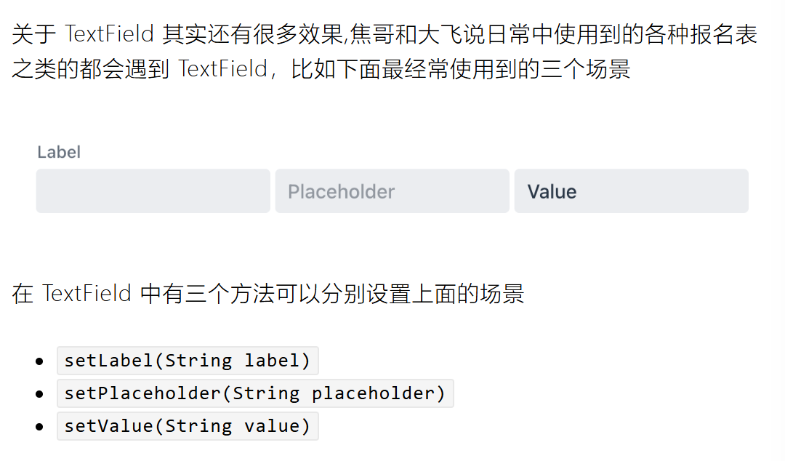
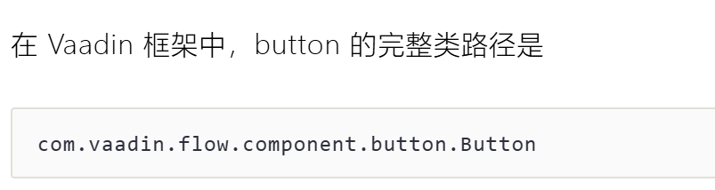

Vaadin

优秀的Web组件框架

主要分为以下几类：
·表单输入类
包括单选框、复选框、下拉框、日期输入框、邮箱输入框、数字输入框、
密码输入框、文本框以及文件上传框等
·可视化与交互组件
包括：按钮、图标、链接、菜单、对话框、表格、树形表格、进度条以及
标签页等
·布局类
包括：应用布局、表单布局、登录框等
·高级组件（需要收费)
包括：图表、高级表格、富文本编辑器以及类Ec!的编辑组件。


新建TextField对象

Vaadin中提供了好多种布局方案，其中最常用的是Ordered Layout，支持垂直(V)和水平(H)两个方向的自动布局

VerticalLayout

HorizontalLayout

OL中有一个添加子元素的行为,   add方法,	可以添加任意个子组件





Button对象    Button( Text )


在程序开发中，很多时候不是用System.out.println0来输出的，因为用户看不见提示信息
在vaadin框架中，还有个专门的提示组件Notification,它的完整类
路径是
com.vaadin.flow.component.notification.Notification
Notification组件有几个重要的方法

- setText(String text)	设置提示的内容


- setDuration(int duration)	提示框持续显示的时长（这个时间之后会自动关闭），单位毫秒，1000毫秒是1秒


- open() 显示提示框


在Vaadin框架中，使用了注解技术来支持多页面。

```java
import com.vaadin.flow.router.Route;
@Route("/")
public class Todo extends VerticalLayout
```

在上面的代码中，@Route("/")就是一个注解

# LocalDataTime

注意为静态方法，不能实例化

时间日期类型存储到计算机中占用的内存会比字符串更小

Java8以后的时间类型有几个

- java.time.LocalDate		表示日期

比如2021-01-01，像出生年月日这种的就可以使用

- java.time.LocalTime		表示时间

比如12：30：00，像几点的会议就可以使用

- java.time.LocalDateTime	表示日期和时间

比如2021-01-0112：30：00，像报名时间、注册时间之类的就可以使用

LocalDateTime、LocalDate和LocalTime默认严格按照ISO8601规定的日期和时间格式进行打印，也就是说如果直接使用字符串输出格式是遵循1SO格式的。
注意SO8601规定的日期和时间分隔符是T。标准格式如下：
日期：yyyy-MM-dd
时间：HH:mm:ss
带毫秒的时间：HH:mm:ss.SsS
日期和时间：yyyy-MM-dd'T'HH:mm:ss
带毫秒的日期和时间：yyyy-MM-dd'T'HH:mm:ss.SSS

SO8601格式和我们中国国内使用的格式不一样，所以呢，一般需要借助java.time.format.DateTimeFormatter来输出指定格式的字符串
同样也可以使用LocalDateTime.parse来把字符串转换成时间类型

LocalDate d1 LocalDate.now();

DateTimeFormatter     xx   =   D... .ofPattern("...")

xx.format()

LocalDateTime   ...  = LocalDateTime.parse(...  ,  dtf );

如果自定义格式化器时遇到T需要“       ‘T’        ”用单引号引起来


暂时了解这么多有个概念就好，在Jva当中集合也是有专门的接口定义的，Collection这个接口就可以表明支持存储多个元素。
Collection接口又有3种子类型，List、Set和Queue(他们都继承于
Collection),再下面是一些抽象类，最后是具体实现类，常用的有
ArrayList、LinkedList、HashSet、LinkedHashSet、HashMap、
LinkedHashMap等等。


```
public void add(int index,E element):将指定的元素，添加到该集合中的指定位置上。
public E get(int index):返回集合中指定位置的元素。
public E remove(int index):移除列表中指定位置的元素，返回的是被移除的元素。
public int size():取得集合里元素的个数，list.size( );
public void clear():删除所有元素,list.clear();
```

```
// 创建一个字符串集合，用于存储多个字符串
List<String> strings = new ArrayList<>();

// 创建一个用户集合，用于存储多个用户信息
List<User> users = new ArrayList<>();
```

int类型的列表为Integer


如果不想数据丢失，就需要考虑数据持久化啦，一般持久化有两种手段
·存储在文件系统里
·存储在数据库里（这个需要以后再学习）

1.异常
2.文件
3.commons-io库
4.读写文件
5.JSON


异常发生的原因有很多，通常包含以下几大类：
·用户输入了非法数据。
·要打开的文件不存在。
·网络通信时连接中断，或者VM内存益出。


捕获异常
使用 try 和 catch 关键字可以捕获异常。try/catch 代码块放在异常可能发
生的地方。

```java
// try-catch代码块中的代码称为保护代码，使用 try/catch 的语法如下:
try
//程序代码
}catch(ExceptionName e1){
//Catch块
}finally{
//fainally块    不管是否捕获到异常都会执行
}
```


Catch 语句包含要捕获异常类型的声明。当保护代码块中发生一个异常
时，try后面的catch 块就会被检查。
如果发生的异常包含在 catch 块中，异常会被传递到该 catch 块，这和传
递一个参数到方法是一样。


Apache commons-io

```xml
<dependency>
  <groupId>commons-io</groupId>
  <artifactId>commons-io</artifactId>
  <version>2.10.0</version>
</dependency>
```

File 关键字声明文件对象

FileUtils  工具

### **Java 中的 org.apache.commons.io.FileUtils**

Apache Commons IO 库中的核心工具类，提供文件读写、复制、移动、删除等便捷操作，无需手动处理流关闭等细节。
**常用方法**：

- `readFileToString(File file, String encoding)`：读取文件内容为字符串

- `copyFile(File src, File dest)`：复制文件

- `deleteDirectory(File directory)`：删除目录（包括子文件/文件夹）

- `writeStringToFile(File file, String data, String encoding)`：写入字符串到文件

  需要使用try-catch异常捕获，不然会报错

# JSON数据

JSON:JavaScript Object Notation()avaScript对象表示法)是目前最常
用的执行对象序列化的方式。
虽然json最初是为了在JavaScript语言中使用的，但实际上json本身跟
语言没有任何关系，各种编程语言都可以使用。
json官方指定了一套标准，各种语言都支持这一套标准，所以json也能
作为一种跨语言的文本数据（即不支持其它多媒体）交换格式，无障碍的
把数据传递到其它语言的程序。


基本格式

对象

{

}

或者数组

[

]

数据用名称：值(也叫键值对)表示
名称（键）必须是字符串
键、值之间用冒号“：”分隔。
多条数据之间，用逗号”，”分隔

JSON值的类型

- 数字（整数或浮点数）
- 字符串（在双引号中）
- 逻辑值(true或false)
- 数组（在中括号中）
- 对象（在大括号中）
- null

数据和对象可以任意嵌套，任意深度

```JSON
{
    "name": "韦小宝",
    "age": 26,
    "height": 182.4,
    "birthday": "1670-7-28",
    "isRich": true,
    "wifes": ["阿珂", "双儿", "建宁公主", "苏荃", "沐剑屏", "曾柔", "方怡"],
    "firstMaster": {
      "name": "陈近南",
      "birthday": "1634-12-1"
    }
}
```

目前企业中广泛使用SpringBoot框架来搭建应用，SpringBoot内部集成了jackson这个json框架，所以大多数时候，推荐使用jackson处理json


而且时间被序列化之后变成字符串


要处理LocalDateTime的json数据，需要额外添加注解

```java
@JsonDeserialize(using = LocalDateTimeDeserializer.class)
@JsonSerialize(using = LocalDateTimeSerializer.class)
@JsonFormat(shape = JsonFormat.Shape.STRING, pattern = "yyyy-MM-dd HH:mm:ss")
private LocalDateTime gmtCreated;
```

json转java的话如果只是一个类对象，可以使用readValue传参java类就好

如果是对象列表，可以向其中新建一个TypeReference的自定义类型，向其中传入类组成的列表声明


LoginForm

```java
public LoginView(){
	setJustifyContentMode(JustifyContentMode.CENTER);
	setAlignItems (Alignment.CENTER);
	loginForm.setForgotPasswordButtonVisible(false);
	H1 h1 new H1(text:"TODO");
	HorizontalLayout regLayout new HorizontalLayout();
	regLayout.setAlignItems (Alignment.CENTER)
	Label tips new Label(text:"Don't have an account?");
	Button regBtn new Button(text:"Sign up here.");
	regBtn.setThemeName("tertiary");
	regLayout.add(tips,regBtn);
	add(h1,regLayout,loginForm);
}
```


