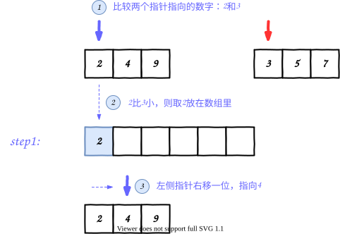

为什么需要算法复杂度：


1.测试结果大大依赖硬件条件**

> 以时间举例，你不可能绝对的说某个代码需要跑 10s，在某台机器上需要跑 10s。因为程序的执行和机器的性能正向相关，如果放在一台老的机器上可以会大大多于 10s，而放在一款未来高性能机器上可能只需要 5s。 因此受硬件环境的影响，并不能简单的用时间去统计。

**2.测试结果需要事后才能计算**

> 上面所有的操作，往往都是在程序运行之后才能形成统计结果，但我们大多希望在伪码阶段，便能预测程序的执行性能。 因此这种**事后统计法**不能作为性能预测的方法。

**3.测试结果受原始数据特性影响大**

> 我们以排序为例，需要多少时间呢？试想一下如果给出的数据就已经是排好序的，那需要的时间几乎等于 0，而如果给出的数据是完全的打乱的，那需要时间肯定非常长。 因此我们发现测试结果本身就存在差异，除非我们的**样本足够的多**，否则计算出来的结果往往具有**片面性**。


大 O 记法，表示的是**代码执行时间随数据规模增长的变化趋势**

而在这种情况下，**常量、系数部分并不左右增长趋势**，所以都可以忽略。

**大 O 记法，只保留最大趋势公式，指数 > 线性 > 对数 > 常数**。

因此我们在计算时间复杂度的时候，其实并不需要一行行看代码，只需要关注**for 循环嵌套情况**。

写代码的时候，如果能用**线性复杂度**的代码，替换**指数复杂度**的代码，那就是大大性能优化。

时间复杂度是**以步作为基础单位**，空间复杂度是以一个**基础数据类型**值当做基础单位。

我们简单来看一下

#### O(1)

```
int a = 0;
int j = 0;
```

#### O(N)

```
int a[] = new int[n]
```

代码都比较简单，就不多做解释啦。

### 优先考虑时间复杂度

在实际编程过程中，我们大多数情况**只会考虑时间复杂度**！！为什么呢？

因为我们默认计算机内存是足够大的，足够给我们使用的。 大家是否听说过**摩尔定律**。

> 当价格不变时，集成电路上可容纳的元器件的数目，约每隔 18-24 个月便会增加一倍，性能也将提升一倍。

换而言之，**每个 18-24 个月，同样大小的芯片里可存储的数据量将翻一倍**。 因此我们完全可以忽略内存空间不够的情况。

**除非**，注意除非大家以后参与嵌入式开发，参与单片机相关的编程开发，才需要注意空间问题。 **本课程之后的讨论，都只会基于时间复杂度问题展开**。


**为什么连续两个方格内存地址差 8？**

> 因为我们现在电脑基本是 **64** 位，64 位表示内存存储最小使用单位为 **64 个 bit**，也就是 **8 个 byte** 不了解 bit 和 byte 的同学，可以自己网上查查，简单学习一下

> 数组（Array）是一种**线性表数据结构**。它用一组**连续的内存空间**，来存储一组具有**相同类型的数据**

**线性数据结构**：表示数组中数据都是按前后这种线性顺序排列的。 **相同数据类型**：数组中的每个值的数据类型都相同。

因为这些优势和劣势，我们在**高频查询，低频插入和删除**的情况下，可以选择数组作为底层数据结构。


冒泡排序 vs 选择排序vs 插入排序

虽然我们都在说两个排序算法的时间复杂度都为`O(N^2)`，但很明显能感受到`选择排序更快一点点`。

为什么？

> 冒泡需要**频繁的交换相邻两个元素**，而选择排序**每次遍历只需要交换一次**，所以选择排序真实情况速度比冒泡排序**快一倍**。
>
> 冒泡排序相比较而言肯定是较差的。 选择排序和插入排序得**分情况**而定，如果**原始数组本身有很多元素按希望的顺序排好序**，则选择**插入排序(如上面最好极限情况，接近 O(N))，否则选择选择排序**。

插入排序的最核心逻辑是查找应该插入的临时元素位置，类似于**在一个有序数组中查询，找到元素应该插入的位置**。

对于这种有序列表，我们知道**循环遍历**并不是最优解，还有一个更好的方法**二分查找法**。

因此，将插入排序和二分查找法结合一起可以进一步提高排序效率。

```java
// 查找应该插入的索引位置
public static int searchIndex(int[] array, int left, int right, int aim) {
    // 循环查找节点位置
    while (left < right) {
        int middle = (left + right) / 2;
        int value = array[middle];
        if (value < aim) {
            left = middle + 1;
        } else {
            right = middle - 1;
        }
    }
    // #1. 如果最终元素仍然大于目标元素，则将索引位置往左边移动一个
    if(array[left] > aim){
        return left -1;
    }
    // 否则就是当前位置
    return left;
}// 插入排序
public static void insertSort(int[] array) {
    // 从倒数第二位开始，遍历到底0位，遍历 N-1 次
    for (int i = array.length - 2; i >= 0; i--) {
        // 存储当前抽离的元素
        int temp = array[i];
        int index = searchIndex(array, i + 1, array.length - 1, temp);

        // #1. 根据插入的索引位置，进行数组的移动和插入
        int j = i + 1;
        while (j <= index) {
            array[j - 1] = array[j];
            j++;
        }
        array[j - 1] = temp;
    }
}
```


递归实现二分插入排序算法

```java
public static int searchIndex(int[] array, int left, int right, int aim) {
    // 循环查找节点位置
      int middle = (left + right) / 2;
      int value = array[middle];
    // #1. 如果最终元素仍然大于目标元素，则将索引位置往左边移动一个
        if(aim>array[right]){
            return right;
        }
        if (aim<array[left]){
            return left-1;
        }
      if(left == right - 1){
        return left;
      }
      if (value < aim) {
        return searchIndex(array, middle, right ,aim);
      } else {
        return searchIndex(array, left,middle,aim);
      }
        /*
         if (left > right) {
            return left; // 返回插入位置
        }
        
          int middle = left + (right - left) / 2;

    if (arr[middle] > aim) {
        // 在左半部分查找
        return searchIndex(array, left, middle - 1, aim);
    } else {
        // 在右半部分查找
        return searchIndex(array, middle + 1, right, aim);
    }
    */
}
```


分治思想

分而治之的思想是采用了**递归**的思想，将**原问题分成几个规模较小但是类似于原问题的子问题**， 通过递归的方式来求解这些小问题，最后将子问题的解**合并**来得到原问题的解。

需要完成**对两个有序的数组进行合并排序**

我们来看看解题思路：



我们发现左右两侧的数组都只会各遍历一次，所以排序的时间复杂度为`O(N)`。 拆分和合并的时间复杂度和**二分法**类似，时间复杂度为`O(log(N))`。

每次合并都会进行一次排序，所以最后的复杂度为`O(Nlog(N))`，并且归并排序算法速度是稳定的，没有最好最差的情况。


if (array.length == 1) {
      return array;
    }

```java
int middle = array.length / 2;
// 处理 0 到 middle 左侧数组部分
int[] left = mergeSort(subArray(array, 0, middle));
// 处理 middle 到 array.length 右侧数组部分
int[] right = mergeSort(subArray(array, middle, array.length));
// TODO处理合并问题
int l = 0;
int r = 0;
int index =0;
while (index<array.length){
  if(l==left.length||(r!=right.length&&left[l]>right[r])){
    array[index] = right[r];
    r++;
  }else{
    array[index] = left[l];
    l++;
  }
  index++;
}

return array;
```
```java
// 步骤1：比较左右子数组元素，按顺序存入temp
        while (i <= mid && j <= right) {
            if (arr[i] <= arr[j]) {
                temp[k++] = arr[i++];
            } else {
                temp[k++] = arr[j++];
            }
        }

        // 步骤2：将剩余元素存入temp（左子数组剩余）
        while (i <= mid) {
            temp[k++] = arr[i++];
        }

        // 步骤3：将剩余元素存入temp（右子数组剩余）
        while (j <= right) {
            temp[k++] = arr[j++];
        }

       // 步骤4：将temp中的有序元素复制回原数组arr
        for (int m = left; m <= right; m++) {
            arr[m] = temp[m];
        }
    }

```


