`JavaScript`主要由三部分组成：

1. 核心(ECMAScript)
2. 文档对象模型(DOM)
3. 浏览器对象模型(BOM)

`ECMAScript`规定了**这门语言的基本组成部分**，主要有以下几个部分组成：

- 语法
- 类型
- 语句
- 关键字
- 保留字
- 操作符
- 对象

#### 文档对象模型(DOM)

`DOM`的功能简单来说呢就是可以获取到我们写的所有的`html`标签，并给标签添加或者删除样式，并可以给标签添加事件(例如点击、拖动等)。这些功能的实现是基于下面几种接口的：

- **DOM 遍历和范围**： 可以找到页面中所有的标签;
- **DOM 事件**： 例如给某个图片添加拖动事件，使图片可以随意拖动;
- **DOM 样式**： 可以更改页面中所有元素的样式，例如更改某一段文字的颜色。

#### 浏览器对象模型(BOM)

`BOM`只会处理跟浏览器相关的东西，比如：

- 弹出新窗口功能
- 移动、缩放、关闭浏览器窗口的功能
- 给用户提供显示器分辨率的功能
- 提供浏览器信息

外部引入：

```html
<script src='index.js'></script>
```

`console`表示访问控制台，`log()`表示在控制台输出信息，中间用点(.)连接，完整的写法是：

```html
<script>console.log("Hello World");</script>
```

将字符串和变量拼接起来，要用加号（+）去拼接

模版字符串就可以简化书写，模版字符串的核心是反引号（\`\`）和 占位符 ${expression}

```js
let firstName = "胡";
let lastName = "雪岩";

let say = `大家好，我姓${firstName}，名${lastName}`;

console.log(say);
```

js中也有转义符

模板字符串中的换行格式会被打印

在占位符中可以进行运算甚至写入三元表达式


用let定义变量(可以多次赋值)

用const定义变量(只可以赋值一次，且在定义时就要赋值)


0开头表示八进制数

0x十六

浮点数可以用  .2 进行赋值，但是并不推荐

e实现科学计数法

浮点数的最高进度是17位小数，但是在算数运算中其精度远不如整数

```js
let number1 = 0.1;
let number2 = 0.2;
console.log(number1 + number2); // 0.30000000000000004
```

NaN   非数值     执行了数值运算，但是最终没有成功

在类型上是number（用typeof判断）

（判断：typeof  x）

如0/0  字符乘数字  NaN和任何数进行运算


隐式转换

- **数字字符串加数字,数字隐式转换为字符串**

```js
console.log(20 + "20"); // 2020
```

- **数字字符串与数字做非加法运算,字符串隐式转换为数字**

```js
console.log("20" - 10); // 10
console.log(10 * "10"); // 100
console.log(10 / "2"); // 5
```

进行减法运算的时候,'20'会默认转换为 20,然后再进行运算

- **数字字符串与数字字符串做非加法运算,隐式转换为数字**

```js
console.log("20" - "10"); // 10
console.log("20" / "10"); // 2
console.log("20" * "10"); // 200
```

强制类型转换

强制类型转换我们需要学习两个,parseInt(将小数字符串、整数字符串或者小数转换为整数)、parseFloat(将小数字符串转换为小数).

parseInt

```js
let converNumber = parseInt(number);
```

小数转化为整数进行去尾操作

parseFloat

相等(==)和全等(\=\=\=)运算符

js有布尔类型值 true   false

空字符串和0为false   空格算==非空==字符串

逻辑运算	||	&&

js中if等后面但语句也可以省略花括号

else if

js中存在switch语句

```js
switch（x）{
    case 'a':
		...;
    case 'b':
        ...;
    ...
}

```

js switch语句穿透

在js中数组用[]表示，数组内容用逗号隔开，可以放不同类型的值，即数组可以实现嵌套, js也存在索引功能

创建数组：

1. let arr = [];
2. let arr = [1,2,3];
3. let arr = new Array();
4. let arr = new Array(1,2);

数组元素操作

增

push方法

变量名.push( 要添加的值 );可以依次添加多个值，用逗号隔开

unshift方法(从头加)

删

pop方法(从后往前删)

shift方法(从前往后删)

splice方法(删除指定位置的值)

splice一个参数时，删除从指定开始位置到结束位置的所有元素，并返回被删除的元素

两个参数时，从指定位置开始，删除指定个数的元素


改

splice方法(必须三参数)

参数1起始位置，参数2表示步长，向后选几个元素(0表示当前元素)，参数3要替换的值

可以理解为数组的下标是在元素的左下角


查

indexOf()

一个参数

```js
let result = schools.indexOf('大连理工');
```

返回查找的下标，如果未找到，返回-1

两个参数

参数2指定开始寻找的下标(返回的仍然是绝对下标，而非相对下标)

for循环与java语法一致

for...in 循环遍历的结果是数组元素的下标，而 for...of 遍历的结果是元素的值。


while

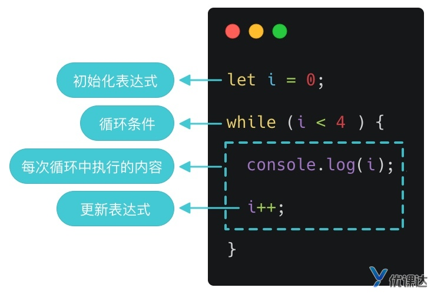

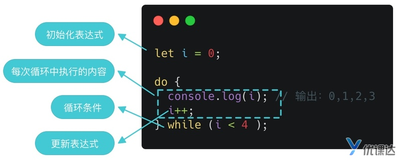

break

continue

> 这里要注意一下，因为 while 循环中，i++ 是放在“{}”中执行的，所以在执行 continue 之前要先执行 i++ 哦，不然会陷入死循环的。

获取随机数 Math.random()
const num = Math.random();
可以获得一个范围在 [0, 1) 之间的随机数
要获取 [100, 1000) 的数，那么 Math.random() 应该属于 [0.1, 1)。

我们处理一下：

// num1 的范围是 [0.1, 1)
const num1 = Math.random() * 0.9 + 0.1;
// num2 的范围是 [100, 1000)
const num2 = Math.floor(num1 * 1000);

Math.floor(x) 是js内置方法，返回小于 x 的最大整数。比如，Math.floor(2.3) 返回 2，Math.floor(4.9) 返回 4。

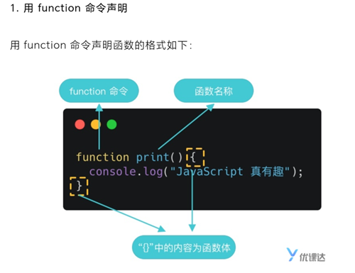

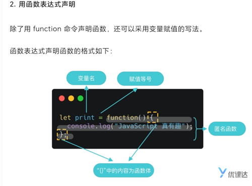

记住没有new

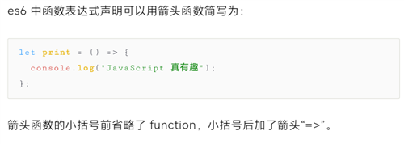

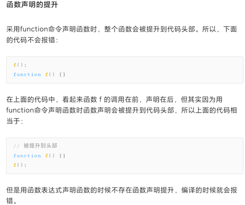

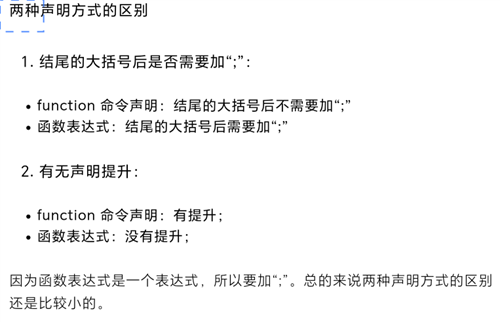

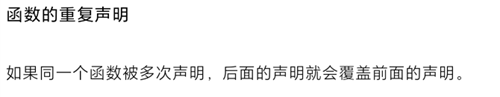

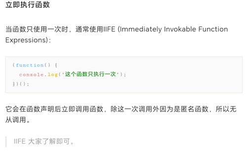
函数可以接受多个参数，多个参数以“,”（英文逗号）分隔：
JavaScript 允许传入任意个参数而不影响调用，因此传入的参数比定义的参数多也没有问题。这一点和 Java 有区别，在 JavaScript 中这样是不会报错的。
如果传入的数据比定义的参数少也不会因为数量不匹配而报错
参数默认值
function code(figure, txt = "随机数：") 

延时执行 setTimeout()


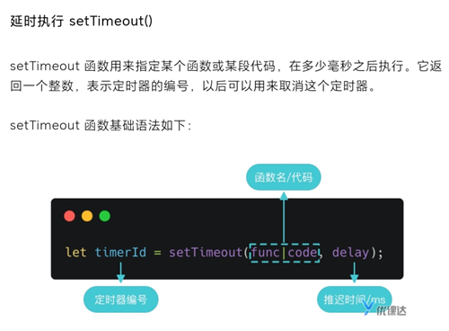
/**

- 第一个参数是代码，注意代码需用引号包裹，否则会立即执行代码
- 第二个参数是 1000，即 1000ms 后执行 console.log(2)
  */
  setTimeout('console.log(2)', 1000);
  /**
  第一个参数是匿名函数
  第二个参数是 2000，即 2s 后执行 console.log(3)
   */
  setTimeout(function () {
  console.log(3);
  }, 2000);
  // 第一个参数是函数名，注意函数名后不要加小括号“()”，否则会立即执行 print4
  setTimeout(print4, 3000);
  console.log(5);
  function print4() {
  console.log(4);
  }
  // 立即执行
  console.log(1);
  // 立即执行
  console.log(5);
  // 1s 后执行
  console.log(2);
  // 2s 后执行
  console.log(3);
  // 3s 后执行
  print4(); // 即：console.log(4)

虽然 setTimeout 只能执行一次，但是我们可以用递归的方式来写计时器。
注意，函数可以调用本身，这就是递归（recursion）。
每隔一秒会执行一次代码，每次执行的代码要能够：
打印剩余秒数；
将秒数减一；
如果剩余秒数 >0，则调用 setTimeout 在一秒后重复上述的 1、2、3，否则不再调用，并清除计时器，即计时结束；
// 首先定义计时总秒数，单位 s
let i = 60;
// 定义变量用来储存定时器的编号
let timerId;
// 写一个函数，这个函数即每次要执行的代码，能够完成上述的 1、2、3
function count() {
  console.log(i);
  i--;
  if (i > 0) {
    timerId = setTimeout(count, 1000);
  } else {
    // 清除计时器
    clearTimeout(timerId);
  }
}
// 首次调用该函数，开始第一次计时
count();

回调函数
用生活中当例子来解释回调函数就是：

你去商店预定中秋的月饼，预定的时候留下了你的手机号。等月饼到货后，店员给你打电话通知你去取。

手机号：回调函数； 到货：触发回调函数的具体条件； 到货后给你打电话：调用回调函数；

上面讲到的定时器 setTimeout 的第一个参数即“回调函数”，我们把函数指针（指向函数的指针变量）作为参数传给 setTimeout，当延时时间到了（触发条件达成）之后，就会通过函数指针调用函数，即调用回调函数。

setInterval，它的用法与 setTimeout 完全一致，区别仅仅在于 setInterval 指定某个任务每隔一段时间就执行一次，也就是无限次的定时执行。


什么是对象？简单说，对象就是一组“键值对”（key-value）的集合，是一种无序的复合数据集合：

- 大括号：定义一个对象；
- person：定义的对象被赋值给`person`，则`person`将指向这个对象；
- `name:'henry'`：键值对（key: value），键值之间用`:`隔开；
- `age: 18`：键值对（key: value）；
- 一个对象中可以包含多个键值对，每个键值对之间用`,`隔开，最后一个键值对后可以加`,`，也可以不加。

这里要注意，当一个对象被赋值给`person`，在`person`中保存的其实是对象的内存地址。而不是对象本身。这种赋值被称为“引用”。

这种定义对象的方法称为“字面量”。

键名

对象的键名基本都是字符串，键名加不加引号是一样的：

```js
let person = {
  name: 'henry',
  age: 18
}

// 和上面的写法意思一样
let person = {
  'name': 'henry',
  'age': 18
}
```

方法

对象的每一个键名又称为“属性”（property），它的“键值”可以是任何数据类型，当它是函数的时候，我们把这个属性称为“方法”，它可以像函数那样调用：

```js
let person = {
  name: 'henry',
  age: 18,
  run: function() {
    console.log('running');
  }
}

person.run();
```


对象的创建

除了上面提到的“字面量”方法，我们还可以通过构造函数创建新对象。

使用构造函数创建对象，我们需要两步走：

1. 创建一个构造函数，构造函数的名称常根据大驼峰命名法命名；
2. 通过 new 创建对象实例；

其中，构造函数可以声明对象的名称、属性和方法。

```js
// 第一步：创建构造函数
function People(name, age) {
  this.name = name;
  this.age = age;
}

// 第二步：通过 new 创建对象实例
let person = new People('henry', 18);
console.log(person);
```


 属性的读取

JavaScript 中有两种方法读取一个对象的属性：点运算符和方括号运算符。

```js
let person = {
  name: 'henry',
  age: 18
}

console.log(person.name);
console.log(person['name']);
```


属性的查看

查看一个对象本身的所有属性，可以使用Object.keys方法：

```js
let person = {
  name: 'henry',
  age: 18
}

console.log(Object.keys(person));
```

> 上述代码中的 Object，是 JavaScript 提供的基本对象，JavaScript 的所有其他对象都继承自Object对象，即那些对象都是Object的实例。keys 是 Object 对象的一个静态方法。

`Object.keys(person)`返回的是一个数组，这个数组由`person`对象的所有属性名构成

属性的删除和增加

如果要删除对象中的某个属性，可以使用 delete 命令

```js
delete person.name;
```

直接增加

```js
person.gender = 'male';
```


在 JavaScript 中我们可以通过 `for...in` 或借助 `Object.keys` 来实现遍历对象的属性


```js
// 字面量
let o1 = {
  name: 'alice',
};

// 构造函数
let o2 = new Object();
let o3 = new Object();

// 继承
funtion O4() {
}; 
O4.prototype = o1; 
let o4 = new O4();
```

属性是否存在：in

```js
'name' in person;
```

自身属性是否存在：hasOwnProperty

```js
person.hasOwnProperty('name');
```


JSON

JSON 是一种轻量级的文本数据交换格式，它用 JavaScript 的语法书写，但独立于这种语言，可以认为这是编程语言间用于传递数据而约定的数据格式。

JSON 格式和 JavaScript 对象的转换

1. JSON.parse()：JSON 格式 => JavaScript 对象

```js
// 一个 JSON 字符串
const jsonStr =
  '{"sites":[{"name":"Runoob", "url":"www.runoob.com"},{"name":"Google", "url":"www.google.com"},{"name":"Taobao", "url":"www.taobao.com"}]}';

// 转成 JavaScript 对象
const obj = JSON.parse(jsonStr);
```

1. JSON.stringify()：JavaScript 对象 => JSON 格式

现在我们把上面得到的 obj 转成 JSON 格式：

```js
const jsonStr2 = JSON.stringify(obj)；
```


Map

Map 和 Object 很相似，都可以保存键值对，但是他们仍有些重要的区别：

1. 一个 Object 的键通常是字符串，但一个 Map 的键可以是任意值，包括函数、对象、基本类型，因此 Map 会方便很多；
2. Map 中的键值是有序的，而添加到对象中的键则不是；
3. Map 的键值对个数可以直接获取，Object 则要借助 Object.keys() 等计算得到；
4. Map 可直接进行迭代，Object 则要借助 Object.keys() 等；
5. Map 不存在键名和原型键名冲突问题，可以直接覆盖，Object 则不行；

从某种程度上来说，Map 比 Object 更灵活方便，但是考虑到 Map 不能直接转为 JSON 格式进行通讯，所以我们可以把 Map 作为 Object 的补充来使用。


Math对象的静态属性，提供以下一些数学常数：

```js
Math.E // 常数e。
Math.LN2 // 2 的自然对数。
Math.LN10 // 10 的自然对数。
Math.LOG2E // 以 2 为底的e的对数。
Math.LOG10E // 以 10 为底的e的对数。
Math.PI // 常数π。
Math.SQRT1_2 // 0.5 的平方根。
Math.SQRT2 // 2 的平方根。
```

Math对象提供以下一些静态方法：

```js
Math.abs() // 绝对值
Math.ceil() // 向上取整
Math.floor() // 向下取整
Math.round() // 四舍五入取整
Math.max() // 最大值
Math.min() // 最小值
Math.pow() // 指数运算
Math.sqrt() // 平方根
Math.log() // 自然对数
Math.exp() // e的指数
Math.random() // 随机数
```

> 注意，以上方法除了 Math.random() 都需要传入合适的参数，即需要处理的数字。


### Storage 对象

Storage 接口用于脚本在浏览器保存数据。两个对象部署了这个接口：window.sessionStorage 和 window.localStorage。

sessionStorage 保存的数据用于浏览器的一次会话（session），当会话结束（通常是窗口关闭），数据被清空；localStorage 保存的数据长期存在，下一次访问该网站的时候，网页可以直接读取以前保存的数据。

数据的存入：setItem

写法：

```js
window.localStorage.setItem('myLocalStorage', 'storage Value');
```

清除缓存：clear

写法：

```js
window.localStorage.clear();
```


JavaScript 原生提供的三个包装对象：String、 Number和Boolean


String:

| 属性/方法           | 作用                                                         |
| ------------------- | ------------------------------------------------------------ |
| str.length          | 返回字符串长度                                               |
| str.indexOf(sub)    | 返回子字符串 sub 的开始下标，不存在则返回 -1注意：这里的参数 sub 是个字符串变量 |
| str.trim()          | 字符串前后去空格                                             |
| str.substring(s, e) | 截取下标从 s 到 e 的子字符串注意：这里的参数 s 和 e 是个数字变量 |
| str.substr(s, len)  | 截取下标从 s 开始，长度为 len 的子字符串注意：这里的参数 s 和 len 是个数字变量 |
| str.split(pattern)  | 按规格 pattern 分割字符串注意：这里的参数 pattern 是个字符串变量 |

注意，substring 和 substr 的第二个参数不写的时候，会一直截取到字符串结束为止。它们和 `trim` 一样都不会改变原字符串，而是返回处理后的字符串。

.join()连接数组

.reverse()倒序		该方法将改变原数组

.sort()排序			也改变原数组


map/forEach遍历

有返回值的遍历map

```js
// elem: 数组成员
// index: 成员下标
// a: 整个数组
const handledArr = arr.map(function (elem, index, a) {
  console.log(elem, index, a);
  return elem.name;//返回的值会存储到handledArr中
});
```

无返回值的遍历：forEach

forEach 的用法和 map 基本一致，不过 forEach 没有返回值：

```js
const handledArr = arr.forEach(function (elem, index, a) {
  console.log(elem, index, a);
  return elem.name;
});

console.log(handledArr);//undefined
```


new Date() 不加参数默认获取当前时间

```js
// 传入表示“年月日时分秒”的数字
let dt1 = new Date(2020, 0, 6, 0, 0, 0);
console.log(dt1);

// 传入日期字符串
let dt2 = new Date("2020-1-6");
console.log(dt2);

// 传入距离国际标准时间的毫秒数
let dt3 = new Date(1578240000000);
console.log(dt3);
```

> 1. 如果只传入一个数字，会被认为传入的是毫秒数；
> 2. 月份的范围是 0-11，而不是 1-12。


日期运算

时间差：毫秒数

两个时间对象是可以直接相减的，返回值为两者的毫秒数差：

```js
let dt1 = new Date(2020, 2, 1);
let dt2 = new Date(2020, 3, 1);

// 求差值
let diff = dt2 - dt1;

// 一天的毫秒数
let ms = 24 * 60 * 60 * 1000;

console.log(diff / ms); // 31
```

可以用大小于号进行早晚比较

Date.parse() 解析日期字符串

返回该时间距离时间零点（1970 年 1 月 1 日 00:00:00）的毫秒数

```js
let dt = Date.parse("2020-1-6");
console.log(dt); // 1578240000000
```

事件对象有三大方法

to、get、set方法

```js
let dt = new Date();
let dtStr = dt.toJSON();

console.log(dtStr); // 2020-01-03T09:44:18.220Z
```

### 获取时间对象的年/月/日：get 方法

Date 对象提供了一系列 get 方法，用来获取实例对象某个方面的值：

```
let dt = new Date();
dt.getTime(); // 返回实例距离1970年1月1日00:00:00的毫秒数。
dt.getDate(); // 返回实例对象对应每个月的几号（从1开始）。
dt.getDay(); // 返回星期几，星期日为0，星期一为1，以此类推。
dt.getFullYear(); // 返回四位的年份。
dt.getMonth(); // 返回月份（0表示1月，11表示12月）。
dt.getHours(); // 返回小时（0-23）。
dt.getMilliseconds(); // 返回毫秒（0-999）。
dt.getMinutes(); // 返回分钟（0-59）。
dt.getSeconds(); // 返回秒（0-59）。

```

> 注意，所有这些 get*方法返回的都是整数，不同方法返回值的范围不一样： 分钟和秒：0 到 59 小时：0 到 23 星期：0（星期天）到 6（星期六） 日期：1 到 31 月份：0（一月）到 11（十二月）

- 除了“日期”外，其他的时间范围都是从 0 开始的。
- 以上方法了解即可，需要用到的时候在 MDN 上进行查询即可。

### 设置时间对象的年/月/日：set 方法

set 方法和 get 方法正好相反，它能够设置时间对象的某个方面的值。

```
let dt = new Date();
dt.setTime(ms); // 设置实例距离1970年1月1日00:00:00的毫秒数。
dt.setDate(date); // 设置实例对象对应每个月的几号（从1开始）。
dt.setFullYear(year); // 设置四位的年份。
dt.setMonth(month); // 设置月份（0表示1月，11表示12月）。
dt.setHours(hour); // 设置小时（0-23）。
dt.setMilliseconds(ms); // 设置毫秒（0-999）。
dt.setMinutes(min); // 设置分钟（0-59）。
dt.setSeconds(sec); // 设置秒（0-59）。

```

> set 方法没有 setDay 方法，因为星期几是计算得到的。

同样的，以上方法了解即可，需要用到的时候在 MDN 上进行查询即可。


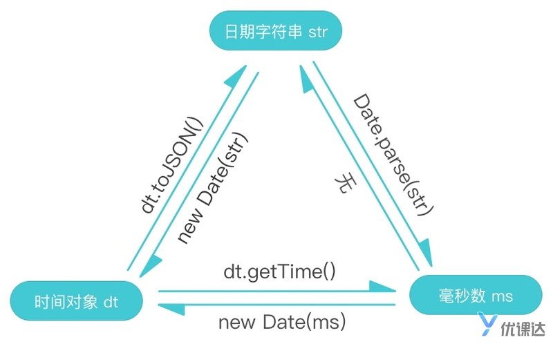


 // 排序

  infoList.sort((a, b) => {

​    const aStartDate = new Date(a.startTime);

​    const bStartDate = new Date(b.startTime);

​    return aStartDate > bStartDate ? 1 : -1;

  });

  

  // 格式化

  infoList.forEach(info => {

​    info.formattedDate = formatDate(info.startTime);

  });

  

  // 打印结果

  console.log(infoList);

  

  function formatDate(dtStr) {

​    const dt = new Date(dtStr);

  

​    const year = dt.getFullYear();

​    const month = dt.getMonth() + 1;

​    const day = dt.getDate();

​    const hour = dt.getHours();

​    const min = dt.getMinutes();

  

​    return year + '年' + month + '月' + day + '日 ' + hour + '点' + min + '分';

  }


### BOM 对象

在 BOM 里最重要的对象有 5 个， 分别如下：

1. **window** （窗口）：window 是整个网页的框架，每个网页的内容都是装载在 window 里面
2. **navigator** （浏览器）：navigator 里面存储浏览器相关信息
3. **history** （历史）：我们知道每个网页可以前进后退，history 便拿来存储整个网页栈的
4. **screen** （显示屏幕）：screen 包含我们显示屏幕的信息，这个是硬件信息
5. **location** （地址）：location 包含当前访问的地址（网址）信息

下面我以我的电脑为例，让大家更形象看看 BOM 对象在电脑上位置：

**特别强调几点**

- screen 是 **整个电脑** 唯一的
- navigator 是 **整个浏览器** 唯一的，如果有多个浏览器就会有多个 navigator
- window 是 *每个网页* 唯一的，每个网页都有一个独立的 window
- history，location 是 *每个网页* 的信息，当然也是网页唯一的

我们看到`window`对象中，有很多**方法**，比如`alert`, `confirm` …… 还有一些**属性对象**比如： `console`, `screen`, `navigator`, `location`……

如果看不清楚，我们还可以打开 [MDN 文档](https://developer.mozilla.org/zh-CN/docs/Web/API/Window)

官方解释为：

> 1. window 对象表示一个浏览器窗口或一个 frame 框架，它处于对象层次的**最顶端**，它提供了处理浏览器窗口的方法和属性。
> 2. window 对象是浏览器对象中的**默认对象**，所以可以隐式地引用 window 对象的属性和方法。在浏览器环境中，添加到 window 对象中的方法、属性等，其作用域都是全局的。


查看 MDN 文档：<https://developer.mozilla.org/zh-CN/docs/Web/API/Location>

#### Location 属性

通过文档，我们看到 Location 中常用属性如下：

| 属性     | 值                                                           | 解释                                                         |
| -------- | ------------------------------------------------------------ | ------------------------------------------------------------ |
| href     | <https://resource.youkeda.com/wss_test/5dc54e230f101ed7c2256d0d/5e33d104680dca7ebc7a223b/index.html?time=1580454161498> | href 是整个网页地址                                          |
| hostname | resource.youkeda.com                                         | hostname 是网页域名                                          |
| host     | resource.youkeda.com                                         | host 是网页域名 + 端口信息，在这里端口默认 80 省略了，所有和 hostname 一样 |
| protocol | https                                                        | protocol 代表协议信息                                        |
| origin   | [https://resource.youkeda.com](https://resource.youkeda.com/) | origin 页面来源的域名的标准形式                              |
| pathname | /5dc54e230f101ed7c2256d0d/5e33d104680dca7ebc7a223b/index.html | pathname 包含 url 路径部分                                   |
| search   | ?time=1580454161498                                          | search 表示 URL 参数                                         |

用图表示如下（pathname 太长，部分省略代替）：

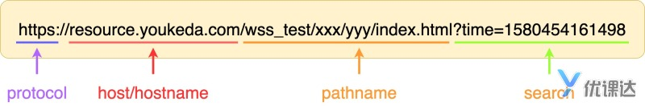


Location 方法

在 Location 方法中，我们重点只需要掌握一个方法 --- **reload()** 。

为了防止无限快速循环，我们设置一个定时器延迟调用 reload。

```js
setTimeout(function () {
  window.location.reload();
}, 3000);
```

每次刷新界面js文件也会刷新，所以这个可以无限刷

其他方法，大家了解一下即可，几乎不会用到。


跳转到新的地址

我们同样可以修改 Location，直接将网页地址赋值给 Location 即可，代码如下：

```js
window.location = 'https://www.youkeda.com';
```


**History** 允许操作浏览器的曾经在标签页或者框架里访问的会话历史记录，由这个名称我们得知，History 会存储该窗口的历史记录。

mdn 地址为: <https://developer.mozilla.org/zh-CN/docs/Web/API/History>

我们以上面跳转到新地址举例，如果原始网页为 `https://www.youkeda.com`， 那 history 中存储为

```js
// 会话记录
['https://www.youkeda.com'];
```

如果我们在网页中点击某个链接，或者使用`window.location = xxx`跳转到`https://www.baidu.com`, 那 history 中存储为

```js
// 会话记录
['https://www.youkeda.com', 'https://www.baidu.com'];
```

后续访问，以此类推。大家学过 JS 基础的话应该能看出来这是一个数组（或者说是列表），在实际存储中用到的数据结构和数组特别类似，叫做**栈**。

在 history 中需要掌握两个方法， **back()** 和 **forward()** ，分别对应到浏览器左上角的返回和前进按钮。


**Navigator** 表示用户代理的状态和标识，也就是浏览器基本信息，在这里面我们需要了解一个属性 --- **userAgent**，代表当前浏览器的用户代理。


> 文档对象模型 (DOM) 可以将 **web 页面** 与 **脚本或编程语言** 连接起来

我们来理解下这句话，有两个重点：

**1. web 页面**

> 这里的 web 页面，也就是之前我们用 HTML 和 CSS 绘制的页面，也称作为**文档**

**2. 脚本或编程语言** 为什么这里不直接说将 Web 页面和 Javascript 语言连接起来，而要绕一下说**脚本或编程语言**呢？

> 因为 DOM 是一种**规范**，或者是一种**约定**，只要遵循这个规范，那么无论是`Javascript`，还是`python`，或者`java`都可以被连接起来。


DOM 映射

我们平时写 HTML 的时候，大多都认为 HTML 是平面的东西，一堆文字包裹在一堆标签中间。但实际上像 HTML 和 XML 这种形式的文档都是**树状结构**， 也对应数据结构中的**树**。

每个 HTML 标签我们称之为 **DOM 节点**，英文为**Node**或者**ELement**


DOCUMENT 元素会存在全局变量 window 下面，我们可以通过如下代码来访问:

```js
window.document;
```

从 JSConsole 我们知道，`window.document`得到的是一个`HTMLDocument`对象，这个对象内容有点多，大家不需要全部了解，只需要看几个属性即可，比如 document 内容 key 为`documentElement`:


**选择器查询方法** --- `querySelector()`

```js
document.querySelector('main .core .subtitle');
```


**迭代查询**

当我们得到 subtitle 元素后，我们还可以利用这个元素，继续筛选器内部元素，比如我们想筛选器内部的 a 标签，我们可以继续完善代码：

```js
let subtitle = document.querySelector('main .core .subtitle');
console.log(subtitle.querySelector('a'));
```


选择器全量查询

querySelectorAll()

返回一个类数组

类数组，顾名思义类似数组形式，（可以通过索引访问的对象我们都可以称之为类数组），从 JSConsole 中我们实际得到的是**NodeList**对象。

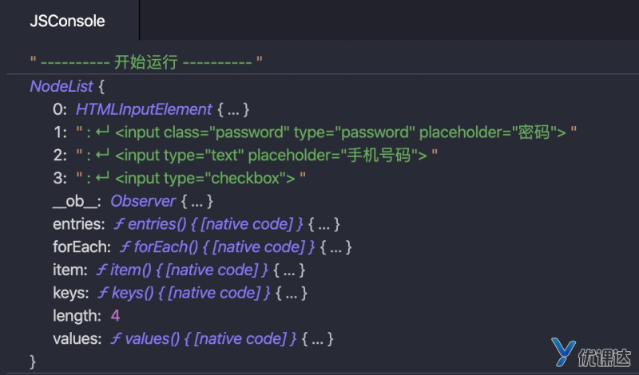


最原生的 DOM 查询函数，我们简单介绍下：

**getElementById()**: 根据 **id** 查询某个节点

**getElementsByClassName()**: 根据 **class** 查询多个节点

**getElementsByTagName()**: 根据 **标签名** 查询多个节点


> querySelector 查询出来的元素是拷贝的原始数据，不会再随着页面 DOM 节点的改变而变化 get 系列方法 查询出来的元素就是原始数据，所以会随着页面的 DOM 节点的改变而变化

这部分不要求掌握！大家只需要记住在以后的场景中，大多数都是用 `querySelector或All` 即可。

#### DOM 类别

在上面我们看到很多 DOM 种类，但可以归纳为几个类别：

1. **元素节点**
2. **特性节点**
3. **文本节点**
4. …… 其他类别不重要，忽略

整个 HTML 中，无论是标签，标签属性，还是纯文本字符串都是`Element`, 不同的地方在于`nodeType`分别为`1, 2, 3`

`attributes`可以获取元素节点的所有属性，得到的结果是一个字典，通过属性 Key 获取对应的特性节点。


| 属性      | 值                                                           | 总结                      |
| --------- | ------------------------------------------------------------ | ------------------------- |
| outerHTML | `<div id="test">优课达<p>youkeda</p><p>学的比别人好一点</p></div>` | **整个 DOM 的 HTML 代码** |
| innerHTML | `优课达<p>youkeda</p><p>学的比别人好一点</p>`                | **DOM 内部 HTML 代码**    |
| innerText | `优课达`                                                     | **DOM 内部纯文本内容**    |

| 属性       | 值                                                           | 总结                            |
| ---------- | ------------------------------------------------------------ | ------------------------------- |
| firstChild | `优课达`                                                     | **指定节点的第一个子节点**      |
| lastChild  | `<p>学的比别人好一点</p>`或`text`                            | **指定节点的最后一个子节点**    |
| childNodes | `优课达<p>youkeda</p><p>学的比别人好一点</p>`                | **指定节点的子节点的集合**      |
| parentNode | `<body><div id="test">优课达<p>youkeda</p><p>学的比别人好一点</p></div><script src="./index.js"></script></body>` | **指定节点在 DOM 树中的父节点** |


#### 1. 创建标签节点

**document.createElement(tagName)**

> 此方法用于创建一个由标签名称 tagName 指定的 HTML 元素，也就是上节课提到的**元素（标签）节点**。

如果想创建一个`div`标签，我们可以使用：

```js
const div = document.createElement('div');
```

**document.createTextNode(string)**

**document.createTextNode(string)**

如果想继续在这个`div`标签内部，添加纯文本内容，可以继续使用创建文本方法**document.createTextNode()**，代码如下：

```js
const txt = document.createTextNode('优课达-学的比别人好一点');
```

1. 添加新节点

**appendChild(newNode)**

```js
document.body.appendChild(div);
```

**inserBefore(newNode， referenceNode)**

`appendChild`是在**所有儿子节点之后**添加，`inserBefore`是在**某个目标儿子节点之前**添加。

`insertBefore(newNode, referenceNode)`，需要两个参数，`newNode`表示新节点，`referenceNode`表示目标节点，也就是新节点插入到目标节点之前。


```js
const root = document.querySelector('ul.root');
const sars = document.querySelector('li.sars');

// 创建 H1N1
const H1N1 = document.createElement('li');
const H1N1Txt = document.createTextNode('H1N1');
H1N1.appendChild(H1N1Txt);
root.appendChild(H1N1);

// 创建 新型冠状病毒
const nCoV = document.createElement('li');
const nCoVTxt = document.createTextNode('新型冠状病毒');
nCoV.appendChild(nCoVTxt);
root.insertBefore(nCoV, sars);
```

再优化：

```js
function createDisease(txt) {
  const dom = document.createElement('li');
  const domTxt = document.createTextNode(txt);
  dom.appendChild(domTxt);
  return dom;
}

const root = document.querySelector('ul.root');
const sars = document.querySelector('li.sars');

// 创建 H1N1
const H1N1 = createDisease('H1N1');
root.appendChild(H1N1);

// 创建 新型冠状病毒
const nCoV = createDisease('新型冠状病毒');
root.insertBefore(nCoV, sars);
```

 设置样式、属性

```js
img.setAttribute('style', 'width: 100%; height: 100%;');
```

`dom.style`是一个 Map 对象，因此如果不想全量替换样式，还可以单独设置某些属性，如下代码：

```js
dom.style.color = 'xxxx';
```

`classList`给我们提供了基础操作的增删改查方法，很容易理解，大家可以查看下 MDN 文档：<https://developer.mozilla.org/zh-CN/docs/Web/API/Element/classList>

innerHTML

在案例中，我们使用`innerHTML = ''`清空`select`节点所有的后代内容。

```js
function createDisease(txt) {
  const dom = document.createElement('li');

  // 我们可以直接用innerHTML设置其纯文本
  dom.innerHTML = txt;
  return dom;
}
```


两种不恰当的写法:

#### 一、事件嵌套到 HTML 代码中

```
<div onclick="console.log('xxx')"></div>

```

> 这种写法会导致 Javascript 代码镶嵌在 HTML 代码中，导致 HTML 代码非常庞大，不利于文件分离。

二、事件方法替换

```js
dom.onclick = function () {};
```

这种写法只能在这个 DOM 上绑定一个点击事件，下一个设置`onclick`将会顶替上面的事件方法。 相比较而言`addEventListener()`可以添加多个监听事件。

因此建议大家在之后的 DOM 绑定操作，统一使用`addEventListener()`。


常用事件：<https://developer.mozilla.org/zh-CN/docs/Web/Events>


焦点事件

**focus**: 表单组件（Input, Textarea, etc..）获取焦点事件 **blur**: 表单组件（Input, Textarea, etc..）失去焦点事件

鼠标事件

**click**: 点击事件 **dblclick**: 双击事件 **mousedown**: 在元素上按下任意鼠标按钮。 **mouseenter**: 指针移到有事件监听的元素内。 **mouseleave**: 指针移出元素范围外（不冒泡）。 **mousemove**: 指针在元素内移动时持续触发。 **mouseover**: 指针移到有事件监听的元素或者它的子元素内。 **mouseout**: 指针移出元素，或者移到它的子元素上。 **mouseup**: 在元素上释放任意鼠标按键。

键盘事件

**keydown**: 键盘按下事件 **keyup**: 键盘释放事件

视图事件

**scroll**: 文档滚动事件 **resize**: 窗口放缩事件

资源

**load**： 资源加载成功的事件

从下一张开始，我们也将通过具体案例，讲解这些事件的使用。

大家也可以点开<https://www.youkeda.com/personal/Ucode/m>查看其他同学的优秀作品，或者自己新建工程。


```js
// 默认是未点击喜欢
let hasLike = false;

const likeBtn = document.querySelector(".like-btn");
const likeBtnRight = likeBtn.querySelector(".right");
likeBtn.addEventListener("click", function () {
  // 点击事件
  hasLike = !hasLike;
  if (hasLike) {
    likeBtn.classList.add("has-like");
    likeBtnRight.innerHTML = parseInt(likeBtnRight.innerText.trim()) + 1;
  } else {
    likeBtn.classList.remove("has-like");
    likeBtnRight.innerHTML = parseInt(likeBtnRight.innerText.trim()) - 1;
  }
});
```


1. 点击事件触发`button.like-btn`监听事件
2. 冒泡找到其父亲节点，触发父亲节点的监听事件
3. 依次冒泡直到 html 根元素为止。

 **阻止冒泡 - e.stopPropagation();**

```js
// ......省略
likeBtn.addEventListener('click', function(e) {
  // 点击事件
  e.stopPropagation()

// ......省略
```


### 捕获

捕获和冒泡是完全相反的，冒泡是从当前元素沿着祖先节点往上冒泡，而捕获是从根 HTML 节点开始依次移动到当前元素。

我们上面使用的`addEventListener`是在冒泡阶段监听事件，如果想在捕获阶段监听事件，我们需要传递第三个参数为`true`， 代码如下

```js
dom.addEventListener('click', function() {}, true);
```

在实际场景中，捕获使用的非常少，以后遇到具体情况我们再具体分析，此处大家需要了解一下即可。


委托

**委托**其实是**冒泡事件**的一种应用，这个概念依赖于这样一个事实,如果你想要在**大量子元素中单击任何一个都可以运行一段代码**，您可以将事件监听器设置在其**父节点**上，并让子节点上发生的事件冒泡到父节点上，而不是每个子节点单独设置事件监听器。


举个例子，在上一节的课程中，为了监听每个图片点击事件，代码如下：

```
const box = document.querySelector('.box');
const imgArr = box.children;

for (let i = 0; i < imgArr.length; i++) {
  imgArr[i].addEventListener('click', function() {
    document.body.style.backgroundImage = `url(${imgArr[i].src})`;
  });
}
```

那我们利用委托应该怎么做呢？对，我们只需要监听`box`即可，代码修改如下：

```
const box = document.querySelector('.box');

box.addEventListener('click', function(e) {
  // document.body.style.backgroundImage = `url(${imgArr[i].src})`;
});
```

那问题来了，我们怎么获取当前点击图片的地址呢？我们需要使用这个地址赋值给`body.style`。

不着急，我们首先把这个`MouseEvent`打印出来看看。 演示一下：

代码演示

从图片看出，虽然我们的事件监听是在`.box`上，但`MouseEvent`的`target`却在``上面，也就是

> target 表示真实响应事件的 DOM 节点

通过这个分析，我们就知道代码怎么写了，完善一下如下：

```js
const box = document.querySelector('.box');

box.addEventListener('click', function(e) {
  // 注意box区域比img大，如果点击在空白间隔区域，那么返回的节点将不会是IMG，需要特殊处理一下
  if (e.target.nodeName === 'IMG') {
    document.body.style.backgroundImage = `url(${e.target.src})`;
  }
});
```


**1. mousemove**

> 这个是鼠标移动事件，比较简单

**2. mouseenter/mouseleave**

> 这个是鼠标进入和离开事件，但是仅仅只作用于当前 DOM 节点，不会作用于其后代节点

**3. mouseover/mouseout**

> 这个也是鼠标进入和离开事件，但和`enter/leave`不同的是：此事件除了作用于当前 DOM 节点，也会同时作用于其后代节点

在平时使用中，90%我们都只会使用**mouseover/mouseout**，这个事件。


#### 焦点事件

我们先来看看获取焦点和失去焦点两个事件 --- **focus** 和 **blur**，非常简单，我们直接来看案例。

我们给 QQ 注册页的昵称输入框加入焦点事件：

```js
const nick = document.querySelector('input.nick');
nick.addEventListener('focus', function() {
  console.log('获取焦点');
});

nick.addEventListener('blur', function() {
  console.log('失去焦点');
});
```


#### 内容值变化

对于表单元素，有两种事件可以监听元素内容变化 --- **input** 和 **change**。

我们写个案例看看情况，仍然对昵称输入框加上上面两种事件的监听，代码如下：

```js
const nick = document.querySelector('input.nick');
nick.addEventListener('input', function() {
  console.log('-----input');
  console.log(nick.value);
});

nick.addEventListener('change', function() {
  console.log('-----change');
  console.log(nick.value);
});
```


我们发现，只要在输入框里面输入值，就会触发**input**事件。而要等到输入框失去焦点，才会触发**change**事件。

我们总结下，这两种是事件的区别：

| 事件     | 介绍                                                         | 案例                                                         |
| -------- | ------------------------------------------------------------ | ------------------------------------------------------------ |
| `change` | 当用户提交对元素值的更改时触发； change 事件不一定会对元素值的每次更改触发 | 1. checkbox 值修改以后2. select 选择后3. input 内容修改并失去焦点 |
| `input`  | 只要 value 值修改就会触发                                    |                                                              |


### 事件描述

滚动事件，事件名称为 --- **scroll**。 首先来看看事件如何处理和监听，我们以之前的**前端基础课程**中文章为例，加入 JS 代码如下：

```js
window.addEventListener('scroll', function () {
  console.log(window.scrollY);
});
```

大家尝试滚动一下页面，我们会发现`JSConsole`里会陆续打印一些数字，这些数字就是`scrollY`(Y 轴滚动距离)。


### 无尽滚动

那接下来我们加一下无尽滚动效果，当页面快滚动到底部时，添加新的文章内容到`body`中。

代码如下：

```js
window.addEventListener('scroll', function () {
  // 可以通过clientHeight获取内容高度
  const height = document.body.clientHeight;

  // 通过screen.height获取浏览器的高度
  const screenHeight = window.screen.height;

  // 当距离底部的距离小于500时，触发页面新增内容
  if (height - window.scrollY - screenHeight < 500) {
    console.log('加载新文章内容');
    // 在底部添加10张图片
    const div = document.createElement('div');
    let str = '';
    for (let i = 0; i < 10; i++) {
      str += `
       
      `;
    }
    div.innerHTML = str;
    document.body.appendChild(div);
  }
});
```

主要使用到的技术

1. 内容高度 `document.body.clientHeight`
2. 浏览器高度 `window.screen.height`
3. 滚动距离 `window.scrollY`
4. 滚动距离底部距离 `内容高度 - 浏览器高度 - 滚动距离`

#### 其它事件

到本节为止，我们已经讲了 80%的事件，覆盖 99%的使用场景。剩下的小众事件我们不在课程中讲，大家看看文档就能理解，比如：

1. **键盘事件**：<https://developer.mozilla.org/zh-CN/docs/Web/API/KeyboardEvent>


`API` 返回的内容统称为`数据`，那我们该如何使用`javascript`获取这部分数据呢？我们可以使用 **fetch**这个方法，我们来看看代码：

```js
fetch(
  'https://mock.youkeda.com/api/m/f4-11-1-1'
)
  .then(function (response) {
    return response.json();
  })
  .then(function (myJson) {
    console.log(myJson);
  });
```


这里我们遇到了新的语法 --- `.then`， 这是个什么东西？为了弄清楚这个，我们首先得知道`fetch()`返回结果是什么？这是一个`Promise`对象。

### Promise

**Promise** 是**异步编程**的一种解决方案，之前异步编程是通过回调方法来实现的，比如我们看看在`fetch`之前的怎么完成网路调用呢？

```js
let oReq = new XMLHttpRequest();
oReq.addEventListener('load', function () {
  console.log(this.responseText);
});
oReq.open(
  'GET',
  'https://mock.youkeda.com/api/m/f4-11-1-1'
);
oReq.send();
```

这是老版的`ajax`调用，大家以后几乎用不到这种方法。

使用这种方法我们需要写一大段代码，然后通过`addEventListener`监听`load`事件，然后触发后面的`function`回调函数。如果在这个回调函数里面继续加入`setTimeout`或者`addEventListener`监听代码，那么会出现多层嵌套，专业叫做**回调地狱**。

而`Promise`对象可以通过`.then`触发回调函数，`then`中文意思**下一步**，也非常符合人的语义化习惯。

在上面`response.json()`返回的也是一个 Promise 对象，所有后续可以继续使用`.then`触发后续回调。

> 把**嵌套型**的回调调整成为**平铺型**的回调，这就完美的解决了回调地狱的问题。

### GET 请求

像上面这种请求数据的接口，我们一般称为`GET接口`，而`fetch`在不指定类型时，默认是发起`GET请求`。

在实际情况中，服务端开发同学在给出 API 接口时，会告诉你这个 API 是一个`GET`还是`POST`类型。

### GET 参数请求

在上面我们练习了如何在程序中调用 `GET 类型 API` 获取结果。、 很多情况下，`API` 调用需要参数，

例如，下面这个 `API`，我们传入的了参数`mood=happy` ：

```js
https://mock.youkeda.com/api/m/reply?mood=happy
```

我们只要把包含**参数**的完整的 `URL` 直接传入到方法中就可以了。


### fetch - POST 操作

我们在服务端提供了一个登录接口，接口地址为：

```
https://mock.youkeda.com/api/m/f4-11-4-1
```

我们知道`fetch`默认是发起`GET`请求，那我们该如何发起`POST`请求呢？

我们查看下`fetch`文档：<https://developer.mozilla.org/zh-CN/docs/Web/API/Fetch_API/Using_Fetch>

在文档中搜索`POST`, 我们会发现只要加一个参数**method**就行了。代码如下：

```js
fetch(
  'https://mock.youkeda.com/api/m/f4-11-4-1',
  {
    method: 'POST'
  }
)
  .then(function(response) {
    return response.json();
  })
  .then(function(myJson) {
    console.log(myJson);
  });
```

代码演示

最终得到的结果是

```
{
  "isSuccess": false
}
```

登录失败了！！和上面故事描述的一样，因为我们没有提供**准入券**，我们添加一下账号密码，分别为：

```
username: 'admin';
password: '123456';
```

我们同样看看上面 Fetch 文档，我们发现可以通过`body`属性完成`POST`请求的传参。 注意，在利用 body 传递`json`格式数据时，我们需要在`headers`里面加入`contentType信息`。

我们完善一下代码如下：

```js
// 把JSON数据序列化成字符串
const data = JSON.stringify({
  username: 'admin',
  password: '123456'
});

fetch(
  'https://mock.youkeda.com/api/m/f4-11-4-1',
  {
    method: 'POST',
    body: data,
    headers: {
      'content-type': 'application/json'
    }
  }
)
  .then(function(response) {
    return response.json();
  })
  .then(function(myJson) {
    console.log(myJson);
  });
```


