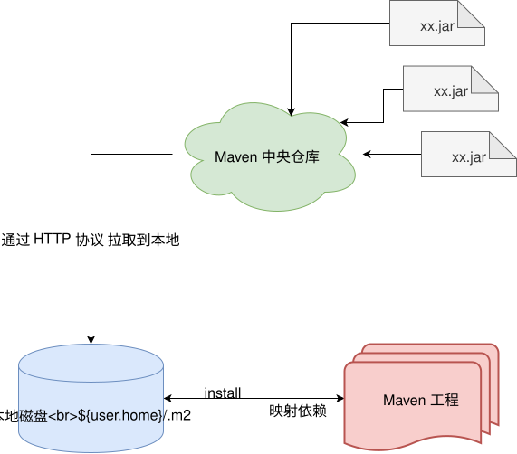
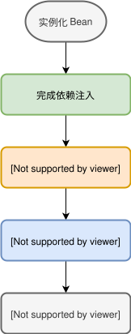
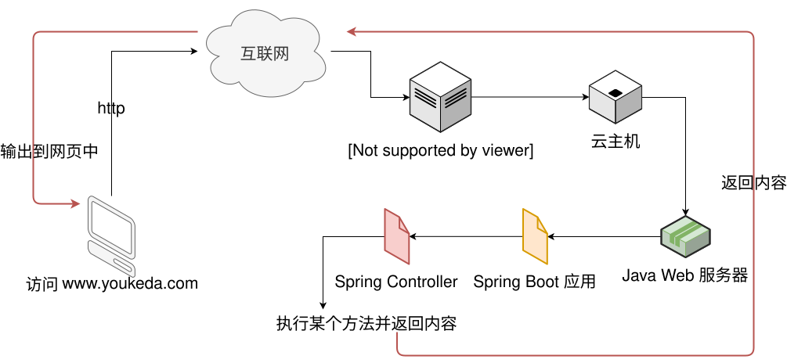
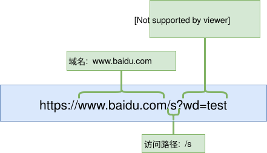
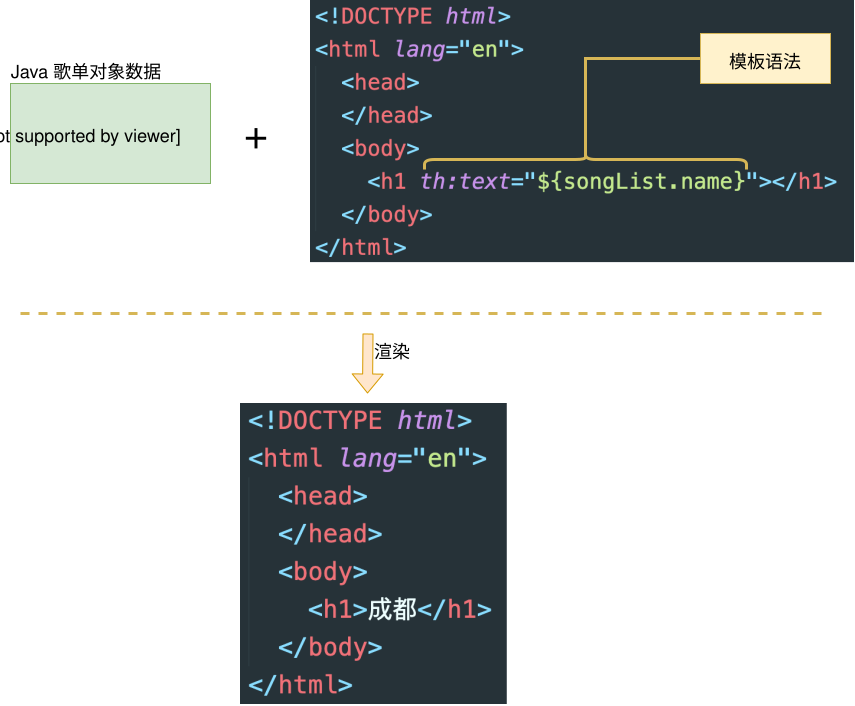
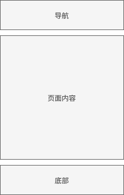
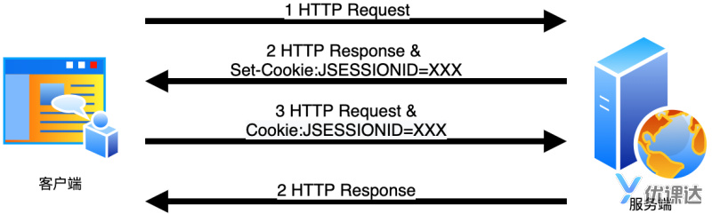
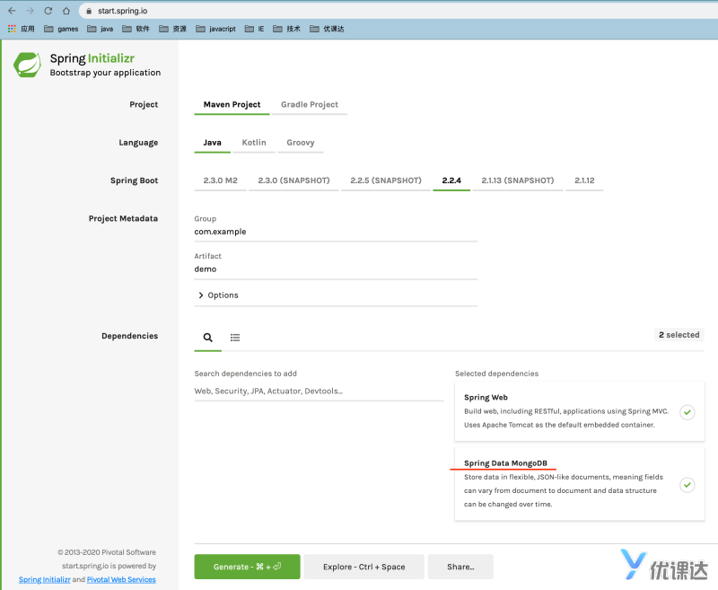

Maven 是一个**项目管理和构建自动化工具**。

Maven 提供了一个命令行工具可以把工程打包成 Java 支持的格式（比如 jar），并且支持部署到中央仓库里，这样使用者只需要通过工具就可以很快捷的运用其他人写的代码，只需要你添加依赖即可




Maven 使用惯例优于配置的原则 。它要求在没有定制之前，所有的项目都有如下的结构（其实我们之前的 Java 工程目录都是遵循了这个结构规范）：

| 目录                          | 目的                             |
| ----------------------------- | -------------------------------- |
| ${basedir}                    | 存放 pom.xml 和所有的子目录      |
| ${basedir}/pom.xml            | **Maven 的项目配置文件**         |
| ${basedir}/src/main/java      | **项目的 java 源代码**           |
| ${basedir}/src/main/resources | 项目的资源，比如说 property 文件 |
| ${basedir}/src/test/java      | 项目的测试类，比如说 JUnit 代码  |
| ${basedir}/src/test/resources | 测试使用的资源                   |

这里的 `${basedir}` 代表的是 Java 工程的根路径，在我们这里就是工程的根目录啦。一个 Maven 项目在默认情况下会产生 JAR (Java 的一种压缩格式)文件，另外 ，编译后 的 classes 会放在 \${basedir}/target/classes 下面， JAR 文件会放在 ${basedir}/target 下面。


Maven 命令

想要使用 Maven 这个工具，是要在命令行（终端软件）里输入指令的方式来执行的，我们需要大家了解几个常用的命令，注意命令要在工程的根目录下执行哦

1. `mvn clean compile`

编译命令，Maven 会自动扫描 src/main/java 下的代码并完成编译工作，执行完，会在根目录下生成 target/classes 目录（存放所有的 class）

1. `mvn clean package`

编译并打包命令，这个命令是 compile 和 package 的集合，也就是说会先执行 compile 命令，然后在执行 jar 打包命令，这个的结果会把所有的 java 文件和资源打包成一个`jar`,jar 是 java 的一个压缩格式，方便我们灵活的运用多个代码

1. `mvn clean install`

执行安装命令，这个命令是 compile 和 package、install 的集合，也就是说会先执行 compile 命令，然后在执行 jar 打包命令，然后执行 install 命令安装到本地的 Maven 仓库目录里，这个目录是 `${user_home}/.m2`

这个 `${user_home}` 指的就是你的电脑登录用户名的个人目录

> 如果大家在本地完成了 Maven 的安装，大家可以打开我的电脑进行看一看的

这个操作基本和`mvn clean package`看起来一样，所以我们就不演示了

#### 4. `mvn compile exec:java -Dexec.mainClass=${main}`

这个命令的意思是在 compile 执行完后，执行运行 Java 的命令，具体执行哪个 Java 类是由 `-Dexec.mainClass=${main}` 参数指定的，比如我们想执行 `com.youkeda.Test`类，那么这个完整的命令就是

```
mvn compile exec:java -Dexec.mainClass=com.youkeda.Test
```


Maven 坐标

```xml
<groupId>com.youkeda.course</groupId>
<artifactId>app</artifactId>
<packaging>jar</packaging>
<version>1.0-SNAPSHOT</version>
```

这四个标签组成了 Maven 的坐标，所谓**坐标**就是一种位置信息，Maven 的坐标决定了这个 Maven 工程部署后存在 Maven 仓库的文件位置，所以这个坐标信息是必须要指定的。

groupId

groupId 就像一个文件夹一样，它的命名和 Java 的包比较一致

artifactId

artifactId 有点像文件名一样，在一个 groupId 内，它应该是唯一的,你不能使用中文或者特殊字符，从规范上来说只能使用小写的英文字母、`.`、`-`、`_`。比如：`app、member.shared` 这些都可以

##### packaging

Maven 工程执行完后会把整个工程打包成`packaging`指定的文件格式，默认情况下`packaging`的值是`jar`,所以如果`pom.xml`文件中没有声明这个标签，那就是 jar

packaging 有如下的几种格式

- jar
- war
- ear
- pom

##### version

version 很有意思的，它基本上遵守了软件工程中对版本号的约定。

在 Maven 的世界里，会把一个工程分为两个状态，这也是软件工程里最最常用的规范。

- **SNAPSHOT** 这个单词翻译过来的意思是快照，实际上代表了当前程序还处于不稳定的阶段，随时可以再修改，所以在我们开发的时候我们会在版本号后面加上`SNAPSHOT`关键字
- **RELEASE** RELEASE 和 SNAPSHOT 是对立面的，所以它代表的就是稳定，一般我们正式发布的时候，都会把 version 改为`RELEASE`。当然你可以不用特意的加上`RELEASE`,因为只要不是`SNAPSHOT`，那就是`RELEASE`

一般会用三位数字来表示版本号，所以大概是`x.x.x`这样的格式

- 第一位代表的是主版本号

  > 主版本号一般是团队约定来的，上面 iOS 的例子中`13`就是主版本号

- 第二位代表的是新增功能

  > 上面例子中的`1`代表的就是新增功能后的版本，这个数字表明苹果在 13 这个版本里，有了 1 次新增功能的行为

- 第三位代表的是 bugfix 后的版本

  > bugfix 是修复代码缺陷、bug 的行为，我们知道苹果经常会发布一些版本用于修复问题，所以上面的`2`就是 bugfix 版本，从这个数字你可以大致判断，苹果做了两次 bug 修复

也有可能用两位版本，那就是没有第一位的主版本号（因为某些时候，可能不需要主版本号）


软件的版本大多时候是从 `1.0.0`开始的，在开发状态下那就是 `1.0.0-SNAPSHOT`,请注意这个格式`[version]-SNAPSHOT`

一般来说每一位的最大值就是**100**


1.2 **Maven** **属性配置**

- java.version

> 代表设置一个参数：`java.version`，它的值是`1.8`

- maven.compiler.source

> 这个参数是指定 Maven 编译时候源代码的 JDK 版本， `${java.version}` 这个值有点特殊，它是一个动态值，`${key}`这个语法会动态找到`key`这个参数配置的值，所以上面的例子中`${java.version}`的实际值是`1.8`

- project.build.sourceEncoding

> 这个参数指定的是工程代码源文件的**文件编码格式**，一般情况下，我们都设置成`UTF-8`

- maven.compiler.target

> 这个参数作用是是按照这个值来进行编译源代码，比如这里的例子是按照 JDK1.8 进行编译


**依赖管理 dependencies**

dependency 就是用于指定当前工程依赖其他代码库的，Maven 会自动管理 jar 依赖

> 一旦我们在 pom.xml 里声明了 dependency 信息，会先去本地用户目录下的`.m2`文件夹内查找对应的文件，如果没有找到那么就会触发从中央仓库下载行为，下载完会存在本地的`.m2`文件夹内


> 一般我们会把别人写的代码库称为**三方库**，自己、团队写的称为**二方库**，这个概念请大家记住，以后我们可能会这样描述内容的


中央仓库

前面我们提到过 Maven 会把所有的 jar 都存放在中央仓库里，我们可以通过 <https://search.maven.org/> 这个网站来搜索 jar。可惜的是这个网站部署在国外，在国内访问不到，我们可以访问阿里云的镜像服务器 <https://maven.aliyun.com/mvn/search>

间接依赖

间接依赖是 mvn 成功的核心要素，简单的来说，如果一个`remote`工程依赖了 okhttp 库，而当前工程`locale`依赖了 `remote`工程，这个时候`locale`工程也会自动依赖了 okhttp


**Annotation (注解)**

对元素的补充说明

能够在编译、运行阶段读取信息, 而且不会污染源代码。可以借助它来实现一些增强功能，在 Spring 当中就重度使用了 Annotation，通过运行阶段动态的获取 Annotation 从而完成很多自定义的行为


1、Target

`java.lang.annotation.Target` 自身也是一个注解，它只有一个数组属性，用于设定该注解的目标范围，比如说可以作用于类或者方法等。因为是数组，所以可以同时设定多个范围

具体可以作用的类型配置在 `java.lang.annotation.ElementType` 枚举类中，我们说几个常用的

- ElementType.TYPE

  > 可以作用于 类、接口类、枚举类上

- ElementType.FIELD

  > 可以作用于类的属性上

- ElementType.METHOD

  > 可以作用于类的方法上

- ElementType.PARAMETER

  > 可以作用于类的参数

如果想要同时作用于类和方法上，那么你就可以

```java
@Target({ElementType.TYPE,ElementType.METHOD})
```

> 如果某个 Annotation 的 Target 设定为 METHOD ，那么你就只能在方法前面上面引用它，其他的地方都不行,其他 Target 值也类似这个规则

我们再看几个例子来区分一下，

1.1 ElementType.TYPE

```java
@Service
public class MessageServiceImpl implements MessageService{

    public String getMessage() {
         return "Hello World!";
    }

}
```

1.2 ElementType.METHOD

```java
public class MessageServiceImpl implements MessageService{

    @ResponseBody
    public String getMessage() {
         return "Hello World!";
    }

}
```

1.3 ElementType.FIELD

```java
public class MessageServiceImpl implements MessageService{

    @Autowired
    private WorkspaceService workspaceService;

}
```

1.4 ElementType.PARAMETER

```java
public class MessageServiceImpl implements MessageService{

    public String getMessage(@RequestParam("msg")String msg) {
         return "Hello "+msg;
    }

}
```

2、Retention

`java.lang.annotation.Retention` 自身也是一个注解，它用于声明该注解的生命周期，简单的来说就是在 Java 编译、运行的哪个环节有效，它的值定义在`java.lang.annotation.RetentionPolicy`枚举类中，有三个值可以选择

1.SOURCE: 也就是说是纯注释作用 2.CLASS: 也就是在编译阶段是有效的 3.RUNTIME: 在运行时有效

```java
@Retention(RetentionPolicy.RUNTIME)
```

这个代码表示的就是在运行期间有效

> 如果是我们自己定义的 Annotation ，一般我们都会设置成 `RUNTIME`

3、Documented

`java.lang.annotation.Documented` 自身也是一个注解，它的作用是将注解中的元素包含到 JavaDoc 文档中，一般情况下，都会添加这个注解的。

4、@interface

`@interface`就是声明当前的 Java 类型是 Annotation，固定语法，就是这样写就好

5、Annotation 属性

```java
String value() default "";
```

Annotation 的属性有点像类的属性一样，它约定了属性的类型(这个类型是基础类型：String、boolean、int、long)，和属性名称（默认名称是 value ，在引用的时候可以省略），default 代表的是默认值。

有了这个属性，我们就可以正式的引用一个 Annotation 啦，比如

```java
import org.springframework.stereotype.Service;

@Service
public class Demo {

}
```

注意，Annotation 也是 Java 类，所以一样需要 import 的

上面的`@Service` 也可以写成

```
import org.springframework.stereotype.Service;

@Service(value="Demo")
public class Demo {

}
```

因为我们说过 value 是默认属性名称是可以缩写的，所以上面的代码等同于

```
import org.springframework.stereotype.Service;

@Service("Demo")
public class Demo {

}
```

> Annotation 属性是可以有多个的，比如下面的一个注解类

```
@Target(ElementType.PARAMETER)
@Retention(RetentionPolicy.RUNTIME)
@Documented
public @interface RequestParam {

    @AliasFor("name")
    String value() default "";


    @AliasFor("value")
    String name() default "";


    boolean required() default true;

    String defaultValue() default ValueConstants.DEFAULT_NONE;
}
```

在属性的代码上，我们看到`@AliasFor("name")`这个是别名的意思，就是说这个属性用这个别名也可以访问到，所以下面的代码是一样的意思

```
@RequestParam("key")
@RequestParam(value="key")
@RequestParam(name="key")
```


依赖注入

```
@Autowired
private SongService songService;
```


IoC 控制反转可以降低代码之间的耦合度

```
ApplicationContext context = 
    new AnnotationConfigApplicationContext("fm.douban");
```

这段代码的含义就是启动 IoC 容器，并且会自动加载包 `fm.douban` 下的 Bean，哪些 Bean 会被加载呢？只要引用了 Spring 注解的类都可以被加载（前提是在这个包下哦）

`AnnotationConfigApplicationContext` 这个类的构造函数有两种

- AnnotationConfigApplicationContext(String ... basePackages) 根据包名实例化
- AnnotationConfigApplicationContext(Class clazz) 根据自定义包扫描行为实例化

Spring 官方声明为 Spring Bean 的注解有如下几种：

- `org.springframework.stereotype.Service`
- `org.springframework.stereotype.Component`
- `org.springframework.stereotype.Controller`
- `org.springframework.stereotype.Repository`


- `@Component`注解是通用的 Bean 注解，其余三个注解都是扩展自`Component`
- `@Service`正如这个名称一样，代表的是 Service Bean
- `@Controller`作用于 Web Bean
- `@Repository`作用于持久化相关 Bean


Spring Resource

> Java 拥有很多丰富的第三方类库给我们使用，读取文件，我们可以使用 commons-io 这个库来，需要我们在 pom.xml 下添加依赖

```
<dependency>
  <groupId>commons-io</groupId>
  <artifactId>commons-io</artifactId>
  <version>2.6</version>
</dependency>
```

```java
InputStream in = Test.class.getClassLoader().getResourceAsStream("data.json");
InputStream in = Test.class.getClassLoader().getResourceAsStream("data/urls.txt");
```


从Java运行的类加载器ClassLoader实例中查找文件，Test.class就是指当前Test.java编译后的class文件


在 Spring 当中定义了一个 `org.springframework.core.io.Resource` 类来封装文件，这个类的优势在于可以支持普通的 File 也可以支持 classpath 文件。

并且在 Spring 中通过 `org.springframework.core.io.ResourceLoader` 服务来提供任意文件的读写,你可以在任意的 Spring Bean 中引入 `ResourceLoader`

```java
@Autowired
private ResourceLoader loader;
```


```java
@Service
public class FileServiceImpl implements FileService {

    @Autowired
    private ResourceLoader loader;

    @Override
    public String getContent(String name) {
        try {
            InputStream in = loader.getResource(name).getInputStream();
            return IOUtils.toString(in,"utf-8");
        } catch (IOException e) {
           return null;
        }
    }
}
```

```java
 FileService fileService = context.getBean(FileService.class);
  String content = fileService.getContent("classpath:data/urls.txt");
  System.out.println(content);
  String content2 = fileService.getContent("file:mywork/readme.md");
System.out.println(content2);
String content2 = fileService.getContent("https://www.zhihu.com/question/34786516/answer/822686390");
System.out.println(content2);
```


我们只要在方法上添加`@PostConstruct`注解，就代表该方法在 Spring Bean 启动后会自动执行的哦。


@RequestMapping注解用于解析URL的请求路径，默认支持所有的Http Method


@GetMapping 

非必须参数传递

@RequestParam（name=“pageNmu”，required = false）int pageNum


可以返回html内容，也可以返回JSON数据(包含Java对象)


Thymeleaf

```
<html lang="en" xmlns:th="http://www.thymeleaf.org">
```

数据传递

Spring MVC 把页面数据层封装的非常完善，只需要我们在方法参数里引入一个`Model`对象，就可以通过这个 Model 对象传递数据到页面中了。

```
 model.addAttribute("songList",songList);
```

```
<dependency>
  <groupId>org.springframework.boot</groupId>
  <artifactId>spring-boot-starter-thymeleaf</artifactId>
</dependency>
```

模板文件

Spring MVC 中对于模板文件是有固定的存放位置，放置在工程的 `src/main/resources/templates`

所以上面的 `return "songList";` 其实会去查找 `src/main/resources/templates/songList.html`文件，系统会自动去匹配后缀的，所以你不需要写成`return "songList.html";`


${}

th:text

th:each		支持List Map 数组

```html
<ul th:each="song:${songs}">
	<li th:text="${song.name}"></li>
</ul>
```

```html
<ul th:each="song,it: ${songs}">
  <li>
    <span th:text="${it.count}"></span>
    <span th:text="${song.name}"></span>
  </li>
</ul>
```

it.index(0开始)

it.count(1开始)

it.size 迭代变量大小

it.current 当前迭代变量

it.even/odd 布尔 是否为奇偶

it.first/last 布尔 是否首末位

字符串处理

```html
<span th:text="'00:00/'+${totalTime}"></span>
```

拼接优化

```html
<span th:text="|00:00/${totalTime}|"></span>
```

数据转化

```xml
<dependency>
  <groupId>org.thymeleaf.extras</groupId>
  <artifactId>thymeleaf-extras-java8time</artifactId>
  <version>3.0.4.RELEASE</version>
</dependency>
```

dates/temporals

工具类${#  }

dates 和 temporals 支持的方法是一样的，只是支持的类型不同，dates 支持的是 Date 类，temporals 支持的是 LocalDate 和 LocalDateTime

> java.util.Date 类和 LocalDateTime 类功能是一样的，不同的是 LocalDateTime 是 Java8 才出现的，一些老的应用还是用 Date 类的。

```html
<p th:text="${#dates.format(dateVar, 'yyyy-MM-dd')}"></p>
<p th:text="${#dates.format(dateVar, 'yyyy年MM月dd日')}"></p>
<p th:text="${#dates.format(dateVar, 'yyyy-MM-dd HH:mm:ss')}"></p>
<p th:text="${#dates.format(dateVar, 'yyyy年MM月dd日 HH时mm分ss秒')}"></p>
```

```java
  @RequestMapping("/demo")
  public String index(Model model){

    Date dateVar = new Date();

    model.addAttribute("dateVar",dateVar);
    return "demo";
  }
```

如果日期类型是`LocalDate/LocalDateTime`那么就把`#dates`换成`#temporals`


一定要注意是用dates还是temporals


strings工具

.toUpperCase(name)

.toLowerCase(name)

.arrayJoin(array , ',' )

.arraySplit(str ,  ',' )

.trim(str)		去掉左右空格

.length(str)        也支持获取集合类的长度

.equals(str1,str2)

.equalsIgnoreCase(str1,str2)       忽略大小写比较

.isEmpty(name)

.arrayIsEmpty(name)

.listIsEmpty(name)		集合类

.containsIgnoreCase(name,'abc')

.startsWith(name,'abc')

.endsWith(name,'abc')

- `#messages`
- `#urls/uris`
- `#conversions`
- `#dates`
- `#calendars`
- `#numbers`
- `#strings`
- `#objects`
- `#bools`
- `#arrays`
- `#lists`
- `#sets`
- `#maps`
- `#aggregates`
- `#ids`

> [看介绍文档](https://www.jianshu.com/p/d8bc610c4400)
>
> 也可以[查看官方文档](https://www.thymeleaf.org/apidocs/thymeleaf/3.0.11.RELEASE/org/thymeleaf/expression/Arrays.html)

内联表达式

[[ 变量  ]]     替换th:text

```html
[[${msg}]]
[[ ${#dates.format(dateVar, 'yyyy-MM-dd')} ]]
```


th:if			值非空，非0数字，非false，off，no的字符串，以及boolean，数字，character或字符串除外的值

th:unless

```
<span th:if="${user.sex == 'male'}">男</span>
```


Validation 注解

```xml
<dependency>
  <groupId>jakarta.validation</groupId>
  <artifactId>jakarta.validation-api</artifactId>
  <version>2.0.1</version>
</dependency>
<dependency>
    <groupId>org.springframework.boot</groupId>
    <artifactId>spring-boot-starter-validation</artifactId>
</dependency>
```


@NotNull		不允许为null对象

@AssertTrue		是否为True

@Size		约定字符串长度

@Min		字符串最小长度

@Max		字符串最大长度

@Email		是否为邮箱格式

@NotEmpty		不允许为null或空(可用于判断字符串，集合，数组)

@NotBlank		不允许为空格和null

可以结合使用

```java
 @PostMapping("/user/save")
    public String saveUser(@Valid User user, BindingResult errors) {
        if (errors.hasErrors()) {
            // 如果校验不通过，返回用户编辑页面
            return "user/addUser";
        }
        // 校验通过，返回成功页面
        return "user/addUserSuccess";
    }
```


@PostMapping("/user/save")
    public String saveUser(@Valid User user, BindingResult errors) {
        if (errors.hasErrors()) {
            // 如果校验不通过，返回用户编辑页面
            return "user/addUser";
        }
        userService.saveUser(user);
        // 校验通过，返回成功页面
        return "redirect:/user/list.html";
    }

    @GetMapping("/user/list.html")
    public String list(Model model) {
        List<User> users = userService.getUsers();
        model.addAttribute("users", users);
        return "user/list";
    }

如果想显示具体字段的信息，就得需要结合模型来传输，比如 上一课的 `User`，现在我们改造一下 `UserControl.addUser` 方法
如果想显示具体字段的信息，就得需要结合模型来传输，比如 上一课的 `User`，现在我们改造一下 `UserControl.addUser` 方法

```
@GetMapping("/user/add.html")
public String addUser(Model model) {
    User user = new User();
    model.addAttribute("user",user);
    return "user/addUser";
}
```

th:object

为了让表单生效，需要在form中加入一个标签，th:object="${user}"

th:object用于替换对象，这样不用每次都输入user.xxx而是直接操作xxx

th:classappend			支持动态管理样式

```html
<div th:classappend="${#fields.hasErrors('name')} ? 'error' : ''">
</div>
```

注意 `${#fields.hasErrors('key')}` 这个语法是专门为验证场景提供的，这里的 `key` 就是对象的属性名称，比如 User 对象的 name、age、email 等

th:errors

如果需要显示错误信息，可以使用	th:errors="*{age}"	这个会自动提取出错误信息

> 因为在form中替换了对象，所以这里就可以直接写age，而不是user.age

th:field

错误的时候我们一般还想显示上一次的错误内容，这时候就可以用到th:field语法

```html
<div th:classappend="${#fields.hasErrors('age')} ? 'error' : ''">
  <label>年龄:</label>
  <input type="text" th:field="*{age}" />
  <p th:if="${#fields.hasErrors('age')}" th:errors="*{age}"></p>
</div>
```

Thymeleaf布局Layout

通常界面为导航加内容加底部的布局风格

推荐使用 `th:include + th:replace` 方案来完成布局的开发

开发步骤通常为：

先创建模板

```html
<!DOCTYPE html>
<html lang="en" xmlns:th="http://www.thymeleaf.org">
<head>
    <meta charset="UTF-8">
    <meta name="viewport" content="width=device-width, initial-scale=1.0"/>
    <title>布局</title>
    <style>
        .header {background-color: #f5f5f5;padding: 20px;}
        .header a {padding: 0 20px;}
        .container {padding: 20px;margin:20px auto;}
        .footer {height: 40px;background-color: #f5f5f5;border-top: 1px solid #ddd;padding: 20px;}
    </style>
</head>
<body>
<header class="header">
    <div>
        <a href="/book/list.html">图书管理</a>
        <a href="/user/list.html">用户管理</a>
    </div>
</header>
<div class="container" th:include="::content">页面正文内容</div>
<footer class="footer">
    <div>
        <p style="float: left">&copy; youkeda.com 2017</p>
        <p style="float: right">
            Powered by 优课达
        </p>
    </div>
</footer>

</body>
```

在正文部分加了一个属性th:include

`::content` 指的是选择器，这个选择器指的就是加载当前页面的 `th:fragment`的值。

当页面渲染的时候，布局会合并 content 这个 fragment 内容一起渲染

```html
<!DOCTYPE html>
<html lang="en" xmlns:th="http://www.thymeleaf.org"
      th:replace="layout">
<div th:fragment="content">
    <h2>用户列表</h2>
</div>
```

声明了th:replace之后界面就会被后者替换，而th:replace="layout"指的是templates/layout.html

fragment是片段的意思，当页面渲染的时候，可以通过选择器指定使用这个片段。在上面 layout.html 文件的 `th:include="::content"` 指定的就是这个值


`href="javascript:;"`**：用于阻止 `<a>` 标签默认跳转行为，确保点击时仅执行 `delBook` 函数。


SpringBoot 框架会扫描启动类所在的包及所在包的所有子包进行解析

> 务必记住这个规则和机制，在实际开发工作中排查错误会用得到。

SpringBoot 也存在相应的解决机制

为启动类额外添加注解参数@SpringBootApplication(scanBasePackages={"fm.douban.app", "fm.douban.service"})

- 参数名是：`scanBasePackages`；
- 参数值是一个字符串数组，用于指定**多个**需要额外自动扫描的包。需要把所有的待扫描的包的前缀都写入。

如果不是SpringBoot启动类，可以使用独立的注解@ComponentScan指定多个需要额外扫描的包

```java
@ComponentScan({"fm.service", "fm.app"})
public class SpringConfiguration {
  ... ...
}
```


拓展

@Controller和@RestController

使用 `@RestController` 的类，所有方法都不会渲染 `Thymeleaf` 页面，而是都返回数据。等同于使用 `@Controller` 的类的方法上添加 `@ResponseBody` 注解，效果是一样的。但要**注意：**两个注解的包是不一样的哦：

```
org.springframework.stereotype.Controller
org.springframework.web.bind.annotation.RestController
```

日志系统的优势：

1. 可以轻松地控制日志是否输出
2. 可以灵活配置日志的细节


使用日志系统由两大步骤：

1. 配置

   修改SpringBoot的标准配置文件，application.properties

   增加日志级别配置

   ```
   logging.level.root=info
   ```

   使所有的日志root都为info级别

   也可以为不同的包定义不同的级别，如 logging.level.fm.douban.app=info

   | 优先级 | 级别  | 含义和作用                               |
   | ------ | ----- | ---------------------------------------- |
   | 最高   | ERROR | 错误信息日志                             |
   | 高     | WARN  | 暂时不出错但高风险的警告信息日志         |
   | 中     | INFO  | 一般的提示语、普通数据等不紧要的信息日志 |
   | 低     | DEBUG | 进开发阶段需要关注的调试信息日志         |

   设置级别可以使只输出本身与更高级别的日志，而不输出低级别的

2. 编码

   先定义一个类变量LOG，再使用方法输入日志内容，注意方法要与日志级别一一对应

   定义类变量 `LOG` 的语句属于固定写法，只需要在不同的类中，修改 `getLogger()` 方法参数为当前的类名即可。这样就能识别每段日志的来源。

   修饰为 `static final` 的目的就是尽量复用，一个类无论多少个实例只需要一个日志对象。日志对象一旦定义也不需要修改。

   ```java
   @RestController
   public class SongListControl {
   private static final Logger LOG = LoggerFactory.getLogger(SongListControl.class); 
   @PostConstruct
       public void init(){
           LOG.info("SongListControl 启动啦");
       }
   }
   ```


properties配置文件

配置项名称=配置项值

- 配置项名称能准确表达作用、含义，以点 `.` 分割单词，
- 相同前缀的配置项写在一起，
- 不同前缀的配置项之间空一行，

配置的主要作用，是把**可变**的内容从代码中剥离出来，做到在不修改代码的情况下，方便的修改这些可变的或常变的内容。这个过程称之为避免**硬编码**、做到**解耦**。

我们可以在 `application.properties` 配置文件中加入自定义的配置项。

```
song.name=God is a girl
```

框架会 **\*自动加载*** 并 **\*自动解析*** 整个文件。

那么代码中怎么使用自定义的配置项呢？实际上很简单：

```
import org.springframework.beans.factory.annotation.Value;

public class SongListControl {
    @Value("${song.name}")
    private String songName;
}
```

只需要使用 `@Value` 注解即可，注意写法，花括号中的配置项名称，与配置文件中保持一致即可。


读取Cookie

为control类的方法增加一个HttpServletRequest参数，通过对象的getCookies方法获取cookie数组，再循环遍历数组即可

```java
@RequestMapping("/songlist")
public Map index(HttpServletRequest request) {
  Map returnData = new HashMap();
  returnData.put("result", "this is song list");
  returnData.put("author", songAuthor);

  Cookie[] cookies = request.getCookies();
  returnData.put("cookies", cookies);

  return returnData;
}
```

使用注解读取cookie

如果知道cookie的名字，就可以通过注解的方式读取，不需要再遍历cookie数组了，为control类的方法增加一个@CookieValue("xxx") String XXX 参数即可，但是要注意填入正确的cookie名字

```java
@RequestMapping("/songlist")
public Map index(@CookieValue("JSESSIONID") String jSessionId) {
  Map returnData = new HashMap();
  returnData.put("result", "this is song list");
  returnData.put("author", songAuthor);
  returnData.put("JSESSIONID", jSessionId);

  return returnData;
}
```

> 注意：如果系统解析不到指定名字的 cookie，使用此注解就会报错。必须谨慎使用。

 [cookie属性值](https://ham.youkeda.com/articles/detail/5f37597b5e205f30b2c2b32f)


写Cookie 为control类的方法增加一个HttpServletResponse 参数，调用response.addCookie()方法添加Cookie实例对象即可

```java
@RequestMapping("/songlist")
public Map index(HttpServletResponse response) {
  Map returnData = new HashMap();
  returnData.put("result", "this is song list");
  returnData.put("name", songName);

  Cookie cookie = new Cookie("sessionId","CookieTestInfo");
  // 设置的是 cookie 的域名，就是会在哪个域名下生成 cookie 值
  cookie.setDomain("youkeda.com");
  // 是 cookie 的路径，一般就是写到 / ，不会写其他路径的
  cookie.setPath("/");
  // 设置cookie 的最大存活时间，-1 代表随浏览器的有效期，也就是浏览器关闭掉，这个 cookie 就失效了。
  cookie.setMaxAge(-1);
  // 设置是否只能服务器修改，浏览器端不能修改，安全有保障
  cookie.setHttpOnly(false);
  response.addCookie(cookie);

  returnData.put("message", "add cookie successful");
  return returnData;
}
```

把重要信息放入Cookie中会不安全，因为cookie可能会被拦截，甚至伪造

利用Session可以解决这个问题，Session不是放在客户端而是放在服务端，避免了安全隐患

使用会话机制时，`Cookie` 作为 `session id` 的载体与客户端通信。上一节课演示代码中，`Cookie` 中的 `JSESSIONID` 就是这个作用。

> 名字为 JSESSIONID 的 cookie，是专门用来记录用户session的。JSESSIONID 是标准的、通用的名字。

和Cookie相似，可以通过HttpServletRequest对象的getSession()方法

不同的是方法返回的是对象，再attribute属性中使用键值对的方式存储多个数据

假设存储登录信息的数据 `key` 是 `userLoginInfo`，那么语句就是 `session.getAttribute("userLoginInfo")`


```java
 HttpSession session = request.getSession();
  // 读取登录信息
  UserLoginInfo userLoginInfo = (UserLoginInfo)session.getAttribute("userLoginInfo");
  if (userLoginInfo == null) {
    // 未登录
    returnData.put("loginInfo", "not login");
  } else {
    // 已登录
    returnData.put("loginInfo", "already login");
  }
```

下列代码演示了使用 `Session` 完成登录的过程，略去了校验用户名和密码的步骤（实际项目中需要）：

```java
import javax.servlet.http.HttpServletRequest;
import javax.servlet.http.HttpServletResponse;
import javax.servlet.http.HttpSession;

@RequestMapping("/loginmock")
public Map loginMock(HttpServletRequest request, HttpServletResponse response) {
  Map returnData = new HashMap();

  // 假设对比用户名和密码成功
  // 仅演示的登录信息对象
  UserLoginInfo userLoginInfo = new UserLoginInfo();
  userLoginInfo.setUserId("12334445576788");
  userLoginInfo.setUserName("ZhangSan");
  // 取得 HttpSession 对象
  HttpSession session = request.getSession();
  // 写入登录信息
  session.setAttribute("userLoginInfo", userLoginInfo);
  returnData.put("message", "login successful");

  return returnData;
}
```

拓展

`Cookie` 存放在客户端，一般不能超过 `4kb` ，要特别注意，放太多的内容会导致出错；而 `Session` 存放在服务端，没有限制，不过基于服务端的性能考虑也不能放太多的内容。


Spring Session 配置

再类上添加@Configuration注解，表示这是一个配置类，系统会自动扫描并处理

在方法上添加@Bean注解，表示把此方法返回的对象实例注册成Bean

Session配置的依赖库

```xml
<!-- spring session 支持 -->
<dependency>
    <groupId>org.springframework.session</groupId>
    <artifactId>spring-session-core</artifactId>
</dependency>
```

配置类

在类上额外添加一个注解@EnableSpringHttpSession ,开启session，然后注册Bean

- `CookieSerializer`：读写 Cookies 中的 SessionId 信息
- `MapSessionRepository`：Session 信息在服务器上的存储仓库。

```java
@Configuration
@EnableSpringHttpSession
public class SpringHttpSessionConfig {
  @Bean
  public CookieSerializer cookieSerializer() {
    DefaultCookieSerializer serializer = new DefaultCookieSerializer();
    serializer.setCookieName("JSESSIONID");
    // 用正则表达式配置匹配的域名，可以兼容 localhost、127.0.0.1 等各种场景
    serializer.setDomainNamePattern("^.+?\\.(\\w+\\.[a-z]+)$");
    serializer.setCookiePath("/");
    serializer.setUseHttpOnlyCookie(false);
    // 最大生命周期的单位是秒
    serializer.setCookieMaxAge(24 * 60 * 60);
    return serializer;
  }

  // 当前存在内存中
  @Bean
  public MapSessionRepository sessionRepository() {
    return new MapSessionRepository(new ConcurrentHashMap<>());
  }
}
```

这是 Spring 官方推荐的比较标准的写法：[官方文档](https://docs.spring.io/spring-session/docs/2.3.0.RELEASE/reference/html5/guides/java-custom-cookie.html)。学习如何使用。


在实际项目中，会有大量的页面功能是需要判断用户是否登陆的，如果每个页面都进行判断，是否登录，为跳转到登录页，就太繁琐了，也不利于维护。

所以需要一个统一处理相同逻辑的机制，Spring提供了HandlerInterceptor拦截器来满足


先创建拦截器

拦截器必须实现HandlerInterceptor接口，可以在三个点进行拦截

1. Controller方法执行之前。这是最常用的拦截点。例如是否登录的验证就要在 `preHandle()` 方法中处理。
2. Controller方法执行之后。例如记录日志、统计方法执行时间等，就要在 `postHandle()` 方法中处理。
3. 整个请求完成后。不常用的拦截点。例如统计整个请求的执行时间的时候用，在 `afterCompletion` 方法中处理。

```java
public class InterceptorDemo implements HandlerInterceptor {

  // Controller方法执行之前
  @Override
  public boolean preHandle(HttpServletRequest request, HttpServletResponse response, Object handler) throws Exception {

    // 只有返回true才会继续向下执行，返回false取消当前请求
    return true;
  }

  //Controller方法执行之后
  @Override
  public void postHandle(HttpServletRequest request, HttpServletResponse response, Object handler,
      ModelAndView modelAndView) throws Exception {

  }

  // 整个请求完成后（包括Thymeleaf渲染完毕）
  @Override
  public void afterCompletion(HttpServletRequest request, HttpServletResponse response, Object handler, Exception ex) throws Exception {

  }
}
```

再创建一个类实现WebMvcConfigurer并实现addInterceptors()方法	用来管理拦截器

实现类要加上@Configuration注解，让框架自动扫描

管理拦截器，比较重要的是为拦截器设置**拦截范围**。常用 `addPathPatterns("/**")` 表示拦截所有的 `URL` 。

当然也可以调用 `excludePathPatterns()` 方法排除某些 `URL`，例如登录页本身就不需要登录，需要排除。

```java
@Configuration
public class WebAppConfigurerDemo implements WebMvcConfigurer {

  @Override
  public void addInterceptors(InterceptorRegistry registry) {
    // 多个拦截器组成一个拦截器链
    // 仅演示，设置所有 url 都拦截
    registry.addInterceptor(new UserInterceptor()).addPathPatterns("/**");
  }
}
```

通常拦截器，会放在一个包（例如`interceptor`）里。而用于管理拦截器的配置类，会放在另一个包（例如`config`）里。


首先要制动注入MongoTemplate实例


insert实例方法可以存入

findById根据主键查询	双参数	第一个主键Id,第二个是参数的类

updataFirst修改 三参 	

修改步骤：

1. 修改条件

   使用条件对象 `Criteria`去构建条件对象Query实例

2. 调用修改对象Update的方法,`.set()` 设置需要修改的字段

3. 最后调用updateFirst(query , updateData, xxx.class)实例方法完成修改

方法修改返回一个UpdateResult对象

第一个参数是Query实例，第二个参数是Update实例，第三个参数是类

```java
// 修改 id=1 的数据
Query query = new Query(Criteria.where("id").is("1"));

// 把歌名修改为 “new name”
Update updateData = new Update();
updateData.set("name", "new name");

// 执行修改，修改返回结果的是一个对象
UpdateResult result = mongoTemplate.updateFirst(query, updateData, Song.class);
// 修改的记录数大于 0 ，表示修改成功
System.out.println("修改的数据记录数量：" + result.getModifiedCount());
```

约定：主键不能修改，其他字段为null表示不修改，值长度为0的字符串""表示清空该字段

remove删除数据

先创建一个实例对象，为对象赋予要删除数据的查找属性，然后传给remove方法，方法返回一个DeleteResult对象

```java
Song song = new Song();
song.setId(songId);

// 执行删除
DeleteResult result = mongoTemplate.remove(song);
// 删除的记录数大于 0 ，表示删除成功
System.out.println("删除的数据记录数量：" + result.getDeletedCount());
```


Query查询

核心语法

```java
List<Song> songs = mongoTemplate.find(query, Song.class);
```

多条件查询

需要构建Query实例对象

or和and  Operator操作

```java
Criteria criteria = new Criteria();
criteria.orOperator(criteria1, criteria2);
```

query.limit()限制

```java
public List<Song> list(Song songParam) {
    // 总条件
    Criteria criteria = new Criteria();
    // 可能有多个子条件
    List<Criteria> subCris = new ArrayList();
    if (StringUtils.hasText(songParam.getName())) {
      subCris.add(Criteria.where("name").is(songParam.getName()));
    }

    if (StringUtils.hasText(songParam.getLyrics())) {
      subCris.add(Criteria.where("lyrics").is(songParam.getLyrics()));
    }

    if (StringUtils.hasText(songParam.getSubjectId())) {
      subCris.add(Criteria.where("subjectId").is(songParam.getSubjectId()));
    }

    // 必须至少有一个查询条件
    if (subCris.isEmpty()) {
      LOG.error("input song query param is not correct.");
      return null;
    }

    // 三个子条件以 and 关键词连接成总条件对象，相当于 name='' and lyrics='' and subjectId=''
    criteria.andOperator(subCris.toArray(new Criteria[]{}));

    // 条件对象构建查询对象
    Query query = new Query(criteria);
    // 仅演示：由于很多同学都在运行演示程序，所以需要限定输出，以免查询数据量太大
    query.limit(10);
    List<Song> songs = mongoTemplate.find(query, Song.class);

    return songs;
}
```


```java
Pageable pageable = PageRequest.of(0 , 20);
query.with(pageable);
```

用PageRequest.of()方法创建一个分页对象

两个步骤：

- 调用 `count(query, XXX.class)` 方法查询总数。第一个参数是查询条件，第二个参数表示查询什么样的对象；
- 根据结果、分页条件、总数三个数据，构建分页器对象。

```java
// 总数
long count = mongoTemplate.count(query, Song.class);
// 构建分页器
Page<Song> pageResult = PageableExecutionUtils.getPage(songs, pageable, new LongSupplier() {
  @Override
  public long getAsLong() {
    return count;
  }
});
```

`PageableExecutionUtils.getPage()` 方法第一个参数是查询结果；第二个参数是分页条件对象；第三个参数稍微复杂一点，实现一个 `LongSupplier` 接口的匿名类，在匿名类的 `getAsLong()` 方法中返回结果总数。方法返回值是一个 `Page` 分页器对象，使用起来非常方便


query.with()分页

> 实际上，在项目设计的时候就必须考虑到分页功能。本课程只是为了演示方便，在前面的课程中就没有用参数类。

control 中调用 `SongService.list()` 方法得分页结果对象后，可以调用 `Page` 的各个方法取得数据集和前端分页器的各种数据值。详情请[点此查看文档](https://blog.csdn.net/u014236541/article/details/50983400)。


最常用的方法是 *getContent()* 取得本页的数据集：

```java
Page<Song> songResult = songService.list(queryParam);
List<Song> songs = songResult.getContent();
```


### classpath

在 Java 内部当中，我们一般把文件路径称为 classpath，所以读取内部的文件就是从 classpath 内读取，classpath 指定的文件不能解析成 File 对象，但是可以解析成 InputStream，我们借助 Java IO 就可以读取出来了

classpath 类似虚拟目录，它的根目录是从 `/` 开始代表的是 `src/main/java`或者`src/main/resources`目录

我们来看一下如何使用 classpath 读取文件,这次我们在 resources 目录下存放一个 `data.json` 文件。

> Java 拥有很多丰富的第三方类库给我们使用，读取文件，我们可以使用 commons-io 这个库来，需要我们在 pom.xml 下添加依赖

```
<dependency>
  <groupId>commons-io</groupId>
  <artifactId>commons-io</artifactId>
  <version>2.6</version>
</dependency>
```

测试代码如下

```java
public class Test {

  public static void main(String[] args) {
    // 读取 classpath 的内容
    InputStream in = Test.class.getClassLoader().getResourceAsStream("data.json");
    // 使用 commons-io 库读取文本
    try {
      String content = IOUtils.toString(in, "utf-8");
      System.out.println(content);
    } catch (IOException e) {
      // IOUtils.toString 有可能会抛出异常，需要我们捕获一下
      e.printStackTrace();
    }
  }

}
```


```java
InputStream in = Test.class.getClassLoader().getResourceAsStream("data.json");
```

这段代码的含义就是从 Java 运行的类加载器（ClassLoader）实例中查找文件，`Test.class`指的当前的 Test.java 编译后的 Java class 文件。记住这个代码格式就好，以后可能会经常用到，如果你记不住，那就记住在这节课程里有这个语法，copy 也可以


> 请记住一点，Spring 擅长的就是封装各种服务

在 Spring 当中定义了一个 `org.springframework.core.io.Resource` 类来封装文件，这个类的优势在于可以支持普通的 File 也可以支持 classpath 文件。

并且在 Spring 中通过 `org.springframework.core.io.ResourceLoader` 服务来提供任意文件的读写,你可以在任意的 Spring Bean 中引入 `ResourceLoader`


Resource 还可以加载远程文件，比如说

```java
String content2 = fileService.getContent("https://www.zhihu.com/question/34786516/answer/822686390");
System.out.println(content2);
```

在 Spring Resource 当中，把本地文件、classpath文件、远程文件都封装成 Resource 对象来统一加载，这就是它的强悍的地方





大部分时候，我们只需要掌握 `init` 方法即可,注意这个 `init` 方法名称可以是任意名称的，因为我们是通过注解来声明 init 的，我们以 SubjectServiceImpl 为例

```
import javax.annotation.PostConstruct;

@Service
public class SubjectServiceImpl implements SubjectService {

  @PostConstruct
  public void init(){
      System.out.println("启动啦");
  }

}  
```

我们只要在方法上添加`@PostConstruct`注解，就代表该方法在 Spring Bean 启动后会自动执行的哦。


Spring Boot 的核心还是 Spring（所以你也无需单独去管理 Spring 的 Maven 依赖），只是多了一些工程化的方案:

- 比如说 Java Web 容器的嵌入集成（所以有了 Spring Boot，就不再需要额外部署 Tomcat 这类服务器啦），Spring Boot 默认集成了 Tomcat。
- Spring Boot 还自定义了工程打包格式，通过这个直接就把一个 Java Web 工程转化成普通的 Java 工程，启动一个 main 方法就可以把 Spring 工程启动起来，所以这也极大的降低了开发难度。
- Spring Boot 默认集成了你能想到的第三方框架和服务，比如数据库连接、NoSQL、安全等等，开发者再也不用关心复杂的 Maven 依赖了，开箱即用
- Spring Boot 还提供了标准的属性配置文件，支持应用的参数动态配置，这也让代码运行更加的灵活强大。

再啰嗦一下，Java Web 的规范就是 Servlet 技术，所以所有的 Java Web 都实现了 Servlet API 的定义




Spring Controller 技术有三个核心点：

- Bean 的配置：Controller 注解运用
- 网络资源的加载：加载网页
- 网址路由的配置：RequestMapping 注解运用

### Controller 注解

Spring Controller 本身也是一个 Spring Bean，只是它多提供了 Web 能力。我们只需要在类上提供一个 @Controller 注解就可以啦

```
import org.springframework.stereotype.Controller;

@Controller
public class HelloControl {


}
```

如上面代码所示，这就是一个 Spring Controller，注意这个注解别忘记添加，很多新手经常漏掉了

> 我们前面说过 Spring 大多数是基于接口开发的，但是没有接口也是可以工作的。Spring Controller 一般情况下不需要特意实现接口

### 2. 加载网页

在 Spring Boot 应用中，一般把网页存放在 `src/main/resources/static` 目录下,如下图

在 controller 中，会自动加载 static 下的 html 内容，所以通过 Spring Boot 建设网站也非常简单

```java
import org.springframework.stereotype.Controller;

@Controller
public class HelloControl {

    public String say(){
        return "hello.html";
    }

}
```

- 1. 定义返回类型为 `String`

- 1. ```
     return "hello.html"
     ```

```
 返回的是 html 文件路径

 > 当执行这段代码的时候，Spring Boot 实际加载的是 `src/main/resources/static/hello.html` 文件
```


### RequestMapping 注解

学过 Java 网络的同学应该知道 HTTP URL（网址）的规范，之前我们看到的都是从浏览器或者客户端去请求 URL，那么从 Web 服务端角度去看呢？

对于 Web 服务器来说，必须要实现的一个能力就是解析 URL，并提供资源内容给调用者。这个过程一般我们称为**路由**

> 路由这个概念最早应该是来源于路由器，这个涉及到计算机网络系统了，超出我们的理解，大家暂时就不要去关联理解啦

Spring MVC 完美的支持了路由能力，并且简化了路由配置，只需要在需要提供 Web 访问的 方法上添加一个 `@RequestMapping` 注解就可以完成配置啦,比如

```java
import org.springframework.stereotype.Controller;
import org.springframework.web.bind.annotation.RequestMapping;

@Controller
public class HelloControl {

    @RequestMapping("/hello")
    public String say(){
        return "html/hello.html";
    }

}
```




在 Spring MVC 中，定义一个 URL 参数也非常重要，只需要我们在方法上面添加对应的参数和参数注解就可以了，可以看一下下面的代码

```
import org.springframework.stereotype.Controller;
import org.springframework.web.bind.annotation.*;

@Controller
public class SongListControl {

    @RequestMapping("/songlist")
    public String index( @RequestParam("id") String id){
        return "html/songList.html";
    }

}
```

上面的代码也很简单,大家可以仔细看看，我们在之前代码的基础上添加了

```
 @RequestParam("id") String id
```

请注意 RequestParam 注解的参数`"id"` 这个值必须要和 URL 的param key一样哦，因为我们在url中定义的是id，所以这里写id。

如果我们的访问 URL 是

```
https://域名/songlist?listId=xxxx
```

那么代码应该是

```
@RequestMapping("/songlist")
public String index( @RequestParam("listId") String id){
    return "html/songList.html";
}
```


```java
import org.springframework.stereotype.Controller;
import org.springframework.web.bind.annotation.*;

@Controller
public class SongListControl {

    @RequestMapping("/songlist")
    public String index( @RequestParam("id") String id){
        if("38672180".equals(id)){
            return "html/songList.html";
        }else{
            return "html/404.html";
        }
    }
}
```

获取多个参数

```java
 public String index(@RequestParam("id") String id,  @RequestParam("pageNum") int pageNum)
```


基础的 boolean、int、String 数据类型是可以直接自动转化的，所以上面的**页数**参数使用了`int`

### @GetMapping

我们在一开始学习了 `@RequestMapping` 注解用于解析 URL 请求路径，这个注解默认是支持所有的 Http Method 的。放开所有的 Http Method 这样不是很安全，一般我们还是会明确制定 method，比如说 get 请求

我们可以使用`@GetMapping`来替换注解`@RequestMapping`

非必须传递参数

```java
@RequestParam(name="pageNum",required = false) int pageNum
```

### 输出 JSON 数据

我们前面的例子都是返回 HTML 内容，但是有的时候作为服务端，我们只想返回数据，目前来说通用的 Web 数据格式就是 JSON，在 Spring 当中配置 JSON 数据非常非常简单，如下

```
@GetMapping("/api/foos")
@ResponseBody
public String getFoos(@RequestParam("id") String id) {
  return "ID: " + id;
}

```

字符串也是 JSON 数据的一种，大家应该看见了，我们在`getFoos`方法上增加了`@ResponseBody`注解

你会发现 Spring MVC 会自动的把对象转化成 JSON 字符串输出到网页了，这也是 Spring MVC 比较强大和方便的地方，一般我们会把这种输出JSON数据的方法称为 API


Web 开发离不开动态页面的开发，很早以前企业主要使用 JSP 技术来开发网页，随着技术的升级更替，目前来说最主流的方案是：**Thymeleaf**，Thymeleaf 是一个模板框架，它可以支持多种格式的内容动态渲染非常强大，它天然和 HTML 是相融合的，所以对于前端工程师来说它也是易于理解的。

> 还有一个重要的原因是 Spring 选择 **Thymeleaf** 作为默认模板方案，Spring 的选择自然让这项技术成为最优先采用的方案啦

Web 工程师基本上也必须要掌握一门模板框架的，要不然没有办法完成动态网页的开发工作，这也是软件开发最基本的要求了



通过模板引擎，可以把 **Java 对象数据+模板页面**动态的渲染出一个真实的 HTML 页面来。

模板引擎在所有的 Web 编程语言里都有类似的方案的，所以大家掌握住一个框架，以后在去学习其他的也很容易。关键先理解它的机制，简单的来说就是**数据+模板+引擎**渲染出真实的页面


### 初始化 Thymeleaf

#### 添加 Maven 依赖

由于现代的工程都是基于 Spring Boot 来搭建的，所以我们使用 Thymeleaf 也非常简单。我们只需要在工程的`pom.xml`中添加依赖即可

```xml
<dependency>
  <groupId>org.springframework.boot</groupId>
  <artifactId>spring-boot-starter-thymeleaf</artifactId>
</dependency>
```


#### 数据传递

Spring MVC 把页面数据层封装的非常完善，只需要我们在方法参数里引入一个`Model`对象，就可以通过这个 Model 对象传递数据到页面中了。

我们首先正确的导入这个 Model 类

```
import org.springframework.ui.Model;

```

为了更好的演示数据，我们把之前的歌单服务也集成了过来

```java
@Controller
public class SongListControl {

  @Autowired
  private SongListService songListService;

  @RequestMapping("/songlist")
  public String index(@RequestParam("id")String id,Model model){

    SongList songList = songListService.get(id);
    //传递歌单对象到模板当中
    //第一个 songList 是模板中使用的变量名
    // 第二个 songList 是当前的对象实例
    model.addAttribute("songList",songList);

    return "songList";
  }
}
```

#### 模板文件

Spring MVC 中对于模板文件是有固定的存放位置，放置在工程的 `src/main/resources/templates`

所以上面的 `return "songList";` 其实会去查找 `src/main/resources/templates/songList.html`文件，系统会自动去匹配后缀的，所以你不需要写成`return "songList.html";`

模板文件的后缀虽然也是 **.html** ，大部分内容跟 HTML 文件很像，但因为它放置在 `src/main/resources/templates` 目录下，而且里面可以写变量：`th:text="${...}"` ，所以它其实不是 HTML 文件，而是 *thymeleaf* **模板** 。

```html
<!DOCTYPE html>
<html lang="en" xmlns:th="http://www.thymeleaf.org">
  <head>
    <meta charset="UTF-8" />
    <meta name="viewport" content="width=device-width, initial-scale=1.0" />
    <meta http-equiv="X-UA-Compatible" content="ie=edge" />
    <link rel="stylesheet" href="/css/songList.css" />
    <title>豆瓣歌单</title>
  </head>
  <body>
    <h1 th:text="${songList.name}"></h1>
  </body>
</html>
```

➤ 另外需要注意：`xmlns:th="http://www.thymeleaf.org"` 的作用是，在写代码时，让软件能识别 *thymeleaf* 语法。


### 模板变量

由于 Thymeleaf 是完全兼容 HTML 的，所以为了不破坏 HTML 结构，Thymeleaf 采用了自定义 HTML 属性的方式来生成动态内容

`th:text` 这个属性就是 Thymeleaf 自定义的 HTML 标签属性，`th`是Thymeleaf 的缩写，所以你如果看到 `th:` 开头的标签属性，那么就代表使用的是 是 Thymeleaf 语法


`th:text` 语法的作用就是会动态替换掉 html 标签的内部内容

> 上下文这个术语在编程里用的比较多，一般泛指在某个具体的实例里，比如说模板上下文，指的是这个模板运行的实例

一般情况下，模板的变量都是会存放在模板上下文中，所以我们如果想要调用变量，就需要先设置变量到模板上下文中去，你只需要像上节课一样`model.addAttribute("songList",songList);`就可以完成上下文变量的设置


```
import org.springframework.ui.Model;

@Controller
public class DemoControl {

  @RequestMapping("/demo")
  public String index(Model model){
    String str = "你好";
    model.addAttribute("msg",str);
    return "demo";
  }
}

```

大家仔细看看这个 `model.addAttribute("msg",str);`这个方法

- 第一个参数设置的就是上下文变量名（变量名是可以随便定义）
- 第二参数设置的是变量值（可以是任意的对象）

#### 对象变量

模板语言还可以支持复杂对象的输出，我们完全可以使用 `.` 把属性调用出来，比如我们的歌单对象 SongList

```java
import org.springframework.ui.Model;

@Controller
public class DemoControl {

  @RequestMapping("/demo")
  public String index(Model model){
    
    SongList songList = new SongList();
    songList.setId("0001");
    songList.setName("爱你一万年");

    model.addAttribute("sl",songList);
    return "demo";
  }
}
```

我们在模板中可以通过`th:text="sl.name"`、`th:text="sl.id"` 分别得到 name、id 值

```html
<!DOCTYPE html>
<html lang="en" xmlns:th="http://www.thymeleaf.org">
  <head>
    <meta charset="UTF-8" />
  </head>
  <body>
    <span th:text="${sl.id}"></span>
    <span th:text="${sl.name}"></span>
  </body>
</html>
```

如果对象包含对象，还是可以用 `.` 一直点出来的，前提是这个对象是 POJO 类哦


Thymeleaf 的 for 循环也是使用标签属性来完成的，`th:each` 代表的就是循环语句

```html
<ul th:each="song : ${songs}">
  <li th:text="${song.name}">歌曲名称</li>
</ul>
```


Thymeleaf 除了支持 List 数据类型，还可以支持数组、Map，你可以当成 Java 的 for 语句一样，集合类都支持的

### 打印列表的索引值

我们经常看到有些列表需要显示当前行数，这个时候，就需要借助 `th:each`语句的另外一种写法

```html
<ul th:each="song,it: ${songs}">
  <li>
    <span th:text="${it.count}"></span>
    <span th:text="${song.name}"></span>
  </li>
</ul>
```


 it 是作为可选参数出行，如果定义了就可以通过这个 it 对象来获取更多关于统计的需求，具体参数如下

- ```
  it.index

  ```

  > 当前迭代对象的 index（从 0 开始计算），如果想从 0 开始显示行数用这个就可以了

- ```
  it.count

  ```

  > 当前迭代对象的 index(从 1 开始计算)，如果显示行数用这个就可以了

- ```
  it.size

  ```

  > 被迭代对象的大小，如果想获取列表长度，用这个就可以了

- ```
  it.current

  ```

  > 当前迭代变量，等同与上面的 song

- ```
  it.even/odd

  ```

  > 布尔值，当前循环是否是偶数/奇数（从 0 开始计算）

- ```
  it.first

  ```

  > 布尔值，当前循环是否是第一个

- ```
  it.last

  ```

  > 布尔值，当前循环是否是最后一个


作为一个模板语言，必不可少的能力就是动态， **Thymeleaf 表达式** 对于动态数据处理更为方便

Thymeleaf 表达式主要用于两种场景

- 字符串处理
- 数据转化

### 字符串处理

我们在很多网站上都会看到视频时间的显示效果是这样的`00:00/45:00`,大家应该很容易明白这个代表的就是这个视频从 0 分 0 秒开始，总共 45 分钟。在 Thymeleaf 中这种显示就需要借助`+`就可以完成字符串拼接了

```html
<span th:text="'00:00/'+${totalTime}"></span>
```

这里需要注意的是`'00:00/'`,我们使用`'`包围住 00:00/ 这个文本的作用在于把这个文本变成 Java 字符串，两个字符串就可以使用`+`拼接成新的字符串了，这和 Java 的字符串拼接是一样的。 Control 代码我们也调整一下

```java
  @RequestMapping("/demo")
  public String index(Model model){

    String totalTime = "45:00";

    model.addAttribute("totalTime",totalTime);
    return "demo";
  }
```

#### 字符串拼接优化

Thymeleaf 做字符串拼接还做了优化工作，我们可以使用 上面的代码你还可以这样`|`包围住字符串

```html
<span th:text="|00:00/${totalTime}|"></span>
```


### 数据转化

Thymeleaf 默认集成了大量的工具类可以方便的进行数据转化，一般我们使用最多的是 `dates`

如果你想处理`LocalDate`和`LocalDateTime`类，你可以在 pom.xml 添加如下依赖

```
<dependency>
  <groupId>org.thymeleaf.extras</groupId>
  <artifactId>thymeleaf-extras-java8time</artifactId>
  <version>3.0.4.RELEASE</version>
</dependency>

```

这个库会自动添加一个新的工具类`temporals`

工具类的运用和变量不同，变量使用的是 `${变量名}`,工具类使用的是`#{工具类}`。我们依次看看具体如何运用

#### dates/temporals

dates 和 temporals 支持的方法是一样的，只是支持的类型不同，dates 支持的是 Date 类，temporals 支持的是 LocalDate 和 LocalDateTime

> java.util.Date 类和 LocalDateTime 类功能是一样的，不同的是 LocalDateTime 是 Java8 才出现的，一些老的应用还是用 Date 类的。如果不了解也没有关系的，搜索一下看看文档就知道啦

我们一般使用 dates/temporals 用于处理日期类型到字符串的转化，比如显示`年月日`

```
<p th:text="${#dates.format(dateVar, 'yyyy-MM-dd')}"></p>
<p th:text="${#dates.format(dateVar, 'yyyy年MM月dd日')}"></p>

```

如果显示`年月日时分秒`

```
<p th:text="${#dates.format(dateVar, 'yyyy-MM-dd HH:mm:ss')}"></p>
<p th:text="${#dates.format(dateVar, 'yyyy年MM月dd日 HH时mm分ss秒')}"></p>

```

Java 代码如下

```
  @RequestMapping("/demo")
  public String index(Model model){

    Date dateVar = new Date();

    model.addAttribute("dateVar",dateVar);
    return "demo";
  }

```

我们运行看看

如果日期类型是`LocalDate/LocalDateTime`那么就把`#dates`换成`#temporals`

```java
  @RequestMapping("/demo")
  public String index(Model model){
    LocalDateTime dateVar = LocalDateTime.now();

    model.addAttribute("dateVar",dateVar);
    return "demo";
  }
```


#### strings

除了日期方法，`#strings` 也是我们使用比较多的，支持字符串的数据处理，比如

- ```
  ${#strings.toUpperCase(name)}
  ```

  > 把字符串改成全大写

- ```
  ${#strings.toLowerCase(name)}
  ```

  > 把字符串改成全小写

- ```
  ${#strings.arrayJoin(array,',')}
  ```

  > 把字符串数组合并成一个字符串，并以`,`连接，比如`["a","b"]`执行后会变成`a,b`

- ```
  ${#strings.arraySplit(str,',')}
  ```

  > 把字符串分隔成一个数组，并以`,`作为分隔符，比如`a,b`执行后会变成`["a","b"]`；如果`abc`没有匹配到，执行后会变成`["abc"]`

- ```
  ${#strings.trim(str)}
  ```

  > 把字符串去空格，左右空格都会去掉

- ```
  ${#strings.length(str)}
  ```

  > 得到字符串的长度，也支持获取集合类的长度

- ```
  ${#strings.equals(str1,str2)}
  ```

  > 比较两个字符串是否相等

- ```
  ${#strings.equalsIgnoreCase(str1,str2)}
  ```

  > 忽略大小写后比较两个字符串是否相等


### 内联表达式

尽管我们使用 `th:text` 也比较方便，但是有些时候可能我们还是更喜欢直接把变量写在 HTML 中，比如这种写法

```
<span>Hello [[${msg}]]</span>
```

上面的`[[变量]]`这种格式就是内联表达式，支持我们直接在 HTML 中调用变量

`[[]]` 是用来替代 `th:text` 的，不是替代所有的`th:`标签哦

Thymeleaf 也支持 if/else 能力，同样也是以`th:`开头的属性，这次我们使用的是 `th:if`，if 表达式的值是 ture 的情况下就会执行渲染

```
<span th:if="${user.sex == 'male'}">男</span>
```

我们还可以使用 `th:unless` 代表的是否定条件，这个语句和 if 是相反的，代表的是 sex 不是 male 情况才会执行渲染

```
<span th:unless="${user.sex == 'male'}">女</span>
```

th:if 条件判断除了判断 boolean 值外，Thymeleaf 还认为如下表达式为 true:

- 值非空
- 值是非0数字
- 值是字符串，但是不是 `false`, `off` or `no`
- 值不是 boolean 值，数字，character 或 字符串


### strings 逻辑判断

在很多时候，我们还会借助`#strings`这个内置对象来做逻辑判断和数据处理，比如

#### isEmpty

检查字符串变量是否为空（或者为 null)，在检查之前会先执行 trim() 操作，去掉空格

```
${#strings.isEmpty(name)}
```

数组也适用 isEmpty

```
${#strings.arrayIsEmpty(name)}
```

集合类也适用 isEmpty

```
${#strings.listIsEmpty(name)}
```


#### contains

检查字符串变量是否包含片段

```
${#strings.contains(name,'abc')}
```

```
<p th:if="${#strings.contains(str1,'人')}">匹配到人这个字啦</p>
```


可以借助 Spring Validation 来处理表单数据的验证

JSR 380

JSR是Java Specification Requests的缩写，意思是Java 规范提案。是指向JCP(Java Community Process)提出新增一个标准化技术规范的正式请求。任何人都可以提交JSR，以向Java平台增添新的API和服务。JSR已成为Java界的一个重要标准。

```xml
<dependency>
  <groupId>jakarta.validation</groupId>
  <artifactId>jakarta.validation-api</artifactId>
  <version>2.0.1</version>
</dependency>
<dependency>
    <groupId>org.springframework.boot</groupId>
    <artifactId>spring-boot-starter-validation</artifactId>
</dependency>
```

Spring Validation 也是 JSR 380 提案的一个实现方案。


## Validation 注解

JSR 380 定义了一些注解用于做数据校验，这些注解可以直接设置在 Bean 的属性上

- ```
  @NotNull
  ```

  > 不允许为 null 对象

- ```
  @AssertTrue
  ```

  > 是否为 true

- ```
  @Size
  ```

  > 约定字符串的长度

- ```
  @Min
  ```

  > 字符串的最小长度

- ```
  @Max
  ```

  > 字符串的最大长度

- ```
  @Email
  ```

  > 是否是邮箱格式

- ```
  @NotEmpty
  ```

  > 不允许为null或者为空，可以用于判断字符串、集合，比如 Map、数组、List

- ```
  @NotBlank
  ```

  > 不允许为 null 和 空格


```
package com.bookstore.model;

import javax.validation.constraints.*;

public class User {

    @NotEmpty(message = "名称不能为 null")
    private String name;

    @Min(value = 18, message = "你的年龄必须大于等于18岁")
    @Max(value = 150, message = "你的年龄必须小于等于150岁")
    private int age;

    @NotEmpty(message = "邮箱必须输入")
    @Email(message = "邮箱不正确")
    private String email;
 
    // standard setters and getters 
}
```

> 大多数情况下，我们建议使用 NotEmpty 替代 NotNull、NotBlank

```
@Controller
public class UserControl {

    @GetMapping("/user/add.html")
    public String addUser() {
        return "user/addUser";
    }

    @PostMapping("/user/save")
    public String saveUser(@Valid User user, BindingResult errors) {
        if (errors.hasErrors()) {
            // 如果校验不通过，返回用户编辑页面
            return "user/addUser";
        }
        // 校验通过，返回成功页面
        return "user/addUserSuccess";
    }

}
```

大家仔细看 saveUser 这个方法的参数，在第一个参数 user 那，我们添加了参数注解 @Valid,然后我们新增了第二个参数 errors（它的类型是 BindingResult），顺序不要写错哦

> - @Valid 完整的包路径是 `javax.validation.Valid;`
> - BindingResult 类的路径是 `org.springframework.validation.BindingResult`

BindingResult 对象的 hasErrors 方法可以用于判断校验成功还是失败

- 如果失败，回到添加用户的页面
- 如果成功，显示成功页面

#### addUserSuccess.html

创建一个 `user/addUserSuccess.html` 模板文件

```html
<!DOCTYPE html>
<html lang="en" xmlns:th="http://www.thymeleaf.org">

<head>
  <meta charset="UTF-8" />
  <meta name="viewport" content="width=device-width, initial-scale=1.0" />
  <meta http-equiv="X-UA-Compatible" content="ie=edge" />
  <title>添加用户</title>
</head>

<body>
  <h2>添加用户成功</h2>
</body>

</html>
```


### user/add.html 改造

在 `user/add.html` 模板当中，我们得去处理错误的状态,增加错误的样式和文案

#### th:object

为了让表单验证状态生效，你还需要在 `form` 标签里增加一个 `th:object="${user}"` 属性

> `th:object` 用于替换对象，使用了这个就不需要每次都编写 `user.xxx`,可以直接操作 `xxx` 了

完整的如下

```
<form action="/user/save" th:object="${user}" method="POST">
  ...
</form>
```

#### th:classappend

关于错误提示这个信息，我们还需要再分解一下。如果想显示错误的状态，我们就得定义一个错误的 `css class` ，比如

```
.error {
  color: red;
}
```

如果某个 html 标签拥有这个 `error` class 那么就会出现红色的字体，说明错误啦

> 如果设计师有明确错误的样式，可以跟随设计稿来开发，这里只是举例

现在我们就需要动态的管理表单的样式，如果有错误就再该标签上增加这个 `class`,否则不处理

你可以使用 `th:classappend` 这个语法，支持我们动态的管理样式

```
<div th:classappend="${#fields.hasErrors('name')} ? 'error' : ''">
</div>
```

如果错误信息里有 name 字段，上面的代码会生成

```
<div class="error">
</div>
```

注意 `${#fields.hasErrors('key')}` 这个语法是专门为验证场景提供的，这里的 `key` 就是对象的属性名称，比如 User 对象的 name、age、email 等

#### th:errors

如果还想要显示出错误信息，你可以使用 `th:errors="*{age}"`属性，这个会自动取出错误信息来，完整的代码如下

```
<p th:if="${#fields.hasErrors('age')}" th:errors="*{age}"></p>
```

> 注意这里的 `*`由于我们在 form 中使用了 `th:object="${user}"`,所以我们就可以通过 `*{age}`来获取具体的属性值

#### th:field

一般错误的时候，我们还希望显示上一次输入的内容，所以你可以使用 th:field 语法

```
<div th:classappend="${#fields.hasErrors('age')} ? 'error' : ''">
  <label>年龄:</label>
  <input type="text" th:field="*{age}" />
  <p th:if="${#fields.hasErrors('age')}" th:errors="*{age}"></p>
</div>
```

如果你想显示其他的字段，我们可以参考上面的代码

```
<div th:classappend="${#fields.hasErrors('name')} ? 'error' : ''">
    <label>用户名称:</label>
    <input type="text" th:field="*{name}">
    <p th:if="${#fields.hasErrors('name')}" th:errors="*{name}"></p>
</div>
```


Thymeleaf 布局(Layout)

layout 解决的是模板复用的问题

比如常见的网站是下面这样的



按照这个布局，我们可以把导航和底部做成布局组件，每个页面套用就可以了。

我们推荐使用 `th:include + th:replace` 方案来完成布局的开发


## layout.html

现在我们继续完善我们的 bookstore ，创建一个 `layout.html` 模板

```
<!DOCTYPE html>
<html lang="en" xmlns:th="http://www.thymeleaf.org">
<head>
    <meta charset="UTF-8">
    <meta name="viewport" content="width=device-width, initial-scale=1.0"/>
    <title>布局</title>
    <style>
        .header {background-color: #f5f5f5;padding: 20px;}
        .header a {padding: 0 20px;}
        .container {padding: 20px;margin:20px auto;}
        .footer {height: 40px;background-color: #f5f5f5;border-top: 1px solid #ddd;padding: 20px;}
    </style>
</head>
<body>
<header class="header">
    <div>
        <a href="/book/list.html">图书管理</a>
        <a href="/user/list.html">用户管理</a>
    </div>
</header>
<div class="container" th:include="::content">页面正文内容</div>
<footer class="footer">
    <div>
        <p style="float: left">&copy; youkeda.com 2017</p>
        <p style="float: right">
            Powered by 优课达
        </p>
    </div>
</footer>

</body>

```

如上的代码，这个layout页面中，我们添加了 `header、container、footer` 三个节点。重点在 container 这个节点上，我们使用了一个 `th:include="::content"` 语法

#### th:include="::content"

这个语法还是要理解一下，`::content` 指的是选择器，这个选择器指的就是加载当前页面的 `th:fragment`的值。

当页面渲染的时候，布局会合并 content 这个 fragment 内容一起渲染，下面我们会配置 fragment

## user/list.html

现在我们继续改造一下 user/list.html ，让这个页面支持布局，如下：

```
<!DOCTYPE html>
<html lang="en" xmlns:th="http://www.thymeleaf.org"
      th:replace="layout">
<div th:fragment="content">
    <h2>用户列表</h2>
    <div>
        <a href="/user/add.html">添加用户</a>
    </div>
    <table>
        <thead>
        <tr>
            <th>
                用户名称
            </th>
            <th>
                用户年龄
            </th>
            <th>
                用户邮箱
            </th>
        </tr>
        </thead>
        <tbody>
        <tr th:each="user : ${users}">
            <td th:text="${user.name}"></td>
            <td th:text="${user.age}"></td>
            <td th:text="${user.email}"></td>
        </tr>
        </tbody>
    </table>
</div>

</html>

```

#### th:replace="layout"

这里指定了布局的名称，这个一旦声明后，页面会被替换成 layout 的内容，记住不要指定布局名称错误哦，这个`"layout"`指的是 `templates/layout.html`

#### th:fragment="content"

```
<div th:fragment="content">
</div>

```

fragment是片段的意思，当页面渲染的时候，可以通过选择器指定使用这个片段。在上面 layout.html 文件的 `th:include="::content"` 指定的就是这个值


出错提示：

```
Field subjectService in fm.douban.app.control.SongListControl required a bean of type 'fm.douban.service.SubjectService' that could not be found.

```

的意思是，找不到需要注入的 `bean` : `fm.douban.service.SubjectService`，导致启动失败。这是为什么呢？

第 2 、3 章的习题中经常出现的、加了 `@SpringBootApplication` **注解**的类是**启动类**，是整个系统的启动入口。

本演示中 `fm.douban.app.AppApplication` 类是启动类。而 `Spring Boot` 框架就会默认扫描 `fm.douban.app` 包（启动类所在的包）及其所有子包（`fm.douban.app.*`、`fm.douban.app.*.*`）进行解析。

但 `fm.douban.service`、`fm.douban.service.impl` 不是 `fm.douban.app` 的子包（平级），所以不会自动扫描，也不会自动实例化 `Bean`，自然不会实例化 `SongServiceImpl`。所以报错了。

> 务必记住这个规则和机制，在实际开发工作中排查错误会用得到。

### 解决办法

当然，`Spring` 框架有机制解决这个问题。

为**启动类**的**注解** `@SpringBootApplication` 加一个参数，告知系统需要额外扫描的包：

```
@SpringBootApplication(scanBasePackages={"fm.douban.app", "fm.douban.service"})
public class AppApplication {
  public static void main(String[] args) {
    SpringApplication.run(AppApplication.class, args);
  }
}
```

- 参数名是：`scanBasePackages`；
- 参数值是一个字符串数组，用于指定**多个**需要额外自动扫描的包。需要把所有的待扫描的包的前缀都写入。


### 另一种写法

如果不是 `Spring Boot` 启动类，可以使用独立的注解 `@ComponentScan` ，作用也是一样的，用于指定多个需要额外自动扫描的包。这个知识点不太常用，但是也需要记住，未来有可能会用到的。

```
@ComponentScan({"fm.service", "fm.app"})
public class SpringConfiguration {
  ... ...
}
```

## 额外知识点

演示过程中，为了简单起见，本节课的 `control` 类用的不是 `@Controller` 而是 `@RestController` 。

使用 `@RestController` 的类，所有方法都不会渲染 `Thymeleaf` 页面，而是都返回数据。等同于使用 `@Controller` 的类的方法上添加 `@ResponseBody` 注解，效果是一样的。但要**注意：**两个注解的包是不一样的哦：

```
org.springframework.stereotype.Controller

org.springframework.web.bind.annotation.RestController

```


```
@PostConstruct
public void init(){
  System.out.println("SongListControl 启动啦");
  if (subjectService != null) {
    System.out.println("subjectService 实例注入成功。");
  } else {
    System.out.println("subjectService 实例注入失败。");
  }
}
```

`SongListControl` 实现了一个初始化的方法 `init()` ，加上了 `@PostConstruct` 注解，在类初始化后检查依赖的 `SubjectService` 是否成功注入。


但实际上，系统启动成功后，`console` 并未看到成功的提示。这是为什么呢？

因为在 `Spring` 这种比较复杂的系统中，`System.out.println()` 打印的内容会输出到什么地方，是不确定的。所以在企业级的项目中，都用日志系统来记录信息。


日志系统的两大优势：

1. 日志系统可以轻松的控制日志是否输出。例如淘宝这样超大型的网站，在开发阶段需要打印出调试信息，但是发布到正式环境就不能打印了，因为每天几十几百亿的访问量，大量调试信息到导致磁盘撑爆。这时候就需要控制日志的输出，而不是修改所有的代码。
2. 日志系统可以灵活的配置日志的细节，例如输出格式，通常在日志输出时，需要自动附带输出日志发生的时间、打印日志的类名等信息，这样能很方便的观察日志分析问题。


## 步骤

使用日志系统，有两大步骤：

### 1. 配置

修改 `Spring Boot` 系统的标准配置文件： `application.properties`（在项目的 `src/main/resources/` 目录下），增加日志级别配置：

```
logging.level.root=info
```

表示所有日志（`root`）都为 `info` 级别。

我们也可以为不同的的包定义不同的级别，例如

```
logging.level.fm.douban.app=info
```

就表示 `fm.douban.app` 包及其子包中的所有的类都输出 `info` 级别的日志。

常用的日志级别（优先级），请看下列表格：

| 优先级 | 级别  | 含义和作用                               |
| ------ | ----- | ---------------------------------------- |
| 最高   | ERROR | 错误信息日志                             |
| 高     | WARN  | 暂时不出错但高风险的警告信息日志         |
| 中     | INFO  | 一般的提示语、普通数据等不紧要的信息日志 |
| 低     | DEBUG | 进开发阶段需要关注的调试信息日志         |

### 级别的作用

`logging.level.root=error` 意味着 *不输出* **更低** 优先级的 WARN、INFO、DEBUG 日志， *只输出* ERROR 日志。

`logging.level.root=warn` 意味着 *不输出* **更低** 优先级的 INFO、DEBUG 日志， *只输出* WARN 和 **更高** 优先级的 ERROR 日志。以此类推。

在开发阶段配置为 `DEBUG`，在项目发布时调整为 `INFO` 或更高级别，即可做到不改代码而控制只输出关心的日志。

> 日志级别是重要的概念，请务必理解每个级别的作用

### 2. 编码

配置完成后，编码很简单，只需要实例化日志对象即可打印日志了。

```
import org.slf4j.Logger;
import org.slf4j.LoggerFactory;
import org.springframework.web.bind.annotation.RestController;
import javax.annotation.PostConstruct;

@RestController
public class SongListControl {
    private static final Logger LOG = LoggerFactory.getLogger(SongListControl.class);

    @PostConstruct
    public void init(){
        LOG.info("SongListControl 启动啦");
    }
}
```

先定义一个类变量 `LOG`，然后在 `LOG.info()` 方法的参数中输入日志内容。

注意这里的方法名（`info()`）与日志级别一一对应：

| 优先级 | 级别  | 方法名    |
| ------ | ----- | --------- |
| 最高   | ERROR | `error()` |
| 高     | WARN  | `warn()`  |
| 中     | INFO  | `info()`  |
| 低     | DEBUG | `debug()` |

如果想输出警告信息就调用 `LOG.warn()` 方法，以此类推。

## 日志按级别输出

配置为 `logging.level.root=error` 时， `warn()` 、 `info()` 、 `debug()` 三个方法是无效的，都不会在 *Console* 打印日志内容（ **不会报错** 哦），只有 `error()` 可以。

当修改配置为 `logging.level.root=warn` 后，`warn()` 自动变的有效，也可以打印日志内容了（高级别 `error()` 本来就有效），`info()` 、 `debug()` 仍然不行。

这样，就可以通过修改 **\*一个配置*** ，并 **不修改** 每行日志打印代码，即可方便的 **调节** 日志输出的内容。


我们在第 3 章第 1 节已经学习了使用[https://start.spring.io/](javascript:void(0))创建 `Spring Boot` 的工程。创建完毕即可运行，这是因为 `Spring Boot` 框架中已经免除了大部分手动配置。

但是对于一些特定的情况，还是需要我们进行手动配置的，框架为我们提供了 `application.properties` 配置文件，让我们可以进行自定义配置，来对默认的配置进行修改，以适应具体的情况。

在上一节中，我们已经使用过 `application.properties` 配置文件了。这是一个固定位置（在项目的 `src/main/resources/` 目录下）、固定名字的文件，框架会**自动加载**并**解析**这个配置文件，使用起来十分方便。

## 配置文件格式

`application.properties` 配置文件的格式也很简单。每一行是一条配置项：**配置项名称**=**配置项值**。

```
logging.level.root=info
logging.level.fm.douban.app=info
```

> 注意：等号两边不要加空格，要写紧凑一些。

为了方便阅读和维护，书写配置文件时推荐遵守如下约定：

- 配置项名称能准确表达作用、含义，以点 `.` 分割单词，
- 相同前缀的配置项写在一起，
- 不同前缀的配置项之间空一行，

## 配置的意义

配置的主要作用，是把**可变**的内容从代码中剥离出来，做到在不修改代码的情况下，方便的修改这些可变的或常变的内容。这个过程称之为避免**硬编码**、做到**解耦**。

怎么判断可变呢？通常跟项目运行相关的上下文环境，比如端口号、路径等可能变化信息，是可变的或常变的内容。但主要还是根据具体的项目经验积累，提前判断。

在经验欠缺的时候，主要是依靠代码重构，当一个值变化的时候，要有敏感度思考是否应该采用配置的方式。

## 自定义配置项

我们可以在 `application.properties` 配置文件中加入自定义的配置项。

```
song.name=God is a girl
```

框架会 **\*自动加载*** 并 **\*自动解析*** 整个文件。

那么代码中怎么使用自定义的配置项呢？实际上很简单：

```
import org.springframework.beans.factory.annotation.Value;

public class SongListControl {
    @Value("${song.name}")
    private String songName;
}
```

只需要使用 `@Value` 注解即可，注意写法，花括号中的配置项名称，与配置文件中保持一致即可。

项目启动的时候，Spring 系统会自动把 `application.properties` 配置文件中的 song.name 的值，赋值给 SongListControl 对象实例的 songName 变量。

代码中使用配置项，*application.properties* 文件必须有配置，缺少了就会报错；但 *application.properties* 文件中的配置没有被代码使用，则没关系。就是说，多了没事，**少了就报错** 。

> 就是由于使用了注解，系统才能自动完成赋值。
>
> > 没有注解，或者没有配置项，或者注解中的配置项名称写错了，系统都不能完成自动赋值的步骤。

从浏览器请求 `/songlist` 的结果看，可以正确取得配置项的结果了。


## 配置文件格式

`application.properties` 配置文件的格式也很简单。每一行是一条配置项：**配置项名称**=**配置项值**。

```
logging.level.root=info
logging.level.fm.douban.app=info
```

> 注意：等号两边不要加空格，要写紧凑一些。

为了方便阅读和维护，书写配置文件时推荐遵守如下约定：

- 配置项名称能准确表达作用、含义，以点 `.` 分割单词，
- 相同前缀的配置项写在一起，
- 不同前缀的配置项之间空一行


配置的意义

配置的主要作用，是把**可变**的内容从代码中剥离出来，做到在不修改代码的情况下，方便的修改这些可变的或常变的内容。这个过程称之为避免**硬编码**、做到**解耦**。


## 自定义配置项

我们可以在 `application.properties` 配置文件中加入自定义的配置项。

```
song.name=God is a girl
```

框架会 **\*自动加载*** 并 **\*自动解析*** 整个文件。

可以使用@value注解使用自定义的配置项

```java
import org.springframework.beans.factory.annotation.Value;

public class SongListControl {
    @Value("${song.name}")
    private String songName;
}
```

配置文件多了没事，少了报错


## 读 Cookie

为 `control` 类的方法增加一个 `HttpServletRequest` 参数，通过 `request.getCookies()` 取得 `cookie` 数组。然后再循环遍历数组即可。（下列演示代码省略循环代码）

> 系统会自动传入方法参数所需要的 `HttpServletRequest` 对象哦

```java
import javax.servlet.http.Cookie;
import javax.servlet.http.HttpServletRequest;

@RequestMapping("/songlist")
public Map index(HttpServletRequest request) {
  Map returnData = new HashMap();
  returnData.put("result", "this is song list");
  returnData.put("author", songAuthor);

  Cookie[] cookies = request.getCookies();
  returnData.put("cookies", cookies);

  return returnData;
}
```

cookie 有很多属性值，各属性值的作用请 [点击查看文档](https://ham.youkeda.com/articles/detail/5f37597b5e205f30b2c2b32f)


使用注解读取 cookie

为 `control` 类的方法增加一个 `@CookieValue("xxxx") String xxxx` 参数即可，注意使用时要填入正确的 `cookie` 名字。

> 系统会自动解析并传入同名的 `cookie`

```java
import org.springframework.web.bind.annotation.CookieValue;

@RequestMapping("/songlist")
public Map index(@CookieValue("JSESSIONID") String jSessionId) {
  Map returnData = new HashMap();
  returnData.put("result", "this is song list");
  returnData.put("author", songAuthor);
  returnData.put("JSESSIONID", jSessionId);

  return returnData;
}
```


## 写 Cookie

同样，也很简单。为 `control` 类的方法增加一个 `HttpServletResponse` 参数，调用 `response.addCookie()` 方法添加 `Cookie` 实例对象即可。

> 系统会自动传入方法参数所需要的 `HttpServletResponse` 对象哦

```java
import javax.servlet.http.Cookie;
import javax.servlet.http.HttpServletResponse;

@RequestMapping("/songlist")
public Map index(HttpServletResponse response) {
  Map returnData = new HashMap();
  returnData.put("result", "this is song list");
  returnData.put("name", songName);

  Cookie cookie = new Cookie("sessionId","CookieTestInfo");
  // 设置的是 cookie 的域名，就是会在哪个域名下生成 cookie 值
  cookie.setDomain("youkeda.com");
  // 是 cookie 的路径，一般就是写到 / ，不会写其他路径的
  cookie.setPath("/");
  // 设置cookie 的最大存活时间，-1 代表随浏览器的有效期，也就是浏览器关闭掉，这个 cookie 就失效了。
  cookie.setMaxAge(-1);
  // 设置是否只能服务器修改，浏览器端不能修改，安全有保障
  cookie.setHttpOnly(false);
  response.addCookie(cookie);

  returnData.put("message", "add cookie successful");
  return returnData;
}
```


`Cookie` 类的构造函数，第一个参数是 cookie 名称，第二个参数是 cookie 值。而且其他的属性，需要根据实际情况和具体的业务需求决定。


把**用户ID**、**登录状态**等重要信息放入 `cookie`，会带来安全隐患，因为网络上很不安全，`cookie`可能会拦截、甚至伪造。

采用 `Session` 会话机制可以解决这个问题，**用户ID**、**登录状态**等重要信息不存放在客户端，而是存放在服务端，从而避免安全隐患。



使用会话机制时，`Cookie` 作为 `session id` 的载体与客户端通信。上一节课演示代码中，`Cookie` 中的 `JSESSIONID` 就是这个作用。

> 名字为 JSESSIONID 的 cookie，是专门用来记录用户session的。JSESSIONID 是标准的、通用的名字。

Session操作分为读和写


读

与 `cookie` 相似，从 `HttpServletRequest` 对象中取得 `HttpSession` 对象，使用的语句是 `request.getSession()`

但不同的是，返回结果不是数组，是对象。在 `attribute` 属性中用 **key** -> **value** 的形式存储多个数据。

假设存储登录信息的数据 `key` 是 `userLoginInfo`，那么语句就是 `session.getAttribute("userLoginInfo")`


### 登录信息类

登录信息实例对象因为要在网络上传输，就必须实现序列化接口 `Serializable` ，否则不实现的话会报错。

登录信息类需要根据具体的需要设计属性字段。下列代码的两个属性仅供演示。

```java
import java.io.Serializable;

public class UserLoginInfo implements Serializable {
  private String userId;
  private String userName;
}
```

```java
import javax.servlet.http.HttpServletRequest;
import javax.servlet.http.HttpServletResponse;
import javax.servlet.http.HttpSession;

@RequestMapping("/songlist")
public Map index(HttpServletRequest request, HttpServletResponse response) {
  Map returnData = new HashMap();
  returnData.put("result", "this is song list");

  // 取得 HttpSession 对象
  HttpSession session = request.getSession();
  // 读取登录信息
  UserLoginInfo userLoginInfo = (UserLoginInfo)session.getAttribute("userLoginInfo");
  if (userLoginInfo == null) {
    // 未登录
    returnData.put("loginInfo", "not login");
  } else {
    // 已登录
    returnData.put("loginInfo", "already login");
  }

  return returnData;
}
```

写操作

相对应读操作使用setAttribute()方法

```java
import javax.servlet.http.HttpServletRequest;
import javax.servlet.http.HttpServletResponse;
import javax.servlet.http.HttpSession;

@RequestMapping("/loginmock")
public Map loginMock(HttpServletRequest request, HttpServletResponse response) {
  Map returnData = new HashMap();

  // 假设对比用户名和密码成功
  // 仅演示的登录信息对象
  UserLoginInfo userLoginInfo = new UserLoginInfo();
  userLoginInfo.setUserId("12334445576788");
  userLoginInfo.setUserName("ZhangSan");
  // 取得 HttpSession 对象
  HttpSession session = request.getSession();
  // 写入登录信息
  session.setAttribute("userLoginInfo", userLoginInfo);
  returnData.put("message", "login successful");

  return returnData;
}
```

拓展：

`Cookie` 存放在客户端，一般不能超过 `4kb` ，要特别注意，放太多的内容会导致出错；而 `Session` 存放在服务端，没有限制，不过基于服务端的性能考虑也不能放太多的内容。


```
import org.springframework.context.annotation.Bean;
import org.springframework.context.annotation.Configuration;

@Configuration
public class SpringHttpSessionConfig {
  @Bean
  public TestBean testBean() {
    return new TestBean();
  }
}
```

在类上添加 `@Configuration` 注解，就表示这是一个配置类，系统会自动扫描并处理。

在方法上添加 `@Bean` 注解，表示把此方法**返回**的**对象实例**注册成 `Bean`。

> 跟 `@Service` 等写在类上的注解一样，都表示注册 `Bean`。

### 配置类

在类上额外添加一个注解：`@EnableSpringHttpSession` ，开启 `session` 。然后，注册两个 `bean`：

- `CookieSerializer`：读写 Cookies 中的 SessionId 信息
- `MapSessionRepository`：Session 信息在服务器上的存储仓库。

```java
import org.springframework.session.MapSessionRepository;
import org.springframework.session.config.annotation.web.http.EnableSpringHttpSession;
import org.springframework.session.web.http.CookieSerializer;
import org.springframework.session.web.http.DefaultCookieSerializer;

import java.util.concurrent.ConcurrentHashMap;

@Configuration
@EnableSpringHttpSession
public class SpringHttpSessionConfig {
  @Bean
  public CookieSerializer cookieSerializer() {
    DefaultCookieSerializer serializer = new DefaultCookieSerializer();
    serializer.setCookieName("JSESSIONID");
    // 用正则表达式配置匹配的域名，可以兼容 localhost、127.0.0.1 等各种场景
    serializer.setDomainNamePattern("^.+?\\.(\\w+\\.[a-z]+)$");
    serializer.setCookiePath("/");
    serializer.setUseHttpOnlyCookie(false);
    // 最大生命周期的单位是秒
    serializer.setCookieMaxAge(24 * 60 * 60);
    return serializer;
  }

  // 当前存在内存中
  @Bean
  public MapSessionRepository sessionRepository() {
    return new MapSessionRepository(new ConcurrentHashMap<>());
  }
}
```

这段代码有些长，是 Spring 官方推荐的比较标准的写法：[点此阅读官方文档](https://docs.spring.io/spring-session/docs/2.3.0.RELEASE/reference/html5/guides/java-custom-cookie.html)。当前的重点是学习如何使用。


在实际的项目中，会有大量的页面功能是需要判断用户是否登录的。例如电商的网站，订单、购物车、管理收货地址等等，都需要登录。那么让每一个页面都判断是否登录、未登录跳转到登录页，就太繁琐了，也不利于维护。

所以需要一种统一处理相同逻辑的**机制**，`Spring` 提供了 `HandlerInterceptor`（拦截器）满足这种场景的需求。

实现拦截器也不同负责，有三个步骤：

## 一、创建拦截器

拦截器必须实现 `HandlerInterceptor` 接口。可以在三个点进行拦截：

1. Controller方法执行之前。这是最常用的拦截点。例如是否登录的验证就要在 `preHandle()` 方法中处理。
2. Controller方法执行之后。例如记录日志、统计方法执行时间等，就要在 `postHandle()` 方法中处理。
3. 整个请求完成后。不常用的拦截点。例如统计整个请求的执行时间的时候用，在 `afterCompletion` 方法中处理。

请看下列示例代码：

```java
import javax.servlet.http.HttpServletRequest;
import javax.servlet.http.HttpServletResponse;

import org.springframework.web.servlet.HandlerInterceptor;
import org.springframework.web.servlet.ModelAndView;

public class InterceptorDemo implements HandlerInterceptor {

  // Controller方法执行之前
  @Override
  public boolean preHandle(HttpServletRequest request, HttpServletResponse response, Object handler) throws Exception {

    // 只有返回true才会继续向下执行，返回false取消当前请求
    return true;
  }

  //Controller方法执行之后
  @Override
  public void postHandle(HttpServletRequest request, HttpServletResponse response, Object handler,
      ModelAndView modelAndView) throws Exception {

  }

  // 整个请求完成后（包括Thymeleaf渲染完毕）
  @Override
  public void afterCompletion(HttpServletRequest request, HttpServletResponse response, Object handler, Exception ex) throws Exception {

  }
}
```


## 实现 WebMvcConfigurer

创建一个类实现 `WebMvcConfigurer`，并实现 `addInterceptors()` 方法。这个步骤用于**管理**拦截器。

> 注意：实现类要加上 `@Configuration` 注解，让框架能自动扫描并处理。

管理拦截器，比较重要的是为拦截器设置**拦截范围**。常用 `addPathPatterns("/**")` 表示拦截所有的 `URL` 。

当然也可以调用 `excludePathPatterns()` 方法排除某些 `URL`，例如登录页本身就不需要登录，需要排除。

```java
import org.springframework.context.annotation.Configuration;
import org.springframework.web.servlet.config.annotation.InterceptorRegistry;
import org.springframework.web.servlet.config.annotation.WebMvcConfigurer;

@Configuration
public class WebAppConfigurerDemo implements WebMvcConfigurer {

  @Override
  public void addInterceptors(InterceptorRegistry registry) {
    // 多个拦截器组成一个拦截器链
    // 仅演示，设置所有 url 都拦截
    registry.addInterceptor(new UserInterceptor()).addPathPatterns("/**");
  }
}
```

> 学习拦截器，要注意理解和体会 **拦截器** 与 **管理拦截器** 分开的思想。思考一下：如果不分开处理，由拦截器本身决定在什么情况下进行拦截，是否更好？

通常拦截器，会放在一个包（例如`interceptor`）里。而用于管理拦截器的配置类，会放在另一个包（例如`config`）里。

这种按功能划分子包的方式，可以让阅读者比较直观、清晰的了解各个类的作用。


## 创建数据库

当你第一次向一个不存在的数据库集合写入数据时，MongoDB会 *自动创建* 这个数据库。

当然，也可以使用命令手动创建。

### 手动创建数据库

手动创建数据库的过程供参考，与 Mysql 不同的是，后面的作业 **\*不需要*** 手动创建数据库。

#### 进入 Mongo Shell

点击左侧菜单条的“终端”按钮，在右侧出现的终端界面中，输入以下命令：

```
mongo
```

然后回车，进入 mongo shell 界面，

#### 输入创建命令

前面大段的信息文字不用管，在 `>` 箭头后面输入

```
use practice
```

回车，即可创建一个名为 **\*practice*** 的数据库，是本课程的后继章节都需要用到的。

> 看到“switched to db practice”提示字样就表示成功了

#### 退出 Mongo Shell

再次在 `>` 箭头后面输入

```
exit
```

回车，即可退出 mongo shell 界面。


为了支持MongoDB，需要增加一个选项：



如果是已经创建的工程，可以手动增加依赖库：

```
<dependency>
    <groupId>org.springframework.boot</groupId>
    <artifactId>spring-boot-starter-data-mongodb</artifactId>
</dependency>
```

效果是一样的。

## 项目配置

修改 `src/main/resources/application.properties` 文件，增加配置项：

```
# mongodb 服务器的 IP，
# 因为在优课达平台上启动 mongodb，就用优课达服务器内部的 IP
spring.data.mongodb.host=127.0.0.1
# MongoDB 服务的端口号
spring.data.mongodb.port=27017
# 创建的数据库及用户名和密码
spring.data.mongodb.database=practice
```

127.0.0.1 是优课达服务器的内部IP地址，供服务器上的 Java 项目与 Mongodb 数据库通讯。


## 新增数据

新增数据就是向数据库中插入一条数据。在 Java 世界中**万物皆对象**，所以，所谓数据就是实例对象。

```
import org.springframework.data.mongodb.core.MongoTemplate;

  @Autowired
  private MongoTemplate mongoTemplate;

  public void test() {
    Song song = new Song();
    song.setSubjectId("s001");
    song.setLyrics("...");
    song.setName("成都");

    mongoTemplate.insert(song);
  }
```

在本课程第 2 章已经学过，使用 `@Autowired` 可以让系统**自动注入** `MongoTemplate` 的实例。

只需要调用 `mongoTemplate.insert()` 方法就能把对象存入数据库。非常简单。

查询数据

一条语句就可以了：

```
mongoTemplate.findById(songId, Song.class)
```

注意：`findById()` 方法第 1 个参数就是主键 id，第 2 个参数是具体的类，写法是 `类名.class`


### 修改数据

修改数据的语句就略复杂一些了。因为修改的操作包括两个部分：

1. 修改哪条数据？
2. 哪个字段修改成什么值？

所以，修改操作也分为部分：修改条件和修改的字段。

```
// 修改 id=1 的数据
Query query = new Query(Criteria.where("id").is("1"));

// 把歌名修改为 “new name”
Update updateData = new Update();
updateData.set("name", "new name");

// 执行修改，修改返回结果的是一个对象
UpdateResult result = mongoTemplate.updateFirst(query, updateData, Song.class);
// 修改的记录数大于 0 ，表示修改成功
System.out.println("修改的数据记录数量：" + result.getModifiedCount());
```

先使用条件对象 `Criteria` 构建条件对象 `Query` 实例，然后在调用修改对象 `Update` 的方法 `.set()` 设置需要修改的字段。

最后调用 `mongoTemplate.updateFirst(query, updateData, Song.class)` 方法完成修改；第 3 个参数是具体的类。


### 删除数据

删除数据也比较简单，只需要**精确确定**需要删除哪什么数据即可。

调用 `mongoTemplate.remove()` 方法即可删除数据，参数是对象，表示需要删除哪些数据。

示例代码：

```
Song song = new Song();
song.setId(songId);

// 执行删除
DeleteResult result = mongoTemplate.remove(song);
// 删除的记录数大于 0 ，表示删除成功
System.out.println("删除的数据记录数量：" + result.getDeletedCount());
```

创建一个对象并设置好属性值，作为删除的条件，符合条件的数据都将被删除。可以设置更多的属性值来提高精确性，但通过主键来删除数据，是保证**不误删**的一个比较好的办法。

**\*删除数据一定要谨慎哦***

条件查询就相对复杂一些，但功能也更强大。查询操作的核心方法是：

```
List<Song> songs = mongoTemplate.find(query, Song.class);
```

因为可能查询到多条数据，所以返回结果是对象的集合。第一个参数是查询对象 `Query` 实例；第二个参数就表示查询什么样的对象，写法是 `类名.class` 。

查询方法比较简单，但查询操作的复杂性在于条件，需要用构建好的 `Criteria` 条件对象的实例，来构建 `Query` 实例：

```
Query query = new Query(criteria);
```

而构建 `Criteria` 条件对象，一般有两种情况：

- 单一条件，用：`Criteria criteria1 = Criteria.where("条件字段名").is("条件值")` 即可返回一个条件对象的实例。

- 组合条件，根据或（or）、且（and）的关系进行组合，多个**子条件**对象组合成一个**总条件**对象：

  - 或（or）关系：

    ```
    Criteria criteria = new Criteria();
    criteria.orOperator(criteria1, criteria2);
    ```

  - 且（and）关系：

    ```
    Criteria criteria = new Criteria();
    criteria.andOperator(criteria1, criteria2);
    ```

  - `orOperator()`和`andOperator()`的参数，都可以输入多个子条件，也可以输入子条件数组

当然，组合条件情况下，也可以多层组合，子条件也可以是组合而来的。

分页是查询中最常用的功能，同时也为了防止一次查询的数据量太大而影响性能。

查询支持分页也比较简单，只需要调用 `PageRequest.of()` 方法构建一个分页对象，然后注入到查询对象即可。

`PageRequest.of()` 方法第一个参数是页码，注意从 `0` 开始计数，**第一页**的值是 `0` ；第二个参数是每页的数量。

```
import org.springframework.data.domain.PageRequest;
import org.springframework.data.domain.Pageable;

Pageable pageable = PageRequest.of(0 , 20);
query.with(pageable);
```

对于分页来说，除了要查询结果以外，还需要查询总数，才能进一步计算出总共多少页，实现完整的分页功能。所以，还需要两个步骤：

- 调用 `count(query, XXX.class)` 方法查询总数。第一个参数是查询条件，第二个参数表示查询什么样的对象；
- 根据结果、分页条件、总数三个数据，构建分页器对象。


```
import org.springframework.data.domain.PageRequest;
import org.springframework.data.domain.Pageable;

Pageable pageable = PageRequest.of(0 , 20);
query.with(pageable);
```

对于分页来说，除了要查询结果以外，还需要查询总数，才能进一步计算出总共多少页，实现完整的分页功能。所以，还需要两个步骤：

- 调用 `count(query, XXX.class)` 方法查询总数。第一个参数是查询条件，第二个参数表示查询什么样的对象；
- 根据结果、分页条件、总数三个数据，构建分页器对象。

```
import org.springframework.data.domain.Page;
import org.springframework.data.repository.support.PageableExecutionUtils;

// 总数
long count = mongoTemplate.count(query, Song.class);
// 构建分页器
Page<Song> pageResult = PageableExecutionUtils.getPage(songs, pageable, new LongSupplier() {
  @Override
  public long getAsLong() {
    return count;
  }
});
```

`PageableExecutionUtils.getPage()` 方法第一个参数是查询结果；第二个参数是分页条件对象；第三个参数稍微复杂一点，实现一个 `LongSupplier` 接口的匿名类，在匿名类的 `getAsLong()` 方法中返回结果总数。方法返回值是一个 `Page` 分页器对象，使用起来非常方便。

control 中调用 `SongService.list()` 方法得分页结果对象后，可以调用 `Page` 的各个方法取得数据集和前端分页器的各种数据值。详情请[点此查看文档](https://blog.csdn.net/u014236541/article/details/50983400)。

最常用的方法是 *getContent()* 取得本页的数据集：

```
Page<Song> songResult = songService.list(queryParam);
List<Song> songs = songResult.getContent();
```

因为 *Page* 表示本页的数据对象是 *Song* ，所以 *songResult.getContent()* 返回一个列表，同样，泛型指定了对象也是 *Song* 。

`Page` 其它的方法是取得当前页码号、总页码数等，就不赘述了，对照上述文档的注释看即可。只是注释为英文，可能不习惯，需要一些耐心，配合有道词典等翻译软件理解。 **重要的是** ，自己动手编码看一下各个方法的返回值，对照文档见就更容易理解了。


