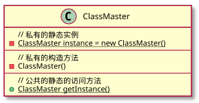
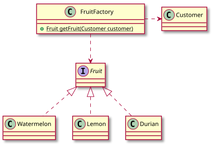
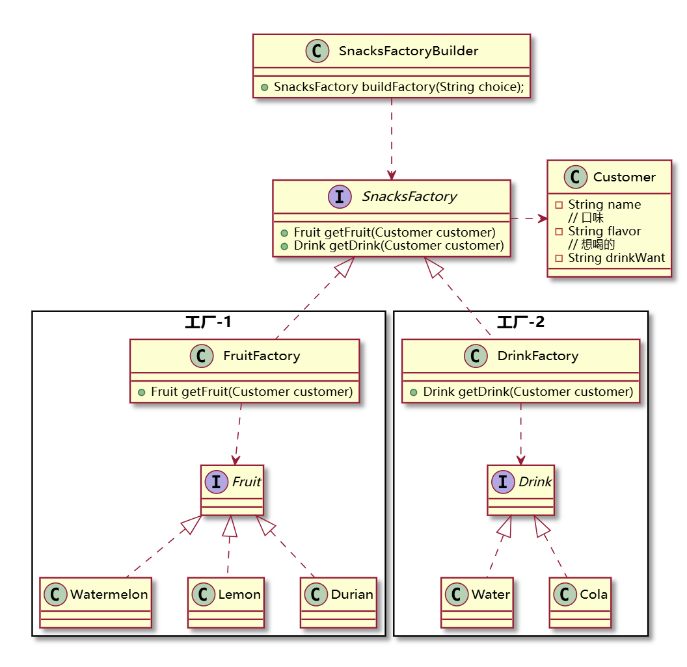
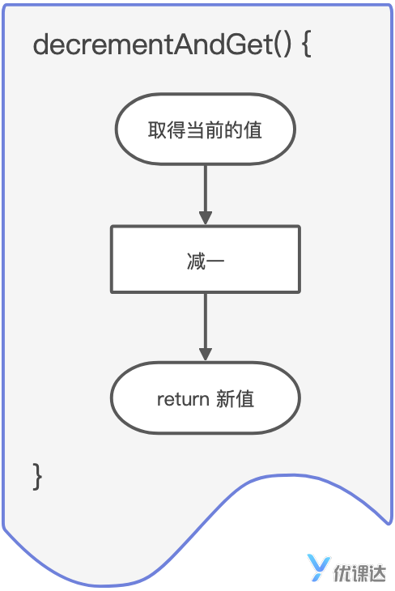

简介

Java 8 是 Java 语言发展史上的一个重要里程碑，更新了许多新特性，包括 **Lambda**、**流**和**函数式编程**等等。这些特性可以使代码更简洁、易阅读、易维护。

Lambda  表达式：
基本结构

f ->{ }

f为参数变量，`->`为语法符号，{}语句块

f变量的类型哟与系统根据上下文自动识别的

Lambda表达式要配合上下文，跟其他方法配合使用，而不是一个独立的语句

多参数时，必须使用小括号包裹	(st1,st2)->{}

无参数时，也需要用小括号包裹	()->{}

如果执行语句只有一条时，可以不用大括号包裹，但建议加上大括号，使代码边界明确，可读性更强


如果Lambda表达式代码比较复杂，也可以在参数变量前加入指定类型，如：

```java
fruits.forEach((Fruit f) -> {
  System.out.println(f.getName());
});
```

此时即使只有一个参数，也需要用小括号包裹


Lambda表达式中也可以引用外部变量

引用规范：

1. 引用的 **局部变量** 不允许被修改

```java
String message;fruits.forEach(f -> {  message = "水果名称：";});   //修改了局部变量，会报错
```
即使使重新赋了相同的值

关键原理：变量捕获的“作用域覆盖”
Lambda表达式对外部变量的引用是**“捕获”（capture）行为，捕获的是变量的整个生命周期**，而非仅使用的那一刻。因此，即使Lambda已经执行完毕，只要变量在Lambda中被引用过，后续任何修改（包括Lambda使用后的赋值）都会被编译器视为“破坏不可变性”，从而报错。
而对于一个对象，其引用对象不可变，但对象的属性可变

2. Lambda表达式参数不能与局部变量同名


双冒号操作符(::)

静态方法

```java
names.forEach(n -> {
  System.out.println(n);
});
names.forEach(System.out::println);//等价写法
```

System.out 类名(调用静态方法)或者实例对象变量名(非静态方法)		println方法名，不需要加小括号传入参数

实例方法

```java
LambdaTest lt = new LambdaTest();
fruits.forEach(lt::print);
```

```java
fruits.forEach(new LambdaTest()::print);
```

多参数

```java
Collections.sort(students, (student1, student2) -> {
  // 第一个参数的学号 vs 第二个参数的学号
  return student1.getRollNo() - student2.getRollNo();
});
```

如果把比较过程定义成一个方法

```java
private static int compute(Student s1, Student s2) {
  ... ...
  ... ...
}
```

那么Lambda就可以简化为：

```java
Collections.sort(students, SortTest::compute);
```

父类方法

::语法也可以用super关键字调用父类的非静态方法

如：

```java
import java.util.Arrays;
import java.util.List;

public class LambdaTest extends LambdaExample {
  public static void main(String[] args) {
    List<Fruit> fruits = Arrays.asList(
            new Fruit("香蕉"),
            new Fruit("苹果"),
            new Fruit("梨子"),
            new Fruit("西瓜"),
            new Fruit("荔枝")
    );

    LambdaTest at = new LambdaTest();
    at.print(fruits);
  }

  public void print(List<Fruit> fruits){
    fruits.forEach(super::print);
    }
}

class LambdaExample {
    public void print(Fruit f){
        System.out.println(f.getName());
    }
}
```


Java 8 的新特性：`Stream`(流)

在 Java 中，`Stream` 是一个接口（`interface`）

创建流：

1. 直接创建

   ```java
   import java.util.stream.Stream;

   Stream<String> stream = Stream.of("苹果", "哈密瓜", "香蕉", "西瓜", "火龙果");
   ```


2. 由数组转化

  ```java
  String[] fruitArray = new String[] {"苹果", "哈密瓜", "香蕉", "西瓜", "火龙果"};
  Stream<String> stream = Stream.of(fruitArray);
  ```


3. 由集合转化
  ```java
  List<String> fruits = new ArrayList<>();
  fruits.add("苹果");
  fruits.add("哈密瓜");
  fruits.add("香蕉");
  fruits.add("西瓜");
  fruits.add("火龙果");
  Stream<String> stream = fruits.stream();
  ```


> 无论是哪种方式创建，一定要清楚的知道：由于源数据（集合或数组）的数据是有序的，所以流中的元素也是有序排队的。

迭代流

在上一章中，我们知道集合类提供了 `forEach()` 方法可以遍历集合中的元素。很巧的是，`Stream` 提供的迭代方法也叫做 `forEach()`。

注意  集合类的 `forEach()` 方法与流的 `forEach()` 方法无关，仅仅是方法名相同而已。不要混淆哦。


流数据过滤

filter()方法

```java
List<Pupil> pupils = new ArrayList<>();
// 这里假设小学生数据对象已经存入了

pupils.stream()
    .filter(pupil -> pupil.getAverageScore() >= 80 && pupil.getViolationCount() < 1)
    .forEach(pupil -> {System.out.println(pupil.getName());});
```

其方法参数是一个Lambda表达式，箭头后的使条件语句，判断数据需要符合的条件

> 注意：这里的 Lambda 表达式略有不同。
>
> > 箭头后的过滤条件语句（非可执行的语句）。传统代码中，条件语句写在 () 中的，所以新特性条件语句可以用 () 而不能用 {} 哦。
> >
> > > 等同于 pupil -> ((pupil.getAverageScore() >= 80) && (pupil.getViolationCount() < 1))

map()映射方法

方法参数是一个Lambda表达式，语句块中对每一个数据对象进行计算处理，最后return处理后的对象来替代原数据

#### 特例写法

少数情况下，如果替换语句简单、系统能自动识别需要返回的值，代码可以简写为：

```java
.map(num -> num * num)
```

初学者还是推荐写完整的

```java
.map(num -> {
  ... ...
  return ... ...;
})
```


流数据排序

不用Stream API 的Lambda优化

```java
List<Student> students = new ArrayList<Student>();
students.add(new Student(111, "bbbb", "london"));
students.add(new Student(131, "aaaa", "nyc"));
students.add(new Student(121, "cccc", "jaipur"));

// 实现升序排序
Collections.sort(students, (student1, student2) -> {
  // 第一个参数的学号 > 第二个参数的学号
  return student1.getRollNo() - student2.getRollNo();
});

students.forEach(s -> System.out.println(s));
```

Stream API：

```java
students.stream()
    // 实现升序排序
    .sorted((student1, student2) -> {
        return student1.getRollNo() - student2.getRollNo();
    })
    .forEach(System.out::println);
```

*student1* 指代后一个元素，*student2* 指代前一个元素。不要被变量名迷惑了哦。

#### 特例写法

少数情况下，如果排序计算语句简单、系统能自动识别需要返回的值，代码可以简写为：

```java
.sorted((student1, student2) -> student1.getRollNo() - student2.getRollNo())
```

初学者还是推荐写完整的

```java
.sorted((... , ...) -> {
  ... ...
  return ... ...;
})
```

返回 **非正数** 表示两个相比较的元素需要 **交换位置** ，返回正数则不需要。

limit()摘取接口


使用 `Stream API`，系统会自动完成很多操作，加上大幅度简化了语法，开发者的注意力重点就变为捋清楚数据计算的步骤，不用太关心变量类型、变量赋值、对象转换等。编程的重点更加清晰。

Stream 的这种变化，特征是：函数式风格。即弱化了面向对象的严格、完整的语法，重心变为通过函数完成数据计算。


流合并

普通的使用 `for` 循环完成计算的代码实现是：

```
int sum = 0;
for (int i : numbers) {
    sum += i;
}

System.out.println("sum : " + sum);
```

而使用 *Stream API* 完成计算的代码实现是：

```
import java.util.Arrays;

int sum = numbers.stream()
    .reduce((a, b) -> a + b)
    .get();

System.out.println("1-10求和 : " + sum);
```

`reduce()` 方法的作用，是合并了所有的元素，**\*终止*** 计算出一个结果。注意这里终止的意思，就是流已经到达终点结束了，不能再继续流动了。

> 实际上，上一章中的 `forEach()` 也是流的终点哦。

`reduce()` 方法的返回值是一个比较复杂的对象，需要调用 `get()` 方法返回最终的整数值。

> 同理，`get()` 方法返回值的类型，也是系统自动根据流中元素类型推定的。

`reduce()` 方法的第一个参数（本例的 `a`）有多重作用，并且系统是自动完成参数赋值的，所以仍然体现了 `Stream` 编程的重点仍然是**\*计算***（本例的 `a + b`）。

可以用map()获取操作对象要处理的数据，但其实reduce也可以直接操作对象，但是会把操作的数据都传给a

```java
Student result = students.stream()
    .reduce(
        (a, b) -> {
            a.setMidtermScore(a.getMidtermScore() + b.getMidtermScore());
            return a;
        }
    )
    .get();

System.out.println(result.getName() + " - " + result.getMidtermScore());
```

解决办法就是new一个新的对象用来充当缓冲角色，而不是流中的原始对象

```java
Student result = students.stream()
    .reduce(new Student("", 0),
        (a, b) -> {
            a.setMidtermScore(a.getMidtermScore() + b.getMidtermScore());
            return a;
        }
    );

System.out.println(result.getName() + " - " + result.getMidtermScore());
```

此时reduce的参数为两个


流收集

```java
List<String> numResult = numbers.stream()
    .sorted((n1, n2) -> n2 - n1)
    .limit(3)
    .map(a -> "" + a)
    .collect(Collectors.toList());

String string = String.join("-", numResult);
System.out.println("字符串是: " + string);
```

`collect()` 方法的作用就是收集元素，但元素收集存放到哪去呢？`Collectors.toList()` 是一个静态方法，作为参数告诉 `collect()` 方法存入一个 `List` 集合。所以 `collect()` 方法的返回值类型就是 `List`。

> `java.util.stream.Collectors` 是流工具包中提供的收集器。

为了能够把最终结果转换为字符串打印，调用了 `map()` 方法把流中原来的整数映射为字符串（`"" + a`），所以 `collect()` 方法的返回值类型就是 `List<String>`，而不是 `List<Integer>`


*管道*的显著特点是，每个节点是依次执行的，下一个节点必须等待上一个节点执行完毕。这种执行方式，通常叫作 **串行**。

如果计算过程越来越复杂、数据量越来越大，**串行**工作模式性能会越来越低。

**串行**工作模式的性能很难被优化。因为这种模式无法发挥 **多核 CPU** 的优势。

为了充分发挥 **\*多核*** **\*CPU*** 的优势，可以把 **串行** 计算模式，改为 **并行** 计算模式。

当然，**并行** 计算模式不能简单的把一个队伍变成三五个队伍。

所谓**并行**，就是利用多线程，变成同时执行。多线程可以充分发掘多核 **CPU** 的优势。


排序1，2，3，4，5时，如果使用并行处理，数字输出的顺序不是期望中的 `1 2 3 4 5`，而是无序的，而且多运行几次，顺序都可能不一样。

这是因为并行计算使用了多线程，每个线程独立输出数字，而线程的输出时机，是由 *CPU* 动态决定的，无法确定。

所以，逻辑上要求数字必须按书写的前后顺序（数字之间有逻辑顺序）输出时，就不能使用并行计算。

实际上，**并行** 计算模式的性能 **\*不是*** 任何情况下都优于 **串行** 计算模式。原因可能为硬件太差或者任务简单


一般来说，任务执行超过一小时的情况下，考虑使用 **并行** 模式优化性能。

任务执行时间较短，又没有特别要求，使用 **串行** 模式也问题不大。

对任务有实时性要求，希望立即得到计算结果，最好是比较一下两种模式，比如各运行 100 次比较使用哪种模式最好。


设计模式（Design Pattern）


单例模式

实现唯一效果，实现办法：

把构造器私有，静态私有化自己的实例(必须要静态，不然会陷入死递归的错误)，使用get去访问唯一的单例



## spring中的单例

不仅是功能逻辑要求只有一个实例，有时从技术角度出发为了节省系统资源的时候，也会用到单例模式。

在《Spring Web全栈》课程我们已经学习过，类变量使用 `@Autowired` 注解，能够实现**自动**注入实例对象。

实际上，任何**自动**注入实例对象，默认只有一个实例对象，是单例的。例如：可能多个 `Service` 和 `Control` 等都需要用到用户服务，那么这些类中都会定义：

```
@Autowired
private UsersService usersService;
```

**Spring** 会保证只生成一个 `UsersServiceImpl` 实例，注入到多个 `Service` 或 `Control` 中，不会为每个 `Service` 或 `Control` 分别 `new` 出多个 `UsersServiceImpl` 实现类的实例。

虽然我们写 `Service` 服务的时候没有像写 `ClassMaster` 代码一样使用私有的构造方法，但 **Spring** 也应用了 **单例** 的 **思想** 来减少不必要的消耗。


简单工厂模式

> 所谓耦合，指的是某个类的代码，包含了其他类的逻辑细节。包含的越多，耦合越紧密，也越容易相互影响。甜水果需要由西瓜改为凤梨时，影响了所有的水果店，就是耦合紧密、耦合度高

实现简单工厂，需要两个步骤：

1. 从具体的产品类抽象出接口。记住 *Java* 强调面向接口编程。意味着工厂应该生产 **一种** 产品，不应该生产某 **一个** 产品。
2. 把生产实例对象的过程，收拢到工厂类中实现。




一般来说，工厂类命名为 `XXXXFactory`，以 `Factory` 作为后缀可以提高辨识度，易于理解这个类的作用。

工厂类中的方法，依据实际情况而定，并没有特别的约定。方法名、输入参数、返回值，都是要根据实际需求确定的。

> 方法名是自由命名的。大家如果没有特别好的创意，建议选用 `get`、`create`、`make` 或 `build` 作为前缀


抽象工厂模式

对于 **一批**、**多种类型** 的对象需要创建的场景，使用抽象工厂模式会更好

简单工厂的主要把多个产品抽象，使用一个工厂统一创建；那么抽象工厂的主要作用是把 *多个工厂* 也进一步 *抽象*。



### 1. 工厂接口

工厂接口（`SnacksFactory`）即规定工厂应该提供什么样的产品，所以包含了所有工厂的方法：

```java
public interface SnacksFactory {
    // 取得水果
    public Fruit getFruit(Customer customer);
    // 取得饮料
    public Drink getDrink(Customer customer);
}
```

但有一个问题，水果工厂是不提供饮料的，但水果工厂实现工厂接口后，又必须实现 `getDrink()` 方法，这时候直接返回 `null` 即可。

### 2. 工厂的工厂

`SnacksFactoryBuilder` 称之为 **生产工厂的工厂** ，工厂用来生成产品实例，`SnacksFactoryBuilder` 用来生成工厂实例。

```java
public class SnacksFactoryBuilder {
    public SnacksFactory buildFactory(String choice) {
        if (choice.equalsIgnoreCase("fruit")) {
            return new FruitFactory();
        } else if (choice.equalsIgnoreCase("drink")) {
            return new DrinkFactory();
        }
        return null;
    }
}
```

那么能不能弄一个 **生产工厂的工厂的工厂** 呢？答案是否定的。太过复杂的代码不易维护，不如用两套抽象工厂了。

扩展知识点

注意，与简单工厂不同的是：

`SnacksFactoryBuilder` 的 `buildFactory()` 方法并不是 `static` 的。

因为复杂场景下尽量不要使用类（static）方法，实例方法可以被继承，扩展性较好，应该优先使用实例方法。


工厂模式结合Spring工程

课程内容中不提倡在**工厂**中定义 `static` 方法的另一个原因是：

在使用 `Spring` 框架的时候，可以为 `SnacksFactoryBuilder` 加上 `@Component` 注解，可以让框架管理实例：

```
@Component
public class SnacksFactoryBuilder {
    public SnacksFactory buildFactory(String choice) {

    }
}
```

> 简单工厂模式的工厂类也可以像这样去掉 static、加注解

相应的，**任何**需要使用工厂的地方，只需要使用 `@Autowired` 注解让框架自动注入实例即可，非常方便：

```java
@Service
public class XxxxxServiceImpl implements XxxxxService {

    @Autowired
    private SnacksFactoryBuilder snacksFactoryBuilder;
}
```

这样可以让工厂模式的代码与 `Spring` 互为一体，扩展性更好、易于维护。


观察者模式

核心是知道要观察什么，什么对象发生变化了需要发出通知

`Observable` 类是 Java 提供的，继承了就表示是核心的、需要被观察的类。

> 记住这个写法：extends Observable

监听

```java
public class WeatherData extends Observable {
    /**
     * 一个城市的气温在某个时刻发生了变化
     */
    public void changeTemp(String time, String temp) {
        if(time == null || temp == null) {
            // 输入数据为空是有问题的，不处理
            return;
        }

        // 与原数据不同，说明发生了变化
        if(!time.equals(this.time) || !temp.equals(this.temp)) {
            // 标记变化
            super.setChanged();
            this.time = time;
            this.temp = temp;
            // 发出通知，参数是额外的信息
            super.notifyObservers("温度变化已通知");
        }
    }
}
```

父类 `Observable` 提供的方法 `setChanged()` 就是标记被观察者对象发送了变化。

父类 `Observable` 提供的方法 `notifyObservers()` 就是发出通知；如果需要发送额外（不在被观察者对象里的）的信息，在参数中传入信息对象，可以是 **任意对象** ，需要自己根据具体的需求场景而定。

本例子只是简单演示发送了一个字符串消息"温度变化已通知"，千万不要以为只能发送字符串哦

> 如果不想发送额外信息，可以写为 super.notifyObservers(null)

观察者需要实现 `Observer` 接口，也是 Java 提供的，实现此接口表示作为观察者。

```
import java.util.Observable;
import java.util.Observer;

public class WeatherObserver implements Observer {
    private String name;

    @Override
    public void update(Observable o, Object arg) {
        System.out.print(this.name + "观察到天气变化为：");
        System.out.print(o.toString());
        System.out.println(" " + arg);
    }

    public String getName() {
        return name;
    }

    public void setName(String name) {
        this.name = name;
    }
}
```

作为观察者，实现 `Observer` 接口后，要自己实现 `update()` 方法，方法签名是接口中定义好的，属于固定写法。

- 第一个参数就是被观察者对象，被观察者对象都需要继承自 Observable
- 第二个参数就是额外的信息，具体说就是调用 `super.notifyObservers()` 是传入的参数对象；传入什么对象，arg 的值就是什么对象

观察者可以有多个。观察者对象与被观察者对象谁先 `new` 出来都可以，但是必须先调用 `addObserver()` 方法把观察者对象实例添加到被观察者（天气数据）实例中，然后再调用自定义的 `changeTemp()` 方法变更天气，才能触发自动通知。

跟工厂模式不同的是，观察者模式主要描述的是类的行为，而不是如何创建。

跟工厂模式的思想相同的是，观察者模式让 **观察者** 和 **被观察者** 双方的 **\*耦合度*** 降到最低（称之为 **\*解耦***）。

观察者不需要知道数据变化后需要通知给谁，发出通知即可；而且不需要知道谁收到通知了谁没收到，由系统保证。

观察者模式让工程师专注于业务逻辑的实现，在具体的业务场景中，让观察者双方的实例产生联系，对类来说，是没有耦合的；系统完成的通知过程，是与具体业务需求无关的。


实现：

1. 线程类

   可以继承Java的Thread类实现

   继承Thread类之后需要重写父类的run()方法，注意必须是修饰为public void (加上@Override注解)

   ```java
   public class Person extends Thread {
       @Override
       public void run() {
           try {
               System.out.println(getName() + " 开始取钱");
               Thread.sleep(200);
           } catch (InterruptedException e) {
               e.printStackTrace();
           }
           System.out.println(getName() + " 取钱完毕");
       }
   }
   ```

2. 运行线程

   线程start() 方法才能启动

   `Thread` 父类中有 `name` 属性，但是 `private` 的，所以可以调用 `setName()` 方法为线程设置名字，通过 `getName()` 就知道是哪个线程在运行。

   我们需要了解的是，线程类的 `run()` 方法是系统调用 `start()` 后自动执行的，编程时不需要调用 `run()` 方法。但永远无法知道系统在什么时刻调用，是立即调用，还是延迟一小段时间调用，都由系统自动决定，无法干预。

   ```java
   public class Bank {
       public static void main(String[] args) {
           Person thread1 = new Person();
           thread1.setName("张三");

           Person thread2 = new Person();
           thread2.setName("李四");

           thread1.start();
           thread2.start();
       }
   }
   ```


实现 Runnable 接口

继承 Thread 类定义多线程程序后，缺点就比较明显了，无法再继承其它类，因为 Java 是单继承的，只允许继承一个类，这会导致程序的可扩展性大大降低。

所以定义多线程程序，**优先**采用第二种方式：实现 `java.lang.Runnable` 接口。

```java
public class Person implements Runnable {
    private String name;

    public String getName() {
        return name;
    }

    public void setName(String name) {
        this.name = name;
    }

    @Override
    public void run() {
        try {
            System.out.println(name + " 开始取钱");
            Thread.sleep(200);
        } catch (InterruptedException e) {
            e.printStackTrace();
        }
        System.out.println(name + " 取钱完毕");
    }
}
```

`Runnable` 接口中只有一个待实现的 `run()` 方法，要自己补充属性了。

无论是 `Thread` 类还是 `Runnable` 接口，`run()` 方法都是系统 **\*适时*** **\*自动*** 执行的，大家只是在方法体内实现业务功能即可。

> Thread.sleep()这个静态方法仍然可以用，记得参数是毫秒数哦。

```java
public class Bank {
    public static void main(String[] args) {
        Person person1 = new Person();
        person1.setName("张三");
        Thread thread1 = new Thread(person1);

        Person person2 = new Person();
        person2.setName("李四");
        Thread thread2 = new Thread(person2);

        thread1.start();
        thread2.start();
    }
}
```


Thread.CurrentThread()  返回当前正在运行的线程的实例对象

线程安全

线程调用的时机时很复杂的，可以同时执行，特别是多核CPU的情况下，索格线程同时执行(并行)的概率很高

多个线程运行同一个实例对象的情况下，修改了同一个变量，后果会很严重，此时发生冲突的现象叫做线程不安全


在Java中可以用synchronized关键字来解决线程不安全问题，synchronized加载在方法上，紧跟着public (不能用于变量哦)

```java
public class Ticket {
    public synchronized void sell() {
        count--;
        System.out.println(Thread.currentThread().getName() + "：卖出一张，还剩下 " + count + " 张票");
    }
}
```

`synchronized` 也叫线程 **\*同步锁*** ，表示此方法是*锁定*的，同一时刻只能由一个线程执行此方法。

`synchronized` 相当于保护了关键方法，不允许同时执行，必须一个个执行。

> 一个个执行不是按照编码的顺序执行。由系统自动决定在解锁后由哪个线程执行方法，也是很复杂的。这种多个线程等待的过程也叫作竞争。


使用场景

 `synchronized` 关键字解决了车票余量错乱、以及余量可能相同的问题。从抽象概念上来说，使用 `synchronized` 的方法意味着满足了两个线程安全的特性：

1. **原子性**：方法全部执行并且执行的过程不会被任何因素打断。
2. **可见性**：当多个线程访问同一个变量时，一个线程修改了这个变量的值，其他线程能够立即看得到修改的值。

但是 `synchronized` 为了实现这两个特性，也是要付出代价是的：性能可能不高。因为方法加锁，同时只有一个线程竞争成功能继续执行，其它很多线程是持续等待、响应慢的。所以 `synchronized` 不能滥用，比较适合的场景是：

1. 写操作的场景。例如用户修改个人信息、点赞、收藏、下单等。
2. 尽量精确锁住最小的代码块，把最关键的写操作抽象成独立的方法加锁。不建议给大段的方法加锁。


`synchronized` 可能由于线程等待导致性能问题。那我们尝试换一种**思路**。

`java.util.concurrent` 是 Java 系统提供的并发编程包，尝试使用 `java.util.concurrent.atomic.AtomicInteger` 让车票余量能够安全的递减。

`AtomicInteger` 虽然是一个类，但等同于一个整数（就像 Integer 是 int 的对象）。调用 `new AtomicInteger()` 构造函数实例化对象的时候，可以指定任意的整数值。

> new AtomicInteger(30) 意思是设定实例的整数值为 30

不同的是，`AtomicInteger` 提供了不使用 `synchronized` 就能保证数据操作原子性的方法。




线程间都是基于**最新的**结果进行减一的运算，所以不会重复，这样是 **可见性** 的体现。

> `count.decrementAndGet()` 代替了使用 `synchronized` 时，整数 `count--`

`incrementAndGet()` 也是不使用 `synchronized` 就能保证数据操作原子性的方法


AtomicInteger 特点

从 [Java 官方文档](https://docs.oracle.com/javase/7/docs/api/java/util/concurrent/atomic/AtomicInteger.html#incrementAndGet()) 可以看到 `incrementAndGet()` 和 `decrementAndGet()` 都没有加 `synchronized` 关键字：

这就意味着，递增、递减等方法虽然也是多个步骤，但多线程场景下，其它线程不会等待。只是在 **\*数据变化*** 的时候，会 **\*判断*** 一下是否有 **\*其它*** 线程 **\*修改*** 了数据，如果有就根据最新的值进行修改。


乐观锁其实是不上锁，总是保证基于最新的数据进行更新。由于没有上锁，就提高了性能。不上锁的思想是乐观的，所以称之为乐观锁。`AtomicInteger` 类的 `incrementAndGet()` 和 `decrementAndGet()` 方法就是典型的乐观锁实现。

相对的，`synchronized` 关键字是把整个方法执行前就上锁，**\*假设*** 其他线程 **\*一定会修改*** 数据，所以提前防范。上锁的思想是悲观的，所以称之为悲观锁。

> 乐观锁和悲观锁是面试过程中出现概率很高的知识点哦。

乐观锁

不适用于多条数据需要修改、以及多个操作的整体顺序要求很严格的场景，乐观锁适用于读数据比重更大的应用场景；反之，

悲观锁

适合写数据比重更大的应用场景。一般来说写数据的整体消耗时间更长些，是可以接受的。


CompletableFuture 是一个异步任务编排、调度框架，以更优雅的方式实现组合式异步编程。

*Java* **最基本**的多线程编程，当然也是 `CompletableFuture` 的基础。但**基本**的多线程编程不利于任务的管理（包括编排、调度等），在 **Java8** 时代，使用新的 `CompletableFuture` 技术就可以让多线程并发编程更优雅。

在方法调用的时候（就是所谓任务），需要等待返回取得返回值是同步，不等待而继续执行程序代码就是异步。采用异步方式，能够支持多个任务并行执行，这种机制称为并发。


```java
import java.util.concurrent.atomic.AtomicInteger;

public class Register {
  private static AtomicInteger count = new AtomicInteger(0);

  // 注册学号
  public Student regId(Student student) {
    student.setId(count.incrementAndGet());
    return student;
  }
}
```

```java
import java.util.ArrayList;
import java.util.List;
import java.util.concurrent.CompletableFuture;

public class StudentIDTest {
  public static void main(String[] args) {
    // 构建学生集合
    List<Student> studentList = new ArrayList<>();
    for (int i = 1; i <= 10; i++) {
      Student s = new Student();
      s.setName("学生" + i);
      studentList.add(s);
    }

    Register reg = new Register();

    studentList.forEach(s -> {
      CompletableFuture.supplyAsync(
          // 每个学生都注册学号
          () -> reg.regId(s)
        )
        // 学号注册完毕后，打印欢迎消息
        .thenAccept(student -> {
          System.out.println("你好 " + student.getName() + ", 欢迎来到春蕾中学大家庭");
        });
    });

    System.out.println("mission complate");
  }
}
```

`CompletableFuture.supplyAsync()` 方法运行一个异步任务并且返回结果，所以 `regId()` 方法必须有返回值。

`Register` 虽然没有实现 `Runnable` 接口，但系统会自动优化：把作为 `supplyAsync()` 方法参数的整个 `() -> reg.regId(s)` 表达式语句包装在另一个对象中；这个对象也是 JDK 内置的，它实现了 `Runnable` 接口，在这个对象中执行表达式语句。

所以实际上，`supplyAsync()` 方法的作用是：在一个单独的线程中执行 `reg.regId(s)` 语句，本质上就是多线程编程。

在注册完毕以后，使用 `thenAccept()` 方法完成后继的任务步骤。`thenAccept()` 方法的参数（`student`）就是前置任务的返回结果，系统会在前一个任务完成后，**自动**执行 `student -> {}` 后继任务。所以本质上，后继任务也是多线程方式执行的。`thenAccept()` 方法通常用于任务链的末尾。

一般情况下，不建议一个大任务的所有步骤都集中在 `supplyAsync()` 里实现，分步骤更好

CompletableFuture vs Stream

它们其实都使用了多线程并发编程，都可以称为并发容器。**不同**的是：`Stream parallelStream()` 侧重点是流的元素的计算操作；而 `CompletableFuture` 的任务可以比较宽泛。

`supplyAsync()` 用于**开头**，`thenAccept()` 用于**末尾**，各自调用一次即可。中间有多个步骤，可以调用多次 `thenApply()` 。由于末尾也要用到 `student` 实例对象，所以位于中间的 `thenApply()` 方法，总是要 `return` 学生实例对象，否则下一个步骤就获取不到了。


拓展：

`supplyAsync()` 是静态方法，返回值是 `CompletableFuture` 实例对象，再调用 `thenApply()` 或 `thenAccept()` 实例方法，返回的也是 `CompletableFuture` 实例对象。

所以，虽然整条语句是连写的，其实也可以定义返回值。

```java
CompletableFuture<Void> cf = CompletableFuture.supplyAsync(() -> reg.regId(s))
  .thenApply(student -> {
    return dis.assignClasses(student);
  })
  .thenAccept(student -> {
     System.out.println("姓名：" + student.getName() + "，学号：" + student.getId() + "，班级号：" + student.getClassId());
  });
```

返回的是仍然是 `CompletableFuture` 实例对象，所以定义变量的类型就是 `CompletableFuture` 。但可以用泛型 `CompletableFuture<>` 表示其中包含的数据具体是什么类型。

因为本案例末尾调用了 `thenAccept()`，其 *Lambda* 表达式没有 `return` 语句，表示 `CompletableFuture` 实例对象**\*不包含***数据，所以泛型写为 `CompletableFuture<Void>`。

*Void* 的完整写法是 `java.lang.Void`，是 *void* 关键字的包装类。表示没有类型，等同于 null

```java
CompletableFuture<Student> cf = CompletableFuture.supplyAsync(() -> reg.regId(s))
  .thenApply(student -> {
    return dis.assignClasses(student);
  });
```

如果没有调用 `thenAccept()` 方法，以 `thenApply()` 或 `supplyAsync()` 结尾的话，因为 `thenApply()` 的 *Lambda* 表达式返回的是 `Student` 对象，所以 `CompletableFuture` 实例对象包含的是 `Student` 数据，于是泛型写为 `CompletableFuture<Student>`


拓展：Main（）方法问题

目前我们的程序，都是通过 `main()` 方法执行的。如果学生人数较多，例如 *2000* 个，所有注册线程的运行就没有那么快完毕了。

问题是，可能线程任务还没执行完毕，`main()` 方法就执行完毕，导致程序运行结束退出了。

**看到这里，大家可以在自己电脑上运行程序，执行 2000 个甚至一万个学生注册。观察出现的现象。**

要解决这个问题，返回值就有用了。我们先把每个学生的入学任务实例对象（`CompletableFuture<Void>`），收集起来（装入集合），然后等待所有的线程执行完毕。

```java
List<CompletableFuture> cfs = new ArrayList<>();
studentList.forEach(s -> {
  CompletableFuture<Void> cf = CompletableFuture.supplyAsync(() -> reg.regId(s))
    .thenApply(student -> {
        return dis.assignClasses(student);
    }).thenAccept(student -> {
        System.out.println("姓名：" + student.getName() + "，学号：" + student.getId() + "，班级号：" + student.getClassId());
    });

  cfs.add(cf);
});

try {
  // 等待所有的线程执行完毕
  CompletableFuture.allOf(cfs.toArray(new CompletableFuture[] {})).get();
} catch (Exception e) {
  e.printStackTrace();
}
```

`CompletableFuture.allOf()` 是静态方法，的作用就是收集所有的任务实例对象。因为 `allOf()` 方法只支持数组不支持集合，所以需要把集合转换成数组（`cfs.toArray(new CompletableFuture[] {})`）。当然，你可以一开始就定义数组来收集任务实例对象，因为学生的个数可以通过 `studentList.size()` 取得。`allOf()` 方法的返回值也是 `CompletableFuture` 实例对象。

再调用类方法 `get()`，其作用就是等待所有的任务线程（`allOf()` 收集的）都执行完毕，再继续执行（本案例 `main()` 方法后面没代码了，就退出程序）。

**\*需要强调的是***：

在 *SpringBoot* 等服务端运行 `supplyAsync()` 异步任务编排的时候，就没有必要可以使用 `get()` 方法等待所有线程任务执行完毕了。因为服务端往往是常驻程序，不像 `main()` 方法执行完毕就退出程序了。


`java.util.concurrent.atomic.AtomicBoolean` 能够以原子的方式操作布尔值，用get()，调用compareAndSet()方法，就能以原子方式修改值

`compareAndSet()` 方法返回值表示**修改操作**成功或失败，跟方法参数值无关。要传入两个参数，前者表示目标修改当前，后者表示后，修改成功返回true


对象除了创建需要消耗计算机CPU，内存等资源，对象还会被销毁也消耗内存(系统自动)，而对于访问数据量巨大的网站，如果这样消耗将是个大问题

因此，复用Thread对象，而不是每次都创建新的的对象则成了可优化的重点

Java的线程池技术就是用来解决这个问题的

`new Thread(register)` 意味着一个线程对象只能执行一个任务，而线程池让线程与任务分离，不再紧密绑定。

受限于CPU，内存等，线程池不是无穷大的，因此同时运行的任务是有限的，其他过剩的任务就需要排队

创建线程池的核心代码：

```java
private static final ThreadFactory namedThreadFactory = new BasicThreadFactory.Builder()
    .namingPattern("studentReg-pool-%d")
    .daemon(true)
    .build();

private static final BlockingQueue<Runnable> workQueue = new LinkedBlockingQueue<Runnable>(1024);

private static final ThreadPoolExecutor EXECUTOR_SERVICE = new ThreadPoolEcutor(
20,
200,
30,
TimeUnit.SECONDS,
workQueue,
namedThreadFactory,
new ThreadPoolExecutor.AbortPolicy()
);

public static void main(String[] args){ ... }
```
依赖库
```xml
<dependency>
  <groupId>org.apache.commons</groupId>
  <artifactId>commons-lang3</artifactId>
  <version>3.10</version>
</dependency>
```

**\*创建线程池的代码，基本上属于固定写法***，有不懂的类和方法，也没关系，**\*不要太纠结***。


步骤分析：

1. 创建工厂实例

   ```java
   new BasicThreadFactory.Builder()
     .namingPattern("studentReg-pool-%d")
     .daemon(true)
     .build();
   ```

   namingPattern()方法是定义县城名字的格式

   多说一点的是，Builder() 不是方法，是构造函数，BasicThreadFactory类中有一个内部类 Builder 。

   > new BasicThreadFactory.Builder() 创建了内部类的实例对象。

2. 创建线程等待队列实例

   如果机器性能好，CPU 核数多（6、8核）、内存大，队列可以大一些：`new LinkedBlockingQueue<Runnable>(2048)`。构造函数的参数表示能排队的任务个数。一般来说参数1024算比较适中

3. 创建线程池实例

   ThreadPoolExecutor构造函数参数比较多

   ```java
   new ThreadPoolExecutor(
   20,
   200,
   30,
   TimeUnit.SECONDS,
   workQueue,
   namedThreadFactory,
   new ThreadPoolExecutor.AbortPolicy()
         );
   ```

   | 参数序号 | 解释                                                         |
   | -------- | ------------------------------------------------------------ |
   | 1        | 线程池初始化核心线程数量，一般是两位数，通常不大             |
   | 2        | 线程池最大线程数，计算机性能强就大一些，否则小一些，通常不超过 200 |
   | 3        | 线程池中的线程数超过核心线程数时，如果一段时间后还没有任务指派，就回收了。想立即回收就填 0，一般 30 |
   | 4        | 第三个参数的时间单位。30 + TimeUnit.SECONDS 表示 30 秒       |
   | 5        | 等待队列实例，已经创建过了                                   |
   | 6        | 线程工厂实例，已经创建过了                                   |
   | 7        | 任务太多，超过队列的容量时，用什么样的策略处理。一般用 AbortPolicy 表示拒绝，让主程序自己处理 |

   多线程编程特别需要注意的问题是防止线程过多把系统搞崩溃

   实际编程工作中，要想办法保证不要创建太多任务，要有所控制，比如可采用分页的思想，分批处理


```java
public class StudentIDTest {
  public static void main(String[] args) {
    // 构建学生集合
    for (int i = 1; i <= 2000; i++) {
Student s = new Student();
s.setName("学生" + i);
Register register = new Register(s);
// 传入 Runnable 对象，运行任务
EXECUTOR_SERVICE.execute(register);
    }
  }
}
```

只要执行线程池对象的 `execute()` 方法，把实现了 `Runnable` 接口的实例对象传入即可。

使用mian()函数运行多线程程序，往往会遇到一个问题，main函数提前退出了为了让main不立即退出，可以用Thread.sleep(3000)等待一段时间(SpringBoot就没有这个问题)

实际上，`CompletableFuture` 内部也用到了线程池。

```java
CompletableFuture.supplyAsync(
    () -> reg.regId(s)
  )
```

实际上是把任务放入内部的**默认线程池**里执行的。

`CompletableFuture` 也可以指定线程池来运行任务：

```java
CompletableFuture.supplyAsync(
    () -> reg.regId(s),
    EXECUTOR_SERVICE
  )
```


Java系统的升级历程

基础多线程-> 线程池 -> 并发容器


