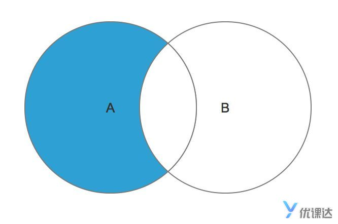
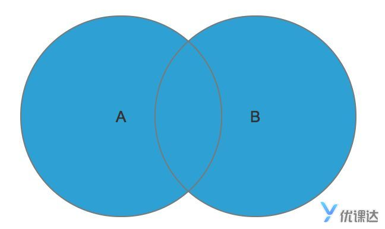
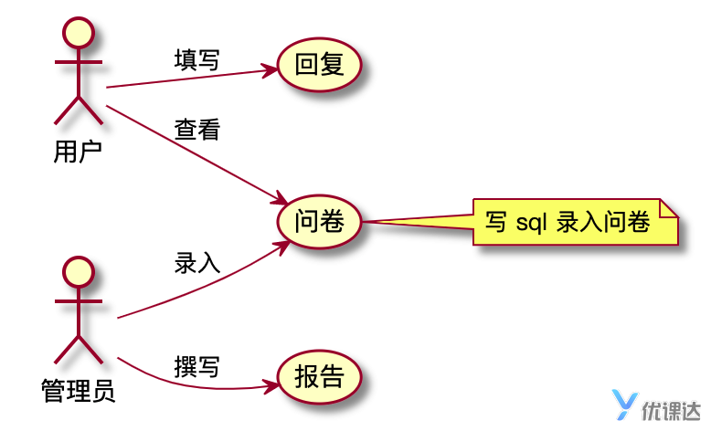

创建数据库

```
mysql -e 'CREATE DATABASE youkedadb;'
```

验证数据库

```
mysql -e 'show DATABASES;'
```

创建表格

设置主键时用的是\` \`而不是单引号或者双引号

记得在创建前先检验是否存在(按需要可以直接如果存在就删去操作)

```SQL
CREATE TABLE `user`(
`id` INT(10)NOT NULL ,
`mobile` VARCHAR(11) NOT NULL ,
`nickname` VARCHAR(40) NOT NULL ,
`gmt_created` datetime ,
`gmt_modified` datetime NOT NULL ,
PRIMARY KEY ( `id` )
)ENGINE=InnoDB DEFAULT CHARSET=utf8;
```
验证表格

```
mysql -Dyoukedadb -e 'desc `table`;'
```

查看数据

```
mysql -Dyoukedadb -e 'select * from timi_adc;'
```

删除表格

```SQL
drop table table_name
```

或者

```SQL
DROP TABLE IF EXISTS table_name;
```

IF EXISTS 的意思就是如果存在 因为删除表格是不可逆的，所以大家在删除表格时，务必慎重

主键自增

```SQL
`id` INT UNSIGNED AUTO_INCREMENT
```

在企业级开发中，往往会使用BIGINT作为主键，因为我们知道INT的值域只有2147483647这么大，也就是20亿多，有些公司用户数达到百万甚至千万，那么记录用户行为的数据，比如说支付宝账单，就很轻松会突破INT的值域，因此使用BIGINT会避免数据溢出的问题

```SQL
INSERT INTO table_name(field1,field2,...fieldN)
VALUES
(value1,value2,...valueN);
```

如果主键为自增，可以不插入主键和对应的数据

插入文本时不能用反引号

如果插入全字段，可以省略字段名，直接插入值，但是类型必须完全一致

批量插入

```sql
INSERT INTO table_name
VALUES
(value1,value2,...valueN),
(value1,value2,...valueN);
```

## 查询表中的数据

先提交作业， **通过** 后，即完成插入数据。

然后，点击左侧的“终端”菜单，打开终端操作界面。输入命令：

```
mysql -Dyoukedadb -e 'select * from timi_adc;'
```

即可查询表中的数据。`select` 是查询数据的语法，下一节就会学习，稍安勿躁。

> 注意：此命令的格式，SQL 语句必须包含在 **单引号** （`''`） 中，且 **不能换行**

## 备份数据

优课达服务器销毁后，MySQL 中所有的库、表、数据都会一起销毁；服务器重启后，就需要重新启动 MySQL 。

但后面的章节可能会继续使用前面章节的表和数据，为了解决数据丢失的问题，可以对数据做备份。

点击左侧的“终端”菜单，打开终端操作界面。输入以下备份命令：

```
mysqldump youkedadb > youkedadb.sql
```

即可把整个 *youkedadb* 数据库中的数据导出。然后执行

```
ls
```

命令，可以看到，除了 *index.sql* 文件外，多了一个 `youkedadb.sql` *备份文件* 。

此时可以执行本作业 **页面底部** 的三条命令，把 *youkedadb.sql* 文件提交并推送到 gitlab 仓库。

建议每完成一道作业，都备份一次。

切记，需要 **自己记住** **\*备份文件放在哪道题中*** ，以免需要恢复时找不到备份文件。

## 恢复数据

服务器重启后，先按照第一章的命令启动 MySQL 并创建好数据库。然后打开 **具有备份文件的作业** ，在“终端”中拉取作业工程。

执行 `cd xxxx` 切换到作业工程，执行 `ls` 命令看一下是否有 *youkedadb.sql* **备份文件** ，如果有，就可以执行下列命令恢复了：

> xxxx 就是具有备份文件的作业目录

```
mysql -Dyoukedadb<youkedadb.sql
```


SELECT查询语句

```sql
SELECT field1,field2,.... FROM table_name;
```

```sql
SELECT
  id,
  hero_name
FROM
  timi_adc;
```

```sql
SELECT * FROM timi_adc;
```


WHERE子句

```
SELECT * FROM table_name WHERE condition;
```

> condition 是指条件，它和if语句一样，可以做简单的逻辑判断，我们查询到的数据是true

判断等于用单等于号

终端运行sql文件

```shell
mysql -Dyoukedadb < index.sql;
```

mysql环境下

```bash
SOURCE index.sql
```


Limit 子句

```sql
SELECT * FROM table_name LIMIT parameter;
```

parameter是LIMIT的参数

eg：

5,6   从第六行(下标为5)开始，查6条数据

5     查询0-5行

4,1  只查询第5行


ORDER BY 子句排序

默认正序排序(对于int,float 从小到大，对于varchar是从A到Z,对于datetime而言是从过去到现在)

正序排列关键字为ASC     逆序排列关键字为DESC

SELECT * FROM timi_adc  ORDER BY win_rate DESC;


更新

```SQL
UPDATE 表名称 SET 列名称 = 新值 WHERE 列名称 = 某值
```

必须要加上WHERE 否则会对整列进行更新


删除

```sql
DELETE FROM table_name [WHERE Clause]
```

由于删除语句是不可恢复的，所以我们务必要增加WHERE语句，否则将会删除整张表格的数据

```sql
delete from `user` where id<20;
```

user两端也可以不加``

DELETE 语句只删除表中的数据，如果要删除表格，我们用之前学过的 DROP TABLE + 表名的语句


LIKE 模糊查询

```sql
SELECT * FROM table_name WHERE condition LIKE condition;
```

%表示任意字符，可以为空

如果没有使用任何%，LIKE就相当于=

_ 代替一个任意非空字符

AND和OR 去连接WHERE 限制条件

IN 和 NOT IN /NOT LIKE

```sql
SELECT * FROM table_name WHERE column IN (condtionA,condtionB);
```


当提供查询条件字段为NULL 时，该命令可能无法正常工作

为了处理NULL值，mysql提供了三种运算符：

IS NULL     运算符返回布尔值

IS NOT NULL   同上

<=>   比较操作符，当两个值都为NULL或者相等时，返回true

>不能用 `= NULL` 或者`!=NULL`来寻找NULL值， NULL=NULL会返回NULL


CONCAT函数

```sql
SELECT column_name1,CONCAT(column_name2,str,column_name3),column_name4 FROM table_name;
```

CONCAT函数可以拼接列名，也可以拼接字符串，参数用,分隔

如果拼接的值中有NULL，则结构一律为NULL

拼接结果优化，可以用as 取一个别名

```sql
SELECT
  concat(hero_name, '的胜率是', win_rate) as result
FROM
  timi_adc
WHERE
  id = 3;
```


TRIM 函数消除空行

TRIM拓展语法：

```sql
TRIM( BOTH|LEADING|TRAILING removed_str FROM str);
```

- TRIM函数可以加上LEADING来只除去前面的空格，或者加上TRAILING来只除去后面的空格，如果都不加，则默认是BOTH。
- TRIM函数可以删除指定的字符串内容，如果不加，则默认删除空格。

REPLACE函数

```sql
UPDATE table_name 
SET colunm_name = 
REPLACE(column_name,string_find,string_to_replace) 
WHERE conditions;
```


关联查询

左连接

```
SELECT
  *
FROM
  TableA LEFT  JOIN
  TableB
  ON condition;
```

- JOIN 是关联查询的关键词，基础的结构是 TableA JOIN TableB，即表 A 和表 B 关联查询，LEFT 表示是左连接
- ON 是关联查询的条件，接下来我们会讲到
- 左连接就是返回左表的所有数据，即使右表没有匹配的数据（此时右表会以 NULL 的形式匹配数据）。


右连接

内连接

```sql
SELECT
  *
FROM
  table_a
  INNER JOIN table_b
ON
  table_a.id = table_b.student_id;
```

**表结构设计规范**

互联网公司在使用 MySQL 在设计表结构时，需要遵从以下的规范：

1. 表必须要有主键。
2. 一个字段只表示一个含义。
3. 总是包含两个日期字段:gmt_created(创建日期),gmt_modified(修改日期)，且这两个字段不应该包含有额外的业务逻辑。
4. MySQL 中，gmt_created、gmt_modified 使用 DATETIME 类型。
5. 禁止使用复杂数据类型（数组，自定义类型等）。
6. 禁止使用物理外键，使用逻辑外键
7. 禁止物理删除，使用逻辑删除 is_deleted

### 多表关联查询

在实际应用中，我们有时候会对三张表以上进行关联查询，在这种情况下，我们往往会选中一张表作为主表，以它为基准，进行 LEFT JOIN 或 RIGHT JOIN 查询。

> 只会使用 `A LEFT JOIN B`、`A LEFT JOIN C`。不要出现 `A RIGHT JOIN B`、`B RIGHT JOIN C` 这种情况

```sql
SELECT
  *
FROM
  ykd_course
  LEFT JOIN ykd_student ON ykd_student.course_id = ykd_course.id
  LEFT JOIN ykd_teacher on ykd_course.teacher_id = ykd_teacher.id;
```



如图预期效果可以通过

```sql
SELECT
  *
FROM
  table_a
  LEFT JOIN table_b ON table_a.id = table_b.student_id
WHERE
  table_b.student_id IS NULL;
```

实现


UNION 关键字



```sql
SELECT
  *
FROM
  table_a
  LEFT JOIN table_b
ON
  table_a.id = table_b.student_id
UNION  DISTINCT
SELECT
  *
FROM
  table_a
  RIGHT JOIN table_b ON table_a.id=table_b.student_id;
```

> 这句话相当于同时执行AB表的左右连接。

UNION关键字可以将两个查询语句的结果合并，并去除重复数据，UNION DISTINCT 和 UNION 的效果一样，所以我们一般直接使用UNION。

> 一般来说我们要求查询得到的数据是去重的，在极少数情况下我们需要展示不去重的数据，我们可以把DISTINCT关键词换为ALL关键词。

### 笛卡尔积

在实际的应用场景中，有时候还会需要查询可能会出现的结果，这个也就是数学上的笛卡尔积。 假设有表A，包含2条数据，以AB代指，集合B，包含3条数据以abc代指，使用cross join关键词查询，得到的结果会是单纯的乘积，一共2*3=6条数据。

笛卡尔积在MySQL的实际应用中应该是避免的，所以大家只需要知道有这么一个概念，不需要掌握实际的使用。

> 在MySQL中INNER JOIN，CROSS JOIN，JOIN都是等价的，一般INNER JOIN配合ON使用，CROSS JOIN配合其他条件使用。我们仅需要知道这个概念就可以辣，在其他的SQL语言中，INNER JOIN 和 CROSS JOIN并不相同。

问卷一般分为两个角色，如下图所示：



我们来看一下一份问卷从创建到结束发生了些什么：

- 管理员创建问卷（创建表并插入问题）
- 用户查看问卷（查询表）
- 用户填写问卷（插入回答）
- 管理员查询问卷结果（查询表）


### 表格的设计

知道了问卷整个生命周期后， 我们来看一下，问卷系统需要几张表？ 首先需要一张问卷表，问卷表中记录了问卷的内容。 由于问卷是多人回答的，每个人的回答不会改变问卷本身的内容，所以问卷表和答卷信息是相对独立的，因此我们需要一张答卷表。 除了这两张表格以外，我们需要一张常规的用户表，接下来我们就来分析这三张表格。

### user表（用户表）

在现实的开发中，我们很少直接去操作MySQL，以Java为例，我们会使用MyBatis等框架去操作MySQL，细心的同学可能已经发现，数据库表和Java的类其实很相似。

| 备注                                                         | SQL字段的    | 字段类型    |
| ------------------------------------------------------------ | ------------ | ----------- |
| 主键id                                                       | id           | VARCHAR(40) |
| 记录创建时间                                                 | gmt_created  | DATETIME(0) |
| 记录修改时间                                                 | gmt_modified | DATETIME(0) |
| 登录名                                                       | login_name   | VARCHAR(20) |
| 登录密码                                                     | password     | VARCHAR(50) |
| 手机号                                                       | mobile       | VARCHAR(20) |
| 邮箱                                                         | email        | VARCHAR(50) |
| 姓名                                                         | name         | VARCHAR(50) |
| 性别                                                         | gender       | VARCHAR(10) |
|                                                              |              |             |
| 在MySQL中我们使用驼峰命名法，比如gmt_created，而在Java中我们使用小驼峰命名法，所以相应的属性写为gmtCreated，就是把`-`去掉并把后面单词首字母大写。 |              |             |

id之前我们一直使用自增INT类型，在很多数据库表结构中，都使用INT类型，它存储快，检索方便，所以是一种主流的选择。 但是INT类型有以下的缺点：

1. 很容易被别人知晓业务数据量，从而通过网络爬虫等手段获取你的业务信息（最致命的缺陷）
2. 在高并发状态下（比如抢票，双11等场景），数据竞争自增锁会降低数据库的吞吐能力
3. 在数据迁移时，特别是发生表格合并这种操作的时候，会非常头疼，因为主键会出现大量重复的情况。

所以在有些场景下，我们会使用String类型的UUID来作为主键，UUID是由代码生成的唯一id，能够很好地规避上面INT类型的三个问题。

但是UUID的性能是不如INT的，对数据库的资源消耗也较大，并且看起来比较丑，没有INT的整齐美观。在实际应用中，不同的公司会根据业务的实际需要选择不同的主键储存方式。


### questionnaire表（问卷表）

在上面我们的已经说到，问卷表是相对独立的，在创建问卷的时候，我们需要对问卷插入题目。

| 备注                                                         | SQL字段的    | 字段类型    |
| ------------------------------------------------------------ | ------------ | ----------- |
| 主键id                                                       | id           | VARCHAR(40) |
| 记录创建时间                                                 | gmt_created  | DATETIME(0) |
| 记录修改时间                                                 | gmt_modified | DATETIME(0) |
| 问卷标题                                                     | title        | VARCHAR(40) |
| 详细描述，大字段，支持富文本格式                             | description  | TEXT        |
| 状态：init/inuse/close                                       | status       | VARCHAR(20) |
| 问卷内容                                                     | content      | TEXT        |
| 问卷作者，关联User.id                                        | author       | VARCHAR(40) |
|                                                              |              |             |
| 问卷表用来记录问卷，一个问题是一条数据。问卷的内容我们一般使用json格式，利用fastjson等库转换成字符串后插入到数据库中。 |              |             |
| 我们一般使用TEXT这个字段类型来储存数据量比较大的数据，它不需要指定长度。 |              |             |

### reply表（回复表）

回复表是用来记录答卷者的答卷信息的，表格字段如下：

| 备注                         | SQL字段的    | 字段类型    |
| ---------------------------- | ------------ | ----------- |
| 主键id                       | id           | VARCHAR(40) |
| 记录创建时间                 | gmt_created  | DATETIME(0) |
| 记录修改时间                 | gmt_modified | DATETIME(0) |
| 问卷id，关联Questionnaire.id | ques_id      | VARCHAR(40) |
| 问卷的问题的序号             | ques_index   | INT(20)     |
| 回复人id，关联User.id        | user_id      | VARCHAR(40) |
| 回复内容                     | content      | TEXT        |


