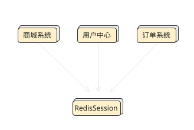

Redis简介

Redis是目前最受欢迎的NoSQL数据库之一，是一个包含多种数据结构，支持网络，基于内存，可选持久性的键值对存储数据库

MySQL和SqlServer都是关系型数据库，这些数据库一般用来存储重要信息，可以应对普通业务

但是在应对超大规模，超大流量，高并发的时候还是需要Redis这样的NoSQL数据库

Redis常见且核心的应用场景为	数据缓存cache，因为器数据读取速度快，能够提高运行效率，所以大多数情况下作为"缓存"

Redis速度快的原因是数据存储在计算机的内存中，但是内存空间有限，所以数据不宜永久保存

计算机重启后消失

Redis也可以存储在计算机硬盘上，但主要应用场景还是作为缓存

Redis支持Set , ZSet List , Hash , String 这五种数据类型

Redis由ANSI C语言编写，并非Java语言，所以不能把Java对象和Redis数据类型看作是等价的

Redis的优点还有持久化存储，可以把数据从内存上保存到磁盘上保证计算机断电而不丢失(内存数据库最担心的就是机器死机宕机，数据就会消失，而Redis采用RDB和AOF做数据的持久化存储，主从数据同时生成rdb文件，利用缓冲区添加新的数据更新操作做对应的同步)

- rdb：rdb在指定的时间间隔内将内存中的数据集快照写入磁盘
- aof：aof以日志的形式记录服务器所处理的每一个写、删除操作，查询操作不会记录，以文本的方式记录，可以打开文件看到详细的操作记录。

Redis的读写性能可以达到10w/s

Redis的缺点也很明显，由于其是内存数据库，短时间大量增加数据可能导致内存不够用(Redis本身有数据过期策略，但是还需要提前预估和节约内存，如果内存增长过快，需要定期删除数据)

经行完整持久化需要生成rdb文件并传输保存，会占用主机的CPU，并且消耗网络带宽，会导致性能损耗

将硬盘中的数据存储进内存，过程会比较长，会有一定耗时，导致重启速度慢


cookie和session回顾

http是无状态协议，因此产生了cookie

cookie存在客户端，用户可以看到并任意修改

而Session存放在服务端，共享，可以让两个页面都获取到

而存放在服务器的内存中带来的问题就是，如果服务器一旦存在问题需要重启，那么所有的用户都需要重新登录，会导致用户的体验感

而Redis作为缓存就可以发挥作用，将Session缓存到Redis里，多台服务器可以共享Session，并且Redis相对稳定



依赖

```xml
<dependency>
    <groupId>org.springframework.boot</groupId>
    <artifactId>spring-boot-starter-data-redis</artifactId>
</dependency>
```

properties配置

服务器地址

服务器端口号

spring.redis.host=

spring.redis.port=

spring.redis.password=


优化可能出现的恶意注册情况或大量用户注册导致数据库性能损耗最终宕机的恶性循环

分析步骤：

注册时判断是否重名时的查询还有保存数据两步操作访问了数据库

第二个保存操作很难优化

所以重点放在第一个操作

可以把用户数据缓存在Redis中，每次检验先从Redis里查询用户数据，这样可以减少对数据库的访问


注入RedisTemplate 实例

*RedisTemplate* 是 *Spring Data Redis* 提供给用户的最高级的抽象客户端，用户可直接通过 *RedisTemplate* 进行多种操作。


实现对象数据的缓存，用户模型必须实现序列化接口

```java
public class UserDO implements Serializable {}
```

用户模型实例在网络上传输，必须能够序列化。对象序列化必须实现 *Serializable* 接口。这是 Java 的规范和机制。

Java系统提供的 `Serializable` 接口中没有定义任何方法，相当于一个空接口

类实现了 *Serializable* 接口，不必再多写方法实现代码，意义主要是 **标识** 此对象能够被序列化。

优化重名判断逻辑：

修改 *UserServiceImpl.register()* 代码，优先从 Redis 查询此用户名有没有对应的用户对象，如果没有，再从数据库查询一次。

这样遇到大量重复注册攻击的时候，可以有效减轻数据库的压力。

```java
UserDO userDO = (UserDO)redisTemplate.opsForValue().get(userName);

if (userDO == null) {
    userDO = userDAO.findByUserName(userName);
}

if (userDO!=null){
    result.setCode("602");
    result.setMessage("用户名已经存在");
    return result;
}
```

要读写缓存Value需要调用redisTemplate.opsForValue()，在调用get方法根据参数key获得缓存值


用户实例放入缓存

用DAO方法向数据库增加一条数据后，可以调用opsForValue()的set方法把新用户实例存入Redis

```java
userDAO.add(userDO1);

result.setSuccess(true);
User user = userDO1.toModel();
result.setData(user);

// 新用户注册成功后，存入缓存
redisTemplate.opsForValue().set(userName, userDO1);
```


如果要进行修改操作直接重写值即可，新值会覆盖旧值

而删除缓存则不是对Value进行操作而是通过删除Key来删除整条K-V数据，所以没有调用opsValue方法，而是直接调用delete()方法


之前做的Session是存在本地Spring项目启动后的内存中，项目重启后，Session数据就没有了


而使用Redis可以作为Session的缓存，已解决分布式系统共享Session的问题

依赖：

去除：

```
<dependency>
  <groupId>org.springframework.session</groupId>
  <artifactId>spring-session-core</artifactId>
</dependency>
```

新的：

```xml
<!-- spring session 支持 -->
<dependency>
  <groupId>org.springframework.session</groupId>
  <artifactId>spring-session-data-redis</artifactId>
</dependency>
<dependency>
  <groupId>org.redisson</groupId>
  <artifactId>redisson-spring-boot-starter</artifactId>
  <version>3.13.0</version>
</dependency>
```

- `spring-session-data-redis` 是核心依赖库，会自动完成 Session 同步到 Redis 等操作
- `redisson-spring-boot-starter` 是需要用到的 Redis 客户端，提供很多分布式相关操作服务，操作 Session 数据的过程中，与核心依赖库搭配使用。


```java
@Configuration
@EnableSpringHttpSession
public class SpringHttpSessionConfig {
    @Bean
    public CookieSerializer cookieSerializer() {
        ... ...
        ... ...
    }

    @Bean
    public MapSessionRepository sessionRepository() {
        return new MapSessionRepository(new ConcurrentHashMap<>());
    }
}
```

系统未提供默认的存储Session数据的仓库，所以需要在sessionRepository()方法中新建一个仓库对象

```
new MapSessionRepository(new ConcurrentHashMap<>())
```

在分布式系统中Session数据存储于线程安全上的，支持高效并发的ConcurrentHashMap中

> ConcurrentHashMap 是 java.util.concurrent 包的重要成员

cookieSerializer()作用是定制Cookie中的session信息

要使用Redis存储Session方案，就需要删除@EnableSpringHttpSession注解，使用@EnableRedisHttpSession注解

并且不需要sessionRepository()方法了，Redis就是仓库，系统已经封装好了

```java
@Configuration
@EnableRedisHttpSession(maxInactiveIntervalInSeconds = 300)
public class SpringHttpSessionConfig {
    @Bean
    public CookieSerializer cookieSerializer() {
        ... ...
        ... ...
    }
}
```

`maxInactiveIntervalInSeconds` 注解参数设置 Session 数据的过期失效时间，单位是秒。系统默认1800秒(半小时)

千万不要忘记在Cookie标准化类前加@Bean注解


当被恶意攻击时可能会接收到大量不存在的账号，此时即使用来Redis但是实际上还是每次操作都重复去查询数据库，在遭受这种攻击的情况下Redis失去了缓存的意义，被称为**缓存穿透**，因此需要考虑数据错误时带来的风险

第一次从数据库查询不到数据时，仍然把这个空结果进行缓存，不过需要设置一个合适的过期时间

第二次访问时，由于缓存的错误账号数据没有属性值，则验证失败，不会执行登录

当然，解决了缓存穿透也并不是彻底解决这种大量攻击，这种持续攻击也可能会导致Redis的撑满


解决乱码问题

Redis时独立软件，并不是由Java语言开发的，所以Java存入Redis数据时，会把数据序列化

而Java默认的序列化方式就是把内容编成字节码，让计算机识别，但是可读性很差，看起来像乱码


解决方案：

新建一个config类(名字随意)

注入RedisTemplate实例

通过方法充值序列化方式

```java
@Bean
public RedisTemplate redisTemplateInit() {
  //设置序列化Key的工具
  redisTemplate.setKeySerializer(new StringRedisSerializer());
  //设置序列化Value的工具
  redisTemplate.setValueSerializer(new GenericJackson2JsonRedisSerializer());
  // 设置 hash 的 key
  redisTemplate.setHashKeySerializer(new GenericJackson2JsonRedisSerializer());
  // 设置 hash 的 value
  redisTemplate.setHashValueSerializer(new GenericJackson2JsonRedisSerializer());
  redisTemplate.afterPropertiesSet();
  return redisTemplate;
}
```

序列化千万不要让AI生成，不然全是String序列化方式，会出现映射错误！！！

Redis 数据的 **Key** 用字符串（`StringRedisSerializer`）的序列化/反序列化方式，**Value** 用 JSON（`GenericJackson2JsonRedisSerializer`）的序列化/反序列化方式。

> 但是 Session 数据仍然是乱码，就不用管了，Session 是系统自动处理的，不要人为干预


商品类目系统	实战


服务命名一般遵从规范：接口命名为 CategoryService，实现类命名为 CategoryServiceImpl

虽然类目具备上下级的关系，但是只是关联关系，就存储来说，每条类目都是一条独立的记录。多条类目组成一组类目数据。这个场景很适合 Redis 的数据结构：**list** 


Redis List是一个简单的字符串列表，按照插入顺序排序，可以添加一个元素到列表的头部和尾部


字符串是Redis最基础的数据类型，从结构上来说，不像 Java 一样，列表中还能嵌套列表。即使想把 Java 的 List 对象存入 Redis，那实际上也是序列化后字符串后存入。

```java
Category category = new Category();
redisTemplate.opsForList().leftPush("categoryList", category);
```

尾部插入同理，rightPush()

第二个参数是数据对象，但注意，整个列表是Value，列表中的数据元素不能被称为Value

Java系统会先把对象进行序列化，然后存入Redis

Redis会把相同Key的数据组织到一个数据结构List中

> 提醒：Category类需要实现 `java.io.Serializable` 接口，标识为可序列化对象。


无论是leftPush()还是rightPush()，都存在返回值，返回值类型为Long，值为操作完后的列表长度


查询列表的长度

opsForList的size方法

```java
Long size = redisTemplate.opsForList().size("categoryList");
```

根据索引查询

index()方法

```java
Category category = (Category)redisTemplate.opsForList().index("categoryList", index);
```

第一个参数是key，第二个参数是索引(索引从0开始计算)

由于从左插入数据时元素索引会变化，所以索引查询数据的时候要特别小心，否则可能与预期不一致


当不知道元素的具体位置，靠遍历Redis列表去找需要的元素是不可取的，操作Redis属于远程操作，要经过网络连接和传输，频繁地调用会导致效率低下，在大数据大流量的情况下尤其明显

而Redis提供部分了范围查询的语法去解决这个问题

```java
List<Category> categoryDatas = redisTemplate.opsForList().range("categoryList", 0, 1);
```

第一个参数是Key

第二，三个参数是起始，终止索引(全闭区间)

range("xx",0,0)表示只查询第一条数据

特别地，如果想一直查询到列表的末尾，第三个参数就填-1(-2表示倒数第二个)


由于 Redis 插入数据时会改变元素的索引，导致根据索引查询单个数据的方法并不常用。


opsForList()的set方法三个参数		第一个Key，第二个索引，第三个对象的值

获取索引值

```java
// 查询所有的数据
List<Category> categoryDatas = redisTemplate.opsForList().range("categoryList", 0, -1);
long index = 0;
for (Category cat : categoryDatas) {
    if (StringUtils.equals(cat.getId(), "gcl_001")) {
        break;
    }
    index++;
}
```


由于在config类中配置的序列化工具类不支持LocalDataTime。所以在模型的时间属性上需要加入两个注解

```java
 @JsonFormat(shape = JsonFormat.Shape.STRING, pattern = "yyyy-MM-dd HH:mm:ss")
@JsonDeserialize(using = LocalDateTimeDeserializer.class)
@JsonSerialize(using = LocalDateTimeSerializer.class)
```

> LocalDate 有对应的 LocalDateSerializer 和 LocalDateDeserializer；
>
> LocalTime 有对应的 LocalTimeSerializer 和 LocalTimeDeserializer


在Redis删除列表数据时可以从头部删除数据，也可以从尾部删除数据leftPop和rightPop，数据返回值为被删除的数据


Redis可以解决在企业级分布式环境中的高并发问题


使用MySQL结合Redis去实现高并发商品抢购

Mysql插入时可以加一个关键字COMMENT，用来注释，解释本字段的作用

Redis事务

Transaction  事务是指将一个业务逻辑作为一个整体一起执行，书屋其实就是打包一组操作作为一个整体，在事务处理时将顺序执行这些操作，并返回结果，如果任何一个环节出错，所有的操作将会被取消

而事务可以保证只有在执行完事务中所有命令后才会继续处理此客户端的其他命令


Redis事务四大指令

MULTI			开启一个事务

EXEC			执行一个事务

DISCARD		取消一个事务

WATCH		用于在客户端并发情况下，为事务提供一个锁(CAS,Check And Set)，可以用watch命令来监控一个或多个变量，如果在执行事务之前，莫格监控项被修改了，那么整个事务就会终止执行


事务基础框架代码

```java
try {
    redisTemplate.execute(new SessionCallback<List<Object>>() {
        @Override
        public List<Object> execute(RedisOperations operations) throws DataAccessException {
            //操作
        }
    });
} catch (Exception e) {
    LOG.error("redisTemplate.execute() error. ", e);
}
```

`redisTemplate.execute();` 是执行事务的方法，**推荐** 写在 *try...catch* 异常抓取语句中，这样执行过程中有任何问题，都打印出日志，方便排查问题。

具体的事务就写在方法参数 `SessionCallback` 接口的 `execute()` 方法体内部。

`new SessionCallback(){}` 这个写法就是匿名类，每个项目在 execute() 方法中实现具体的业务逻辑

```java
 @Override
    public List<Object> execute(RedisOperations operations) throws DataAccessException {
        //监听商品的ID
        operations.watch(id);
    }
```

`operations.watch()` 方法传入待监视的 Redis 数据 Key。

**注意：**这个 Key 必须在 Redis 中存在，否则会抛异常。

开启事务

```java
 operations.multi();
```

multi不需要参数

命令入列

```java
operations.opsForValue().set(idKey, (stock - 1));
        // 数据库的库存减 1
        productDAO.reduceStock(id, 1);
```

执行事务

```java
 List exec = operations.exec();
```

`operations.exec()` 用于执行事务，返回值是 List 列表，存放了每个事务执行结果的标记。事务开启后执行的每个操作，如果成功则放入 true 值作为标记，操作失败则不放入结果标记。

因为事务是要么每个操作都成功，要么都失败，所以一般来说可以简单处理，不用判断 operations.exec() 方法返回值列表中的每个元素是否都为 true，只要判断返回值列表长度大于 0 则表示执行成功。


取消事务

在 `execute(RedisOperations operations)` 方法抛异常时，会自动取消事务，本案例不必写取消事务的代码。

如果需要手动取消事务

```java
operations.discard();
```


Redis 中的库存初始值是 3，而各个线程最终只有一个可以成功的修改库存值为 2。于是，其它线程在最后执行修改数据时，不是基于最新值进行修改（或者笼统的说数据状态已经改变了），那么修改不成功。

Redis 的事务，只能影响 Redis 的操作，`execute(RedisOperations operations)` 方法抛异常时，可以使所有 Redis 的操作取消，但影响不到数据库。因为他们是不同软件。

并不是说 Redis 事务没用，而是事务更适合保证多条操作原子性的场景

事务并不能很好的解决抢购问题。我们可以考虑使用分布式锁。


分布式结构

将一个完整的系统按照业务功能拆分成一个个独立的子系统，分布式结构中，每个子系统被称为"服务"


Java中的synchronized关键字是本地锁，只能解决一台服务器的并发问题

但是随着服务量增大，单机不能满足那么大的访问量，需要编程集群或者分布式结构，因此无法保证某个数据的改变是同一台服务器操作的

而分布式锁可以锁所有的服务器


使用Redis分布式锁需要用到Reddissin客户端，可以在使用基本Redis功能的同时也提供一些更高级服务，比如远程调用，分布式锁，分布式对象，容器

```xml
<dependencies>
    <dependency>
        <groupId>org.redisson</groupId>
        <artifactId>redisson-spring-boot-starter</artifactId>
        <version>3.13.0</version>
    </dependency>
</dependencies>
```

spring-boot-starter-data-redis 仍然保留哦


分布式锁的实现

先注入实例

```java
import org.redisson.api.RedissonClient;
@Autowired
private RedissonClient redissonClient;
```

实现锁大致需要三步

获取锁

上锁

开锁

```java
RLock rLock = redissonClient.getLock("CUSTOM_NAME");
```

getLock得到一个Redis锁对象，方法参数可以自定义锁的名称

为了减少冲突、明确含义、易于理解和维护，不要以简单的数字 id 值作为 Redis 中的数据 Key，推荐的格式是：

```
productId-1-stock
```

这样就知道 Redis 缓存中这个 Key 的作用和含义。同样，锁的名称也不要太简单，推荐的格式是：

```
productId-1-lock
```


```java
rLock.lock();
```

并发情况下，每个线程都会竞争锁，竞争失败的线程会被禁用，并且在重新获取锁之前，该线程将会**一直**处于休眠状态


```java
rLock.unlock();
```

上锁了必须要解锁，否则会导致线程等待而产生死锁，使系统卡死

所以，推荐把业务操作放在 *try...catch...finally* 中：

```java
try {
  rLock.lock();
  // 抢购业务逻辑
} catch (Exception e) {
    LOG.error("some error. ", e);
} finally {
    rLock.unlock();
}
```


设置过期时间

```java
redisTemplate.opsForValue().set("code", "78987", 1000, TimeUnit.MILLISECONDS);
```

常用的时间单位包括：

- TimeUnit.MILLISECONDS ：毫秒
- TimeUnit.SECONDS ：秒
- TimeUnit.MINUTES ：分钟
- TimeUnit.HOURS ：小时
- TimeUnit.DAYS ：天


而列表的push结构使无法设置过期时间的

这时候需要用

```java
redisTemplate.expire("category", 60, TimeUnit.MINUTES);
```

去实现，第一个参数使List 的Key 二三参数共同确认过期时间

其实expire可以为任何数据类型都设置过期时间


1. 惰性删除

每次查询或写键时，都会检查取得的键是否过期。如果过期就删除该键，否则就返回该键

这样做对 CPU 最友好。只有在操作的时候进行过期检查，删除的目标仅限于当前需要处理的键，不会在删除其他无关本次操作的过期键上花费任何 CPU 时间

但是对内存不友好，键过期了，但因为一直没有被访问到，所以一直保留着一直占着存储空间

2. 定期删除

每隔一段时间，程序就对数据库进行检查，删除里面的过期键。至于要删除多少过期键，以及检查多少数据库，则由算法决定

3. 定时删除

在设置键的过期时间的同时，创建一个定时器，让定时器在键的过期时间来临时，立即执行对键的删除操作。

这样的做法对于内存是最好的，可以即使释放存储空，但是对于 cpu 却不好，在过期键比较多的情况下，删除过期键会占用相当一部分 CPU 时间。


分布式ID

ID是数据的唯一标识，常见的是数据库的AUTO_INCREMENT

随着业务的发展，数据量增大，可能需要分表甚至分库，然而每个表的数据会按自己的节奏来自增，这样会造成ID冲突

此时就需要利用一个单独的机制来负责生成唯一的ID


Redis的所有命令操作都是单线程的，不像Java有多线程的概念。虽然单线程但是速度够快


```
import org.redisson.api.RAtomicLong;
import org.redisson.api.RedissonClient;
```

过程代码：

```java
//格式化格式为年月日
DateTimeFormatter dateTimeFormatter = DateTimeFormatter.ofPattern("yyyyMMdd");
//获取当前时间
String now = LocalDate.now().format(dateTimeFormatter);
//通过redis的自增获取序号

//获取一个自增的实例对象
RAtomicLong atomicLong = redissonClient.getAtomicLong(now);
atomicLong.expire(1, TimeUnit.DAYS);
获取实际自增值
long number = atomicLong.incrementAndGet();
//拼装订单号
String orderId = now + "" + number;
```


个人数据初始化存入Redis缓存前需要重置序列化方法，可以让初始化init()方法所在的类依赖重置序列化的类

千万不要忘了在重置序列化设置一下postConstruct


ZSet提供查询功能

根据排序值升序查询

```java
Set tv = redisTemplate.opsForZSet().rangeWithScores("TV", 0, -1)
```

根据排序值降序查询

```java
Set tv = redisTemplate.opsForZSet().reverseRangeWithScores("TV", 0, -1);
```

第一个Key，第二三个是包含的起始终止索引

返回值为Set类型，Set是Java中使用频率一般的集合，不如List，Map用得多，特点是不能出现重复元素，不强调顺序，即使是null，也只能存放一个

Set也是继承Collection接口

最常用的实现类是HashSet()，HashSet是无序的，所以资料通常说Set是无序的

但是对于返回值，不需要管具体的实现类，而是Set接口，返回值是有序的


### 遍历返回值 Set 集合

引入新包：

```java
import org.springframework.data.redis.core.ZSetOperations.TypedTuple;
import java.util.Set;
```

查询及遍历：

```java
Set<TypedTuple<PersonalRecord>> datas = redisTemplate.opsForZSet().rangeWithScores("integralRank", 0, -1);

// 遍历
datas.forEach(data -> {
    // 存入的对象
    PersonalRecord pr = data.getValue();
    // 对应的分数
    Double score = data.getScore();
    System.out.println(pr.getId() + " - " + score);
});
```

查询返回 Set 集合中的元素类型是 `TypedTuple` ，用于整合查询结果对象（通过 `add()` 方法放入 ZSet 中的对象）及其对应的分数，封装在一起，便于读取。

> TypedTuple 是 ZSetOperations 接口中定义的内部接口

于是，通过 `getValue()` 可以取得放入 `ZSet` 的元素对象，通过 `getScore()` 可以取得元素的分数。


以防有用户以"integralRank"作为用户名，那么就跟个人战机的数据集合冲突了

可以用Redis的Hash数据结构解决这个问题


Redis Hash 是一个字符串类型的 field（字段） 和 value（值） 的映射表，Hash 特别适合用于存储对象。


新增

把所有用户数据都存储在 “integralRankUser” 为 Key 的缓存中，以用户名作为 field，那么就可以避免和其他领域数据冲突了

```java
redisTemplate.opsForHash().put("integralRankUser", userDO.getUserName(), userDO);
```

第一个参数是Key，第二个参数是field，第三个参数就是集体的值

当field相同时，再次put会覆盖原来的field值


读取

可以根据Key和field精确查询

```java
UserDO userDO = (UserDO)redisTemplate.opsForHash().get("integralRankUser", userName);
```

也可以根据Key和一批field批量查询

```java
List<String> userNames = new ArrayList<>();
userNames.add(userName);
List<UserDO> users = redisTemplate.opsForHash().multiGet("integralRankUser", userNames);
```


删除

根据Key和field经行删除

```java
redisTemplate.opsForHash().delete("integralRankUser", userName);
```

delete支持变长参数，可以传入多个field值去删除field


拓：变长参数

从 Java5 开始支持变长参数机制，允许在调用方法时传入不确定数量的参数。变长参数是 Java 的一个语法糖，本质上还是基于数组的实现。

> 语法糖是计算机编程领域场景的术语，表示其实并没有提供全新的功能机制，实现功能与原功能一致，但让代码书写简单、简洁流畅、通俗易懂

Redis 中定义 `delete()` 方法的源码是：

```java
Long delete(H key, Object... hashKeys)
```

在方法的参数类型后面加三个点（`...`）就表示变长参数，调用时可以传入一个或多个值。而变量 `hashKeys` 的类型实际上就是数组，可以用 `hashKeys.length` 获取输入参数的个数。


