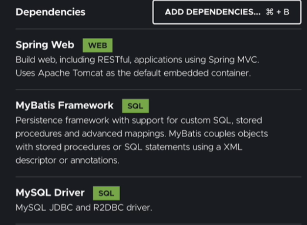
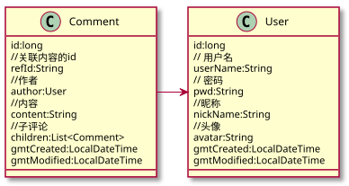

ORM 对象关系映射（英语：Object Relational Mapping，简称ORM，或O/RM，或O/R mapping）


数据库的表（table） --> 类（class）
记录（record，行数据）--> 对象（object）
字段（field）--> 对象的属性（attribute）


有了ORM能力就可以很容易的把SQL对象变成Java对象了

在 Java 领域里所有的数据库框架都是基于 **JDBC** 的，这个是底层；如果你没有学过和了解过也没有问题的，等你掌握了 MyBatis 再看 **JDBC** 也挺容易的

> 绝大多数情况下只会面试的时候会问一些 JDBC 的问题，但是实际工作上很少直接打交道了



依赖(MyBatis Framework, MySQL Driver)

```xml
<dependency>
    <groupId>org.mybatis.spring.boot</groupId>
    <artifactId>mybatis-spring-boot-starter</artifactId>
    <version>2.1.2</version>
</dependency>
<dependency>
    <groupId>mysql</groupId>
    <artifactId>mysql-connector-java</artifactId>
    <scope>runtime</scope>
</dependency>
```

配置数据源

application.properties文件

格式：

```
spring.datasource.url=jdbc:mysql://mysql数据库地址:数据库端口/数据库名称?serverTimezone=GMT%2B8
spring.datasource.username=用户名
spring.datasource.password=密码
```

```
spring.datasource.url=jdbc:mysql://localhost:3306/comment?serverTimezone=GMT%2B8
spring.datasource.username=coder
spring.datasource.password=
```


现在我们设计一下领域模型，大家可以看看，以后遇到类似的场景也可以这样设计



由于评论组件可以运用在很多地方，比如文章、笔记、博客等等，所以我们需要关联到某一个主键上，也就是这里的 `refId`


ref_id 一般字符串的主键或者外键一般都是设置varchar（32）

- `user_id`
- 我们在 Comment.java 模型里关联了 User 对象，但是在数据库表中，我们只需要做一个主键字段关联即可
- 一般来说 `user_id` 这种写法就说明关联的是 `user` 表的主键,这是一种约定


- `parent_id`
- 我们在 Comment.java 模型里设计了 children 字段来包含所有的子评论，但是在数据库表中，我们只需要做一个父主键就可以了，因为实际查找数据的时候，是通过父找子的

##### user 表

| 表字段       | 字段类型     | 允许 Null | 字段描述                         |
| ------------ | ------------ | --------- | -------------------------------- |
| id           | bigint       | 不允许    | 自增主键                         |
| user_name    | varchar(20)  | 不允许    | 用户名，20位长度已经足够了       |
| pwd          | varchar(32)  | 不允许    | 密码                             |
| nick_name    | varchar(20)  | 允许      | 昵称                             |
| avatar       | varchar(200) | 允许      | 头像，url长度有点长，设置200长度 |
| gmt_created  | datetime     | 不允许    | 创建时间                         |
| gmt_modified | datetime     | 不允许    | 修改时间                         |

##### comment 表

| 表字段       | 字段类型      | 允许 Null | 字段描述               |
| ------------ | ------------- | --------- | ---------------------- |
| id           | bigint        | 不允许    | 自增主键               |
| ref_id       | varchar(32)   | 不允许    | 关联外部内容的主键     |
| user_id      | bigint        | 不允许    | 关联用户表主键         |
| content      | varchar(1000) | 不允许    | 评论内容，最长1000个字 |
| parent_id    | bigint        | 允许      | 父评论ID               |
| gmt_created  | datetime      | 不允许    | 创建时间               |
| gmt_modified | datetime      | 不允许    | 修改时间               |


所有的ORM框架都需要由一个Java对象来映射数据库的表，并且是一一对应的，我们一般把这类对象称为DO对象，对象名称规范时表名+DO

通常DO与POJO类配合使用

1. 数据读取流程：
   - 数据库 → ORM 框架查询 → 返回 `UserDO`（数据载体）→ 转换为 `User 模型`（业务实体）→ 业务层处理。
2. 数据写入流程：
   - 业务层操作 `User 模型` → 转换为 `UserDO` → ORM 框架持久化 → 存入数据库。

### DO 对象数据类型

DO 对象和普通的 POJO 类并无不同，唯一要注意的点是属性类型要和数据库类型进行匹配，这个是`JDBC` 制定的规范,常用的数据类型映射如下

| JDBC 类型（数据库字段类型） | Java 数据类型 |
| --------------------------- | ------------- |
| VARCHAR                     | String        |
| TEXT                        | String        |
| INTEGER                     | int           |
| DOUBLE                      | double        |
| BIGINT                      | long          |
| DATETIME                    | Date          |

注意默认情况下，数据库的日期类型对应的是 Java 的 `java.util.Date`对象

```java
import java.time.LocalDateTime;

public class UserDO {

    private long id;

    private String userName;

    private String pwd;
    ...
    //省略getter-setter
    }
```


一般数据层的服务称为DAO层，DAO层会包含对数据库操作的接口和实现类

MyBatis强悍的地方在于只需要定义接口，就可以完成对数据的增删改查。


首先创建DAO层

```java
com.youkeda.comment.dao
```

定义 DAO 接口

继续以`user`表为例,我们创建一个`UserDAO`这样的接口

> 注意需要放在 dao 包里哦

```java
package com.youkeda.comment.dao;

import org.apache.ibatis.annotations.Mapper;

@Mapper
public interface UserDAO {


}
```

引用DAO

完成DAO的定义后，Spring启动时会自动加载这个接口并动态创建一个SpringBean，所以只需按照SpringBean的方式完成资源注入

```java
@Controller
public class UserController {

    @Autowired
    private UserDAO userDAO;

}
```


MyBatis查询

1. 添加接口方法

2. 添加@Select注解

   ```java
   @Mapper
   public interface UserDAO {

       @Select("SELECT id,user_name as userName,pwd,nick_name as nickName,avatar,gmt_created as gmtCreated,gmt_modified as gmtModified FROM user")
       List<UserDO> findAll();

   }
   ```

3. API测试

   ```java
   @Controller
   public class UserController {

     @Autowired
     private UserDAO userDAO;

     @GetMapping("/users")
     @ResponseBody
     public List<UserDO> getAll() {
       return userDAO.findAll();
     }

   }
   ```
   ​

插入

1. 添加接口方法

   ```java
   int insert(UserDO userDO);
   ```

   在UserDAO中

2. 添加@Insert注解

   ```java
    @Insert("INSERT INTO user (user_name, pwd, nick_name,avatar,gmt_created,gmt_modified) VALUES(#{userName}, #{pwd}, #{nickName}, #{avatar},now(),now())")
   int insert(UserDO userDO)
   ```

   执行后会返回插入行数，可以通过返回值大于0来判断

   如上，仔细看看代码，你会发现我们改造了一下 SQL 语句，我们把 value 值换成了 `#{变量名}` 这种格式，这个就是 MyBatis 获取动态值的一种方式，执行的时候会自动从上下文参数（这里的上下文就是 userDO）里获取这个变量名的值

3. API测试

   ```java
    @PostMapping("/user")
     @ResponseBody
     public UserDO save(@RequestBody UserDO userDO) {
       userDAO.insert(userDO);
       return userDO;
     }
   ```

4. 主键值

   ```java
    @Insert("INSERT INTO user (user_name, pwd, nick_name,avatar,gmt_created,gmt_modified) VALUES(#{userName}, #{pwd}, #{nickName}, #{avatar},now(),now())")
     @Options(useGeneratedKeys = true, keyColumn = "id", keyProperty = "id")
   ```

   Options 注解有三个参数

   - useGeneratedKeys

     > 设置为 true，代表允许数据库使用自增主键

   - keyColumn

     > 设置表的主键字段名称，一般都是`id`

   - keyProperty

     > 设置`DO`模型的主键字段，一般都是`id`

修改

1. 接口方法

    int update(UserDO userDO);

   返回影响的行数

2. @Updata注解

   ```
   @Update("update user set nick_name=#{nickName},gmt_modified=now() where id=#{id}")
   ```


XML Mapper

1. 头信息

   创建完 xml 文件后，你首先需要复制下面的内容,这个是固定格式的

   ```xml
   <?xml version="1.0" encoding="UTF-8"?>
   <!DOCTYPE mapper PUBLIC "-//mybatis.org//DTD Mapper 3.0//EN"
           "http://mybatis.org/dtd/mybatis-3-mapper.dtd">
   ```

2. mapper根节点

   namespace属性，命名空间，一般就是mapper对应的DAO接口的全程

   ```xml
   <mapper namespace="com.youkeda.comment.dao.UserDAO">

   </mapper>
   ```

3. resultMap

   resultMap 用于处理表和 DO 对象的属性映射，确保表中的每个字段都有属性可以匹配

   ```xml
   <mapper namespace="com.youkeda.comment.dao.UserDAO">

     <resultMap id="userResultMap" type="com.youkeda.comment.dataobject.UserDO">
       <id column="id" property="id"/>
       <result column="user_name" property="userName"/>
     </resultMap>

   </mapper>
   ```

   id   唯一标示，一般命名规则都是 xxxResultMap，能保证唯一性

   type	对应DO类的完整路径

4. resultMap的子节点

   id	设置数据库主键字段信息，column属性对应表的字段名称，property对应的是DO类的属性

   result	设置数据库其他字段信息

   ```xml
   <resultMap id="userResultMap" type="com.youkeda.comment.dataobject.UserDO">
       <id column="id" property="id"/>
       <result column="user_name" property="userName"/>
       <result column="pwd" property="pwd"/>
       <result column="nick_name" property="nickName"/>
       <result column="avatar" property="avatar"/>
       <result column="gmt_created" property="gmtCreated"/>
       <result column="gmt_modified" property="gmtModified"/>
     </resultMap>
   ```

使用result之后就不需要再写user_name as userName这种别名写法了


xml中添加insert语句

在mapper节点下添加insert节点

id属性	与DAO类中的方法同名


注意，这里的 `delete` 节点并没有配置 parameterType 属性，这是因为

```
int delete(@Param("id") long id);
```

这个 `delete` 方法的参数是由 `@Param` 注解组成，默认情况下，MyBaits 会把这类数据当成 `Map` 数据来传递，而 MyBatis 默认的 `parameterType` 类型就是 `Map`，所以可以省略不写


xml模式的开发顺序

1. 创建 DO 对象
2. 创建 DAO 接口，配置 `@Mapper` 注解
3. 创建 XML 文件，并完成 `resultMap` 配置
4. 创建 DAO 接口方法
5. 创建对应的 XML 语句


select语句

```xml
<select id="findByUserName" resultMap="userResultMap">
  select * from user where user_name=#{userName} limit 1
</select>
```

**注意** 这里我们多使用了一个属性`resultMap`这个值我们一般配置为 该 XML 文件下的`resultMap`节点的 id 值，比如这里的`userResultMap`


`nickName` 字段不应该为`null`的

所以 update 语句里，我们一般会结合条件语句来执行的

```xml
<update id="update" parameterType="com.youkeda.comment.dataobject.UserDO">
  update user set
   <if test="nickName != null">
    nick_name=#{nickName},gmt_modified=now()
   </if>
   where id=#{id}
</update>
```

> 注意，有了逻辑语句以后，大家要仔细两个字段间的`,`不要漏掉了。当然 MyBatis 还是比较强大的，也会有一些纠错行为。执行 SQL 错误的时候，就需要大家仔细检查检查了

在上面的 update 语句中，如果 nickName 为 null，SQL 会变成

```
update user set  where id=?
```

这是错误的 SQL 语句。

在实际开发中，我们一般会结合 set 语句来编写 update 语句

```xml
<update id="update" parameterType="com.youkeda.comment.dataobject.UserDO">
  update user
  <set>
    <if test="nickName != null">
      nick_name=#{nickName},
    </if>
    <if test="avatar != null">
      avatar=#{avatar},
    </if>
    gmt_modified=now()
  </set>
   where id=#{id}
</update>
```

任何情况下，修改操作一定更新 gmt_modified 时间，就可以避免所有列值都为 null 时引起 SQL 语法错误。

并且，使用 `<set>` 语句，系统会自动去除最后一个逗号（`,`），而不用担心到底哪个列才是最后一个。


```xml
<select id="search" resultMap="userResultMap">
  select * from user where
    <if test="keyWord != null">
      user_name like CONCAT('%',#{keyWord},'%')
        or nick_name like CONCAT('%',#{keyWord},'%')
    </if>
    <if test="time != null">
      and  gmt_created <![CDATA[ >= ]]> #{time}
    </if>
</select>
```

> `>=、<、<=、>、>=、&` 这类的表达式会导致 MyBatis 解析失败，所以我们需要使用`<![CDATA[ key ]]>` 来包围住。

如上面代码所示，我们在 `LocalDateTime time` 这个参数里还额外增加了`@DateTimeFormat` 注解，这个注解是由 Spring 提供的，用于把字符串参数转化为日期类型

为了防止where使用if判断出现空的情况，可以使用where子句

```xml
<select id="search" resultMap="userResultMap">
  select * from user
   <where>
      <if test="keyWord != null">
          user_name like CONCAT('%',#{keyWord},'%')
            or nick_name like CONCAT('%',#{keyWord},'%')
      </if>
      <if test="time != null">
        and  gmt_created <![CDATA[ >= ]]> #{time}
      </if>
   </where>
</select>
```


##### 补充说明

MyBatis XML条件语句还有

- choose
- when
- otherwise
- trim

这几个相对来说用的会少一些，如果有这种需求可以自行看一下 [MyBatis 中文文档](https://mybatis.org/mybatis-3/zh/dynamic-sql.html)


foreach

批量插入

```java
@Mapper
public interface UserDAO {

    int batchAdd(@Param("list") List<UserDO> userDOs);

}
```

```xml
<insert id="batchAdd" parameterType="java.util.List" useGeneratedKeys="true" keyProperty="id">
    INSERT INTO user (user_name, pwd, nick_name,avatar,gmt_created,gmt_modified)
    VALUES
    <foreach collection="list" item="it" index="index" separator =",">
        (#{it.userName}, #{it.pwd}, #{it.nickName}, #{it.avatar},now(),now())
    </foreach >
</insert>
```

查询多个用户信息

```
<select id="findByIds" resultMap="userResultMap">
    select * from user
    <where>
        id in
        <foreach item="item" index="index" collection="ids"
                    open="(" separator="," close=")">
            #{item}
        </foreach>
    </where>
</select>
```

这里多了两个参数

- open

  > 表示的是节点开始时自定义的分隔符

- close

  > 表示的是节点结束时自定义的分隔符


MyBaits可以通过插件来很好地支持分页查询

目前比较好的方案就是pagehelper第三方插件

```xml
<dependency>
    <groupId>com.github.pagehelper</groupId>
    <artifactId>pagehelper-spring-boot-starter</artifactId>
    <version>1.2.13</version>
</dependency>
```

我们结合 lambda 语法，在`doSelectPage` lambda 方法中执行 MyBatis 查询方法，就会自动执行分页逻辑，并且返回分页对象`Page`,我们在仔细看看方法调用的情况

```java
  @GetMapping("/users")
    @ResponseBody
    public List<UserDO> getAll() {
        // 设置当前页数为1，以及每页3条记录
        Page<UserDO> page = PageHelper.startPage(1, 3).doSelectPage(() -> userDAO.findAll());
        return page.getResult();
    }
```

startPage第一个参数指定页数，第二个参数指定每个页的记录数

```java
PageHelper.startPage(1, 3);
PageHelper.startPage(0, 3);//二者等价
```

返回类型`Page`对象是 MyBatis 封装的分页模型，通过这个我们可以得到

- `getResult()` 获取分数数据
- `getPages()` 获取总页数
- `getTotal()` 获取总记录数
- `getPageNum()` 获取当前页面数

> `Page` 的完整路径是 `com.github.pagehelper.Page`

在企业开发中，我们都会额外封装一个通用的分页模型`Paging`用于处理返回值，参考如下

> 以后我们再各种项目中可能会经常复用这个模型，就不再额外介绍啦

```java
package com.youkeda.comment.model;

import java.io.Serializable;
import java.util.List;

/**
 * 分页模型
 */

public class Paging<R> implements Serializable {

    private static final long serialVersionUID = 522660448543880825L;

    /**
     * 页数
     */
    private int pageNum;

    /**
     * 每页数量
     */
    private int pageSize = 15;
    /**
     * 总页数
     */
    private int totalPage;

    /**
     * 总记录数
     */
    private long totalCount;

    /**
     * 集合数据
     */
    private List<R> data;

    public Paging() {

    }

    public Paging(int pageNum, int pageSize, int totalPage, long totalCount, List<R> data) {
        this.pageNum = pageNum;
        this.pageSize = pageSize;
        this.totalPage = totalPage;
        this.totalCount = totalCount;
        this.data = data;
    }

    // 省略 getter、setter

}
```

Paging 模型比较简单，主要提供

- `pageNum` 当前页面数

- `pageSize` 每页记录数

- `totalPage` 总页面数

- `totalCount` 总记录数

- `data` 当前页面的集合数据 我们还提供了一个构造函数

  ```java
  public Paging(int pageNum, int pageSize, int totalPage, long totalCount, List<R> data)
  ```


Druid连接池

采用数据源连接池方案可以极大的提高了数据处理能力，因为Java 连接数据库是比较耗时的，如果每次查询都重新连接数据库那样性能非常低下。换成连接池以后，我们的数据库操作就无需每次都去连接数据库，只是复用连接，从而完成性能的提升

> 这个概念还是希望大家能够记住的，因为有的时候面试会经常提问到

基于性能的考虑，目前 SpringBoot 官方集成的连接池是 `HikariCP`，这个是现在所有方案里性能最佳的，SpringBoot 也是默认就集成好了，并不需要我们额外处理。但是今天我们想介绍的是阿里巴巴出品的`Druid`，它有如下优势

- 性能优越（目前略低于 HikariCP）
- 扩展能力极强
- 具备 SQL 拦截功能
- 具备数据统计分析功能，比如慢 SQL 分析

```xml
<dependency>
    <groupId>com.alibaba</groupId>
    <artifactId>druid-spring-boot-starter</artifactId>
    <version>1.1.23</version>
</dependency>
```

Druid 的配置项是比较多的，具体的大家可以看 [Druid Spring Boot Starter 中文文档](https://github.com/alibaba/druid/tree/master/druid-spring-boot-starter)

我们继续看一下如何开启监控，你需要在 `application.properties` 文件里增加配置项

```properties
spring.datasource.druid.stat-view-servlet.enabled=true
spring.datasource.druid.stat-view-servlet.url-pattern=/druid/*
spring.datasource.druid.stat-view-servlet.login-username=druid
spring.datasource.druid.stat-view-servlet.login-password=druid
spring.datasource.druid.stat-view-servlet.allow=
spring.datasource.druid.stat-view-servlet.deny=
```

上面的`login-username`和`login-password` 是可以自己定义的哦


在前面的课程中，为了学习 MyBatis，我们都是采用 API 调用 DAO 层来演示的，在实际企业工作中，一般我们都会把逻辑写在 service 层，不太会直接在 API 调用 DAO 的，这点请记住。


我们接下来通过实战一步步的完成评论服务开发，根据业务流程我们会拆分成如下：

- 用户注册服务
- 用户登陆服务
- 用户发表评论
- 用户回复评论
- 查询文章评论


密码是不能泄漏的，所以我们需要在服务端输出的时候对这个属性进行处理。我们可以使用 jackson 的注解，如下：

```java
package com.youkeda.comment.model;

import com.fasterxml.jackson.annotation.JsonFormat;
import com.fasterxml.jackson.annotation.JsonIgnore;
import com.fasterxml.jackson.databind.annotation.JsonSerialize;
import com.fasterxml.jackson.databind.ser.std.NullSerializer;

import java.time.LocalDateTime;

/**
 */
public class User {

    @JsonSerialize(using = NullSerializer.class)
    private String pwd;

}
```

当我们配置了

```java
@JsonSerialize(using = NullSerializer.class)
```

这个注解

API 在返回 JSON 结果的时候，这个字段的值会被重置为 `null` （相当于实际值被隐藏了），从而达到安全的作用。

> 不是修改了密码值，仅仅在序列化输出的时候做处理，不要理解错了

另外，对于时间我们一般都希望输出的格式是`yyyy-MM-dd HH:mm:ss`，我们依然可以借助 jackson 的注解来完成格式化输出

```java
package com.youkeda.comment.model;

import com.fasterxml.jackson.annotation.JsonFormat;
import com.fasterxml.jackson.annotation.JsonIgnore;
import com.fasterxml.jackson.databind.annotation.JsonSerialize;
import com.fasterxml.jackson.databind.ser.std.NullSerializer;

import java.time.LocalDateTime;

/**
 */
public class User {

    @JsonSerialize(using = NullSerializer.class)
    private String pwd;

    @JsonFormat(shape = JsonFormat.Shape.STRING, pattern = "yyyy-MM-dd HH:mm:ss")
    private LocalDateTime gmtCreated;

    @JsonFormat(shape = JsonFormat.Shape.STRING, pattern = "yyyy-MM-dd HH:mm:ss")
    private LocalDateTime gmtModified;

}
```


注册一个用户主要是根据用户名，密码来注册的，用户注册这个行为有可能会失败，为了能正确地描述数据，我们新增一个Result公共通用模型，用于处理API返回值，类似之前的Paging

```java
public class Result<D> implements Serializable {

    // 表示执行成功或失败
    @JsonProperty("isSuccess")
    private boolean success = false;

    // 返回消息短码，一般用于出错时，简短描述错误
    private String code;
    // 返回消息具体信息，一般用于出错时，比较详细的描述错误
    private String message;

    // 返回的具体数据
    private D data;

    // 省略 getter、setter

}
```

@JsonProperty()用于自定义JSON输出时候的字段名称

泛型

通过Result<D>的声明，让返回模型支持泛型，此时声明的属性D data 需要根据上下文来确定类型


如果成功了并且没有返回code和message属性，此时他们的值为null，也输入到了JSON中，造成了资源浪费，可以通过配置去集中优化

properties文件中新增如下配置即可：

```properties
spring.jackson.deserialization.fail-on-unknown-properties=false
spring.jackson.default-property-inclusion=non_null
```

第一个作用是允许序列化未知的字段，兼容Java模型和JSON数据不一致的情况

true时严格校验数据格式（如内部系统接口，不允许冗余字段）

第二个可以忽略null字段

如果需要对单个字段进行null忽略，可以单独在其上加注解

@JsonIgnoreProperties(ignoreUnknown = true)


判断非空非 null

在企业中，我们一般会结合 commons-lang3 库来处理字符串，你需要在 pom.xml 中添加依赖

```xml
<dependency>
    <groupId>org.apache.commons</groupId>
    <artifactId>commons-lang3</artifactId>
    <version>3.10</version>
</dependency>
```

完成配置后，可以使用 `StringUtils.isEmpty(str)` 来判断是否为空，StringUtils 的完整路径是


判断用户名是否存在

我们可以使用 `UserDAO.findByUserName` 查询数据是否存在，如果存在记录则说明用户名已经存在了

加密

一般来说，我们会使用 md5 算法进行加密，建议使用 commons-codec 库进行加密处理，同样需要先添加依赖

```xml
<dependency>
    <groupId>commons-codec</groupId>
    <artifactId>commons-codec</artifactId>
    <version>1.14</version>
</dependency>
```

看一下加密的例子：

```java
// 密码加自定义盐值，确保密码安全
String saltPwd = pwd + "_ykd2050";
// 生成md5值，并转为大写字母
String md5Pwd = DigestUtils.md5Hex(saltPwd).toUpperCase();
```

Result 返回处理

由于我们在`register`方法定义的返回模型是 `Result<User>` ，所以API层是完全感知不到 UserDO 模型的，需要DO和Model互转


登录有个额外的逻辑，就是在得到 User 数据后，需要大家把 userId 存储到 session 中，比如

```java
if (result.isSuccess()) {
   request.getSession().setAttribute("userId", result.getData().getId());
}
```

session 对象的获取，去找Session API 笔记


在很多时候如果关联 userId 的记录，都是从登录信息里获取到的，也就是从 session 里获取 id，这也是我们正式的开始使用登录数据


测试开发时，我们经常先假定一些数据，然后推导逻辑

比如先确定一个文章ID，假定refId=2025

> 假定数据在编程领域里叫做 **mock**，这个词以后可能会经常遇到


发送评论时的安全处理

基于安全的考虑，用户自定义输入的文本需要禁止 HTML 标签，这样可以避免很多恶意的代码，这个技能大家请掌握住哦

我们可以使用 `commons-text` 这个库进行 HTML 转义，从而达到禁用 HTML 标签的作用，你需要添加依赖

```xml
<dependency>
    <groupId>org.apache.commons</groupId>
    <artifactId>commons-text</artifactId>
    <version>1.8</version>
</dependency>
```

执行下面的代码可以完成转义

```java
String body = StringEscapeUtils.escapeHtml4(content);
```


Mybatis  可以通过对象中的子对象直接映射子对象

在resultMap中有一个子节点association可以聚合其他模型

```xml
<association property="author" javaType="com.youkeda.comment.model.User">
        <id property="id" column="user_id"/>
        <result column="user_name" property="userName"/>
        <result column="nick_name" property="nickName"/>
        <result column="avatar" property="avatar"/>
    </association>
```

配置与resultMap差不多

- property 对应的是 comment 表的字段名称
- javaType 对应的是 Java 对象

只需要映射需要的字段即可


CORS

CORS是一个W3C标准，全称是"跨域资源共享"（Cross-origin resource sharing），允许浏览器向跨源服务器发出XMLHttpRequest请求，从而克服了AJAX只能同源使用的限制


```
Cross-Origin Request Blocked: The Same Origin Policy disallows reading the remote resource at $somesite
```

当看到这样的错误信息就说明请求跨域了(不同域名访问就会发生跨域)

CORS技术可以让服务器信任调用方解决跨域问题

 [跨域资源共享 CORS 详解 ](https://www.ruanyifeng.com/blog/2016/04/cors.html)

在SpringBoot中推荐使用Filter方式解决

```java
package com.youkeda.comment;

import org.springframework.boot.web.servlet.FilterRegistrationBean;
import org.springframework.context.annotation.Bean;
import org.springframework.context.annotation.Configuration;
import org.springframework.web.cors.CorsConfiguration;
import org.springframework.web.cors.UrlBasedCorsConfigurationSource;
import org.springframework.web.filter.CorsFilter;

import java.time.Duration;

@Configuration
public class CorsConfig {

    @Bean
    public FilterRegistrationBean corsFilter() {
        UrlBasedCorsConfigurationSource source = new UrlBasedCorsConfigurationSource();
        CorsConfiguration config = new CorsConfiguration();
        config.setAllowCredentials(true);
        // 设置你要允许的网站域名，如果全允许则设为 *
        config.addAllowedOrigin("*");
        // 如果要限制 HEADER 或 METHOD 请自行更改
        config.addAllowedHeader("*");
        config.addAllowedMethod("*");
        config.setMaxAge(Duration.ofDays(5));
        source.registerCorsConfiguration("/**", config);
        FilterRegistrationBean bean = new FilterRegistrationBean(new CorsFilter(source));
        // 这个顺序很重要哦，为避免麻烦请设置在最前
        bean.setOrder(0);
        return bean;
    }
}
```

只要在工程里创建 CorsConfig 这个类就可以啦，代码如上主要是自定义了一个 Filter 拦截所有的请求从而完成 Cors 的配置。由于这个配置是一次性的，所以大家的工程如果没有这个配置，或者看到错误，就可以添加一下就搞定啦


