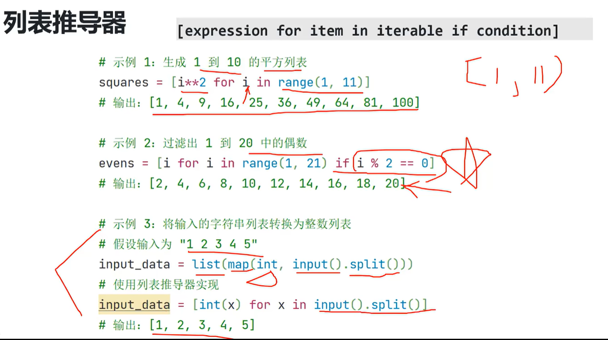
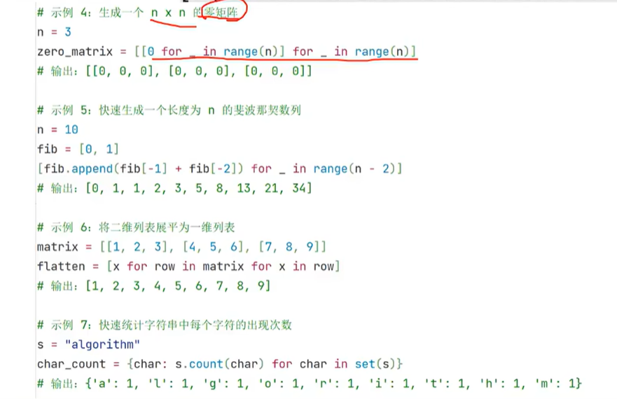
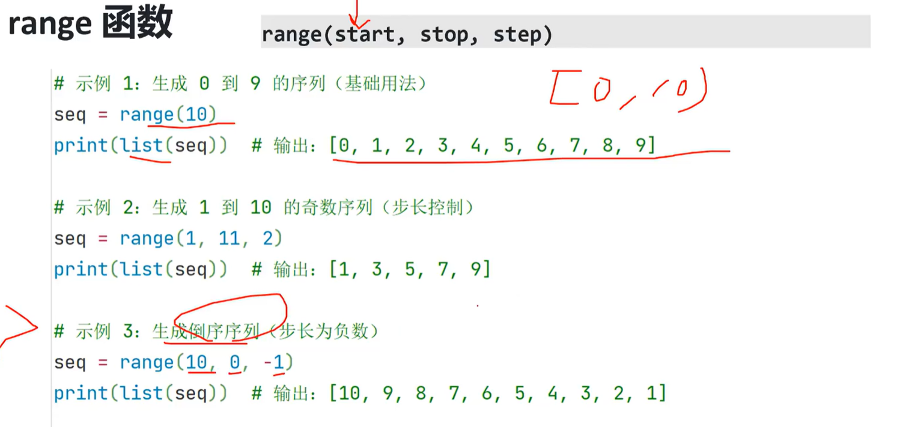
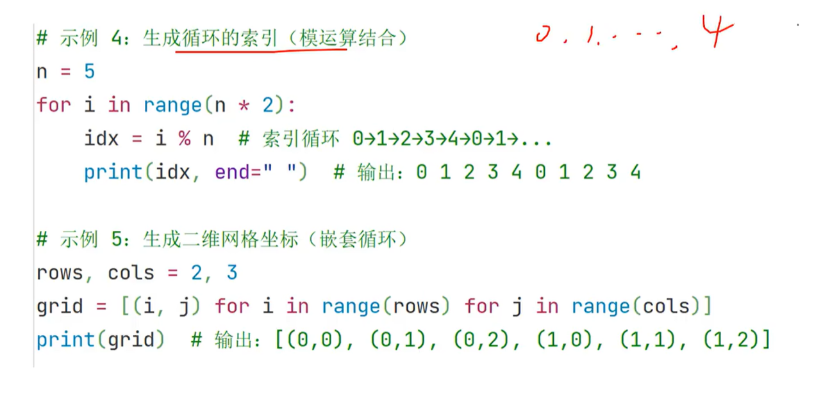

2,输出多个值：
格式：`print(value1,value2,..)
示例：`print("Name:","Alice","Age:",25)`
3,自定义分隔符：
使用`sep`参数指定多个值之间的分隔符。
格式：`print(value1,value:2,,·,sep='separator')`
示例：`print(2023,10,5,sep='-)`#输出：2023-10-05

4,自定义结束符：
使用`end参数指定输出结束时的字符（默认为换行符·\n`)。
格式：`print(value,end='ending')`
示例：`print("Hello",end=')`#输出后不换行，接一个空格

5.格式化输出：
使用·f-string(推荐)：
格式：`print(f"variable)")
示例：`name="A1ice";print(f"Hello,{name}!")`#输出：Hello,A1ice!
使用`format、方法：
格式：`print("{)".format(variable)
示例：`print("Hel1o,(}!".format("Alice")`#输出：Hello,.Alice!
使用`%格式化（旧版）：
格式：`print("%s"%variable)`
示例：`print("Hel1o,%s!"%"A1ice")`#输出：Hel1o,A1ice!
6,高效输出：
-使用`print(*list)`快速输出列表内容：
示例：1st=[1,2,3];print(*1st)

  输出：123
使用`sep`和`end`控制输出格式：
示例：`print(1,2,3,sep=',',end='!')#输出：1,2,3！


可变参数是Python函数中一种灵活的参数传递方式，允许函数接受任意数量的参数。它分为两种形式：
\*ags:用于接收任意数量的位置参数*，并将其打包成一个元组。
\*\*kwargs:用于接收任意数量的关键字参数*，并将其打包成一个字典。

可变参数
def sum_all(*args):
return sum(args)
print(sum_a11(1,2,3) #输出：6
关键字参数
def print_info(**kwargs):
for key,value in kwargs.items():
print(f"{key}:{value}")
print._info(name="Alice",age=25)#输出：name:Alice,age:25

==快读模板，可以提高读入数据效率，建议熟练默写==
==import sys==
==input lambda : sys.stdin.readline().strip()==

Lambda 参数 ：表达式


sorted()函数
Python内置的sorted()函数可以对任何可迭代对象进行排序，返回一个新的排序后的列表。

基本语法：
sorted(iterable,key=None,reverse=False)
iterable:需要排序的可迭代对象
key:排序规则，可以传入一个函数，指定排序依据（如按元素的某个属性排序）
reverse:是否反向排序，默认为False,表示升序排序


- 按照默认升序排序

```python
nums=[5,3,8,6,7]
print(sorted(nums))#输出：[3,5,6,7,8]
```


- 降序排序

```python
 print(sorted(nums,reverse=True))#输出：[8,7,6,5,3]
```


- 按照字符串长度排序

```python
words ["apple","banana","kiwi","cherry"]
print(sorted(words,key=len))#:['kiwi','apple','cherry','banana']
```


列表有sort排序方法，与上面相比少了个对象参数


输入

5.处理常见输入格式
示例1：单行多个整数

```python
a,b,c=map(int,input().split())#输入：123
print(a,b,c)#输出：123
```


示例2：多行多个整数

```python
n=int（input（））#输入行数
1st=[int（input（））for_in range（n）]#读取n行整数
print(lst)
```


示例3：矩阵输入

```python
n，m=map（int，input（）.split（））#输入矩阵大小
matrix=[list(map(int，input().split())) for _ in range(n)]#读取n行m列的矩阵
print(matrix)
```


列表推导器
[expression for item in iterable  if  condition]
-expression:表达式，用于生成列表中的元素
-item:可迭代对象中的每个元素
-iterable:可迭代对象（如列表、字符串、range?等）
-condition:可选，用于过滤元素的条件











逆波兰表达式

所有操作符置于操作数的后面（后缀表达式）

